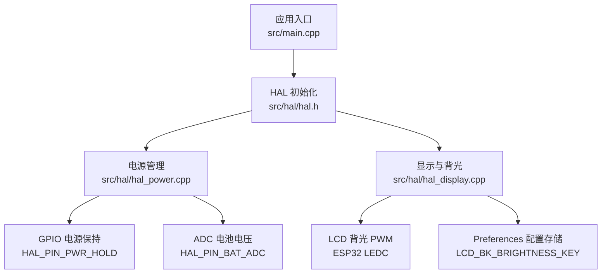
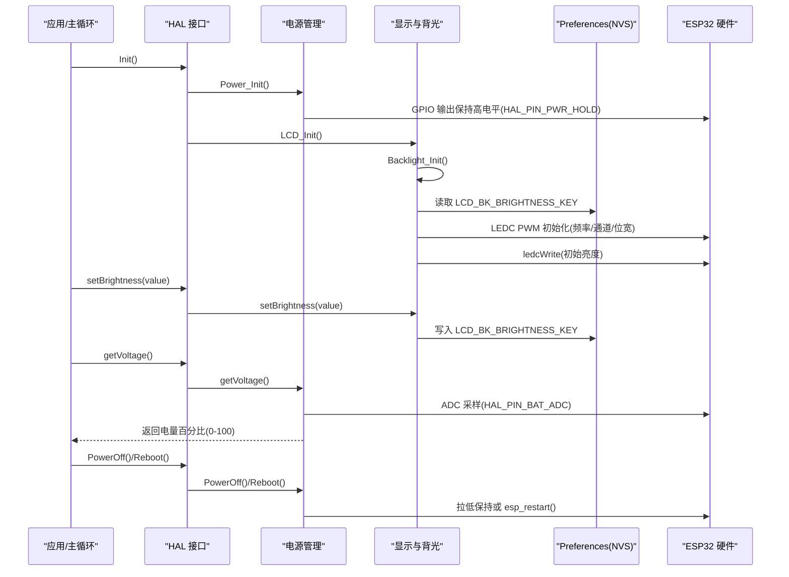
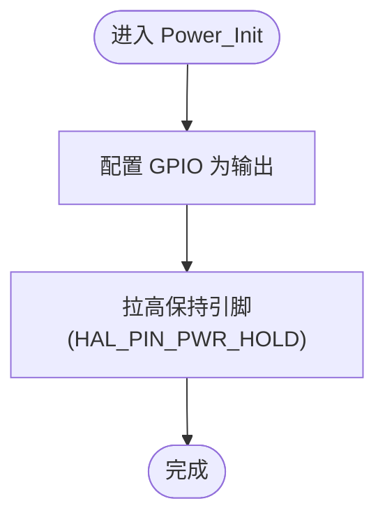
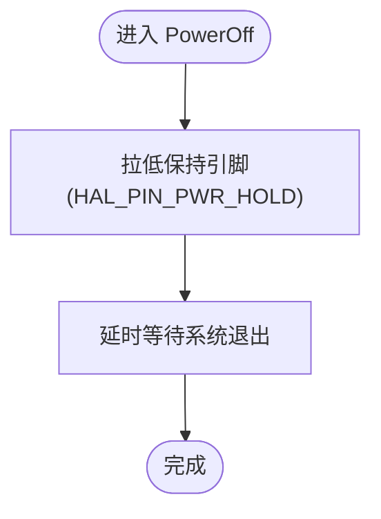
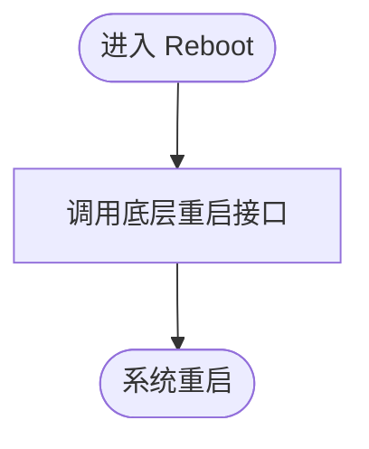
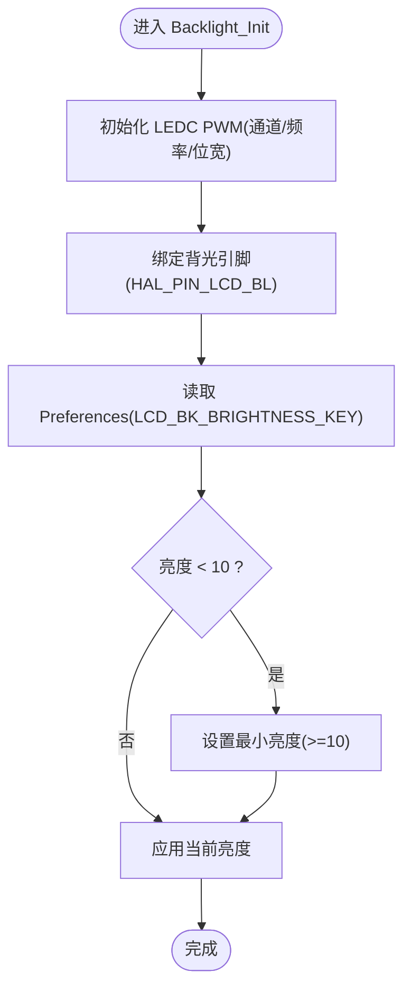
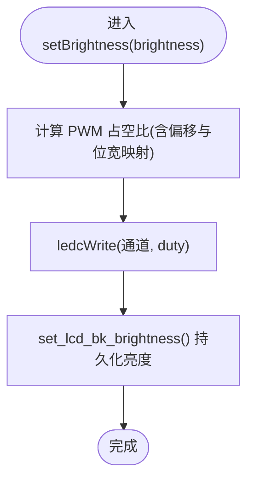
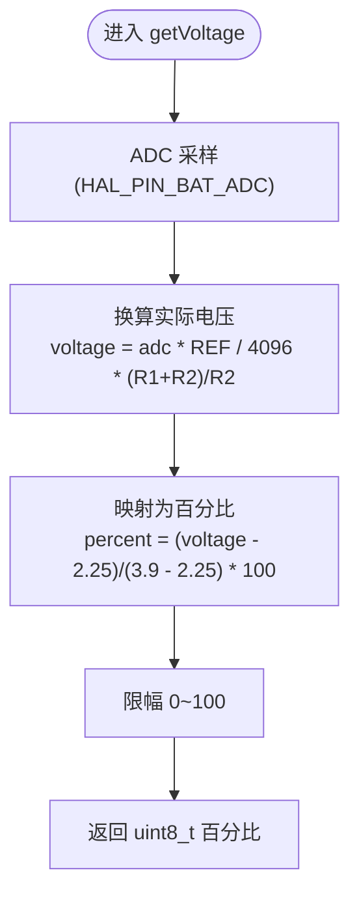
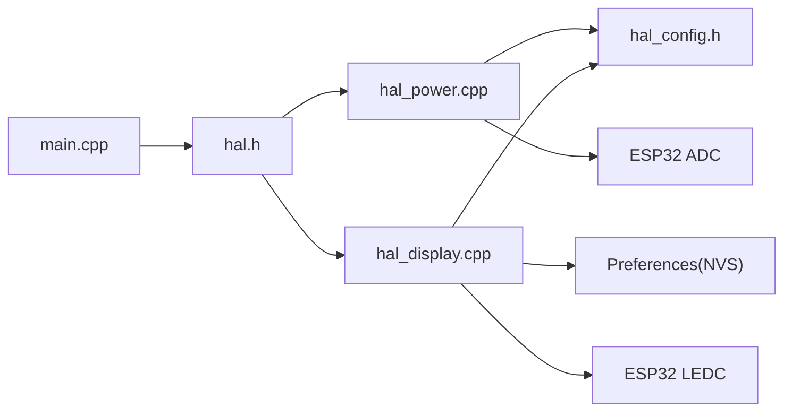

# 电源管理

<cite>
**本文引用的文件**   
- [main.cpp](file://src/main.cpp)
- [hal_power.cpp](file://src/hal/hal_power.cpp)
- [hal_display.cpp](file://src/hal/hal_display.cpp)
- [hal.h](file://src/hal/hal.h)
- [hal_config.h](file://src/hal/hal_config.h)
</cite>

## 目录
1. [简介](#简介)
2. [项目结构](#项目结构)
3. [核心组件](#核心组件)
4. [架构总览](#架构总览)
5. [详细组件分析](#详细组件分析)
6. [依赖关系分析](#依赖关系分析)
7. [性能与功耗优化](#性能与功耗优化)
8. [故障排查指南](#故障排查指南)
9. [结论](#结论)

## 简介
本技术文档聚焦于设备的电源管理系统，覆盖以下关键能力：
- 电源初始化 Power_Init() 的流程与配置项
- 设备关机 PowerOff() 与重启 Reboot() 的实现机制
- 背光控制 Backlight_Init()、Backlight_Off() 与亮度调节 setBrightness()
- 电压检测 getVoltage() 的原理与使用方法
- 功耗优化建议与节能模式配置思路
- 电池管理与充电状态监控的扩展方向

该电源子系统基于 ESP32 平台，通过硬件引脚控制电源保持信号、LED PWM 控制背光、ADC 采样分压网络测量电池电压，并通过 Preferences 持久化显示相关配置。

## 项目结构
电源相关的实现主要位于 HAL 层，具体包括：
- 电源与系统控制：src/hal/hal_power.cpp
- 显示与背光控制：src/hal/hal_display.cpp
- HAL 接口声明：src/hal/hal.h
- 引脚与常量定义：src/hal/hal_config.h
- 应用入口调用 HAL::Init() 启动系统：src/main.cpp

图表来源
- [main.cpp:19-24](file://src/main.cpp#L19-L24)
- [hal.h:101-178](file://src/hal/hal.h#L101-L178)
- [hal_power.cpp:9-38](file://src/hal/hal_power.cpp#L9-L38)
- [hal_display.cpp:18-42](file://src/hal/hal_display.cpp#L18-L42)
- [hal_display.cpp:81-126](file://src/hal/hal_display.cpp#L81-L126)
- [hal_config.h:24-28](file://src/hal/hal_config.h#L24-L28)
- [hal_config.h:54-56](file://src/hal/hal_config.h#L54-L56)
- [hal_config.h:70-77](file://src/hal/hal_config.h#L70-L77)

章节来源
- [main.cpp:19-24](file://src/main.cpp#L19-L24)
- [hal.h:101-178](file://src/hal/hal.h#L101-L178)
- [hal_power.cpp:9-38](file://src/hal/hal_power.cpp#L9-L38)
- [hal_display.cpp:18-42](file://src/hal/hal_display.cpp#L18-L42)
- [hal_display.cpp:81-126](file://src/hal/hal_display.cpp#L81-L126)
- [hal_config.h:24-28](file://src/hal/hal_config.h#L24-L28)
- [hal_config.h:54-56](file://src/hal/hal_config.h#L54-L56)
- [hal_config.h:70-77](file://src/hal/hal_config.h#L70-L77)

## 核心组件
- 电源管理（Power_Init/PowerOff/Reboot/getVoltage）
  - 负责上电保持、关机、重启以及电池电压百分比读取
- 显示与背光（LCD_Init/Backlight_Init/Backlight_Off/setBrightness）
  - 负责 LCD 初始化、背光 PWM 初始化、背光关闭与亮度设置，并持久化亮度值
- 配置与引脚（hal_config.h）
  - 定义电源引脚、电池 ADC 引脚、NVS 命名空间与键名等

章节来源
- [hal_power.cpp:9-38](file://src/hal/hal_power.cpp#L9-L38)
- [hal_display.cpp:18-42](file://src/hal/hal_display.cpp#L18-L42)
- [hal_display.cpp:81-126](file://src/hal/hal_display.cpp#L81-L126)
- [hal_config.h:24-28](file://src/hal/hal_config.h#L24-L28)
- [hal_config.h:54-56](file://src/hal/hal_config.h#L54-L56)
- [hal_config.h:70-77](file://src/hal/hal_config.h#L70-L77)

## 架构总览
电源与显示子系统在 HAL 层提供统一接口，供上层应用与主循环调用。整体数据与控制流如下：

图表来源
- [main.cpp:19-24](file://src/main.cpp#L19-L24)
- [hal_power.cpp:9-38](file://src/hal/hal_power.cpp#L9-L38)
- [hal_display.cpp:18-42](file://src/hal/hal_display.cpp#L18-L42)
- [hal_display.cpp:81-126](file://src/hal/hal_display.cpp#L81-L126)
- [hal_config.h:24-28](file://src/hal/hal_config.h#L24-L28)
- [hal_config.h:54-56](file://src/hal/hal_config.h#L54-L56)
- [hal_config.h:70-77](file://src/hal/hal_config.h#L70-L77)

## 详细组件分析

### 电源初始化 Power_Init()
- 功能概述
  - 将电源保持引脚设置为输出并置高，确保外部电源管理芯片持续供电
- 关键配置
  - 使用 HAL_PIN_PWR_HOLD 作为保持引脚
- 时序要点
  - 初始化后立即置高，避免上电瞬间掉电

图表来源
- [hal_power.cpp:9-15](file://src/hal/hal_power.cpp#L9-L15)
- [hal_config.h:24-28](file://src/hal/hal_config.h#L24-L28)

章节来源
- [hal_power.cpp:9-15](file://src/hal/hal_power.cpp#L9-L15)
- [hal_config.h:24-28](file://src/hal/hal_config.h#L24-L28)

### 设备关机 PowerOff()
- 功能概述
  - 拉低电源保持引脚以触发外部电源管理芯片执行关机流程
- 行为说明
  - 拉低后延时一段时间，等待系统安全退出

图表来源
- [hal_power.cpp:17-21](file://src/hal/hal_power.cpp#L17-L21)
- [hal_config.h:24-28](file://src/hal/hal_config.h#L24-L28)

章节来源
- [hal_power.cpp:17-21](file://src/hal/hal_power.cpp#L17-L21)
- [hal_config.h:24-28](file://src/hal/hal_config.h#L24-L28)

### 设备重启 Reboot()
- 功能概述
  - 调用底层重启接口进行系统复位
- 适用场景
  - 软件更新、异常恢复、配置生效后的重启

图表来源
- [hal_power.cpp:23-26](file://src/hal/hal_power.cpp#L23-L26)

章节来源
- [hal_power.cpp:23-26](file://src/hal/hal_power.cpp#L23-L26)

### 背光控制 Backlight_Init()、Backlight_Off()、setBrightness()
- 背光初始化 Backlight_Init()
  - 配置 LED PWM 通道、频率与位宽
  - 从 Preferences 中读取保存的亮度值，若低于阈值则设为最小可用亮度
  - 调用 setBrightness() 应用初始亮度
- 背光关闭 Backlight_Off()
  - 将 PWM 占空比写为 0，关闭背光
- 亮度调节 setBrightness()
  - 根据输入亮度计算 PWM 占空比，考虑偏移量与位宽映射
  - 调用底层 set_lcd_bk_brightness() 持久化亮度值到 NVS

图表来源
- [hal_display.cpp:81-92](file://src/hal/hal_display.cpp#L81-L92)
- [hal_display.cpp:119-126](file://src/hal/hal_display.cpp#L119-L126)
- [hal_config.h:70-77](file://src/hal/hal_config.h#L70-L77)

图表来源
- [hal_display.cpp:99-117](file://src/hal/hal_display.cpp#L99-L117)
- [hal_display.cpp:119-126](file://src/hal/hal_display.cpp#L119-L126)

章节来源
- [hal_display.cpp:81-92](file://src/hal/hal_display.cpp#L81-L92)
- [hal_display.cpp:94-97](file://src/hal/hal_display.cpp#L94-L97)
- [hal_display.cpp:99-117](file://src/hal/hal_display.cpp#L99-L117)
- [hal_display.cpp:119-126](file://src/hal/hal_display.cpp#L119-L126)
- [hal_config.h:70-77](file://src/hal/hal_config.h#L70-L77)

### 电压检测 getVoltage()
- 原理说明
  - 通过 ADC 读取电池分压网络的电压值
  - 使用分压电阻比例将 ADC 原始值转换为实际电压
  - 将电压映射为电池电量百分比（范围 0-100），并进行限幅处理
- 关键参数
  - 分压电阻 R1=56kΩ、R2=22kΩ
  - ESP32 ADC 参考电压 REF_VOLTAGE=3.3V
  - 电池电压区间映射：2.25V~3.9V 对应 0%~100%
- 使用方式
  - 调用 getVoltage() 获取当前电量百分比，用于 UI 显示或低功耗策略

图表来源
- [hal_power.cpp:28-38](file://src/hal/hal_power.cpp#L28-L38)
- [hal_config.h:54-56](file://src/hal/hal_config.h#L54-L56)

章节来源
- [hal_power.cpp:28-38](file://src/hal/hal_power.cpp#L28-L38)
- [hal_config.h:54-56](file://src/hal/hal_config.h#L54-L56)

## 依赖关系分析
- 模块耦合
  - main.cpp 仅依赖 HAL 接口，不直接访问电源与显示细节
  - hal_power.cpp 依赖 hal_config.h 的引脚定义
  - hal_display.cpp 依赖 hal_config.h 的引脚与 NVS 键名，同时依赖 Preferences 库
- 外部依赖
  - ESP32 LEDC（PWM）用于背光控制
  - Preferences（NVS）用于持久化亮度配置
  - ADC 用于电池电压采样

图表来源
- [main.cpp:19-24](file://src/main.cpp#L19-L24)
- [hal.h:101-178](file://src/hal/hal.h#L101-L178)
- [hal_power.cpp:9-38](file://src/hal/hal_power.cpp#L9-L38)
- [hal_display.cpp:18-42](file://src/hal/hal_display.cpp#L18-L42)
- [hal_display.cpp:81-126](file://src/hal/hal_display.cpp#L81-L126)
- [hal_config.h:24-28](file://src/hal/hal_config.h#L24-L28)
- [hal_config.h:54-56](file://src/hal/hal_config.h#L54-L56)
- [hal_config.h:70-77](file://src/hal/hal_config.h#L70-L77)

章节来源
- [main.cpp:19-24](file://src/main.cpp#L19-L24)
- [hal.h:101-178](file://src/hal/hal.h#L101-L178)
- [hal_power.cpp:9-38](file://src/hal/hal_power.cpp#L9-L38)
- [hal_display.cpp:18-42](file://src/hal/hal_display.cpp#L18-L42)
- [hal_display.cpp:81-126](file://src/hal/hal_display.cpp#L81-L126)
- [hal_config.h:24-28](file://src/hal/hal_config.h#L24-L28)
- [hal_config.h:54-56](file://src/hal/hal_config.h#L54-L56)
- [hal_config.h:70-77](file://src/hal/hal_config.h#L70-L77)

## 性能与功耗优化
- 背光优化
  - 合理设置最小亮度阈值，避免过暗导致可读性差；同时避免过高亮度造成不必要的功耗
  - 在无交互时调用 Backlight_Off() 关闭背光，降低功耗
  - 使用 Preferences 保存用户设置的亮度，减少重复初始化开销
- 电压采样优化
  - 对 ADC 采样结果做多次平均或滤波，提高稳定性
  - 仅在必要时（如 UI 刷新、低电量告警）读取电压，降低频繁 ADC 转换带来的功耗
- 系统级节能
  - 结合 RTC 与空闲任务，在非活跃阶段降低外设时钟或关闭非必要模块
  - 在关机流程中确保所有外设与任务正常退出，避免残留电流

[本节为通用指导，不直接分析具体文件]

## 故障排查指南
- 无法开机或反复重启
  - 检查 Power_Init() 是否正确拉高保持引脚
  - 确认 HAL_PIN_PWR_HOLD 引脚配置正确且未被其他模块占用
- 背光不亮或亮度异常
  - 检查 Backlight_Init() 是否成功初始化 LEDC PWM 并绑定背光引脚
  - 确认 Preferences 中的 LCD_BK_BRIGHTNESS_KEY 值有效且不低于最小阈值
  - 验证 setBrightness() 计算的占空比是否在 LEDC 允许范围内
- 电量显示不准确
  - 校准分压电阻比例与 ADC 参考电压
  - 检查电池电压映射区间（2.25V~3.9V）是否符合实际电池特性
  - 增加采样滤波与限幅逻辑，避免抖动

章节来源
- [hal_power.cpp:9-38](file://src/hal/hal_power.cpp#L9-L38)
- [hal_display.cpp:81-126](file://src/hal/hal_display.cpp#L81-L126)
- [hal_config.h:24-28](file://src/hal/hal_config.h#L24-L28)
- [hal_config.h:54-56](file://src/hal/hal_config.h#L54-L56)
- [hal_config.h:70-77](file://src/hal/hal_config.h#L70-L77)

## 结论
本电源管理子系统通过简洁的 HAL 接口封装了电源保持、关机、重启、背光控制与电池电压检测等核心功能。其设计遵循模块化与可配置原则，便于在不同硬件平台上复用与扩展。建议在现有基础上进一步完善电池管理与充电状态监控，并结合系统空闲策略实现更精细的功耗优化。

[本节为总结性内容，不直接分析具体文件]