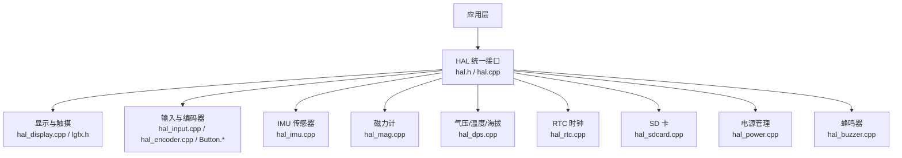
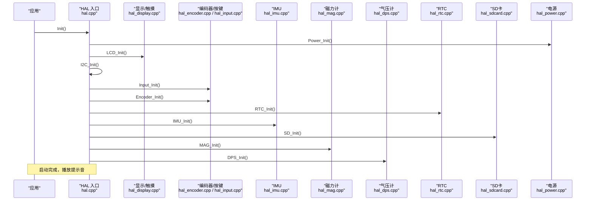
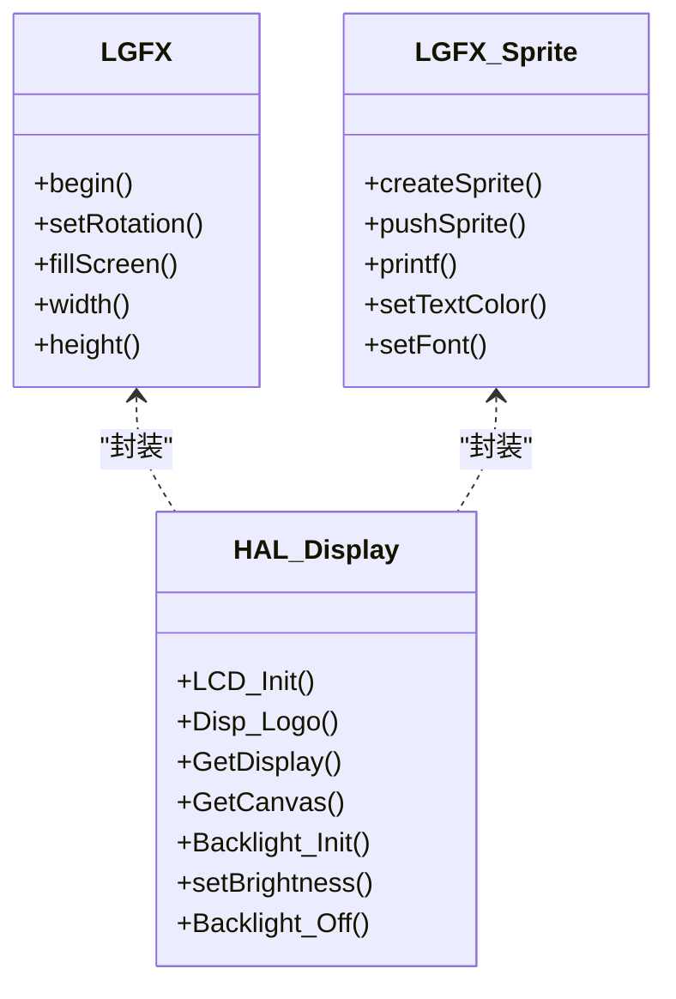
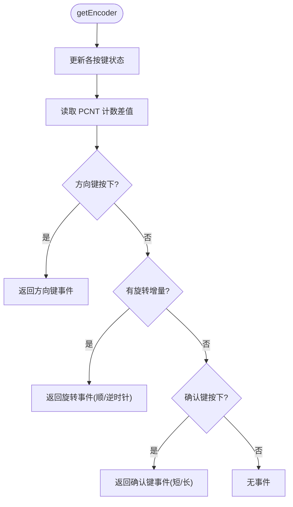
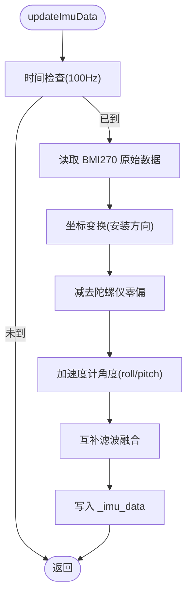
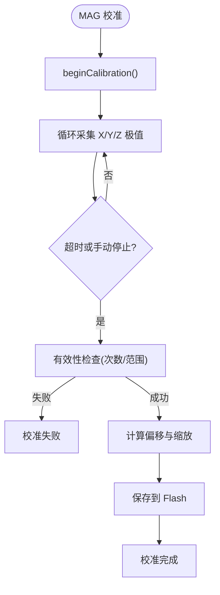
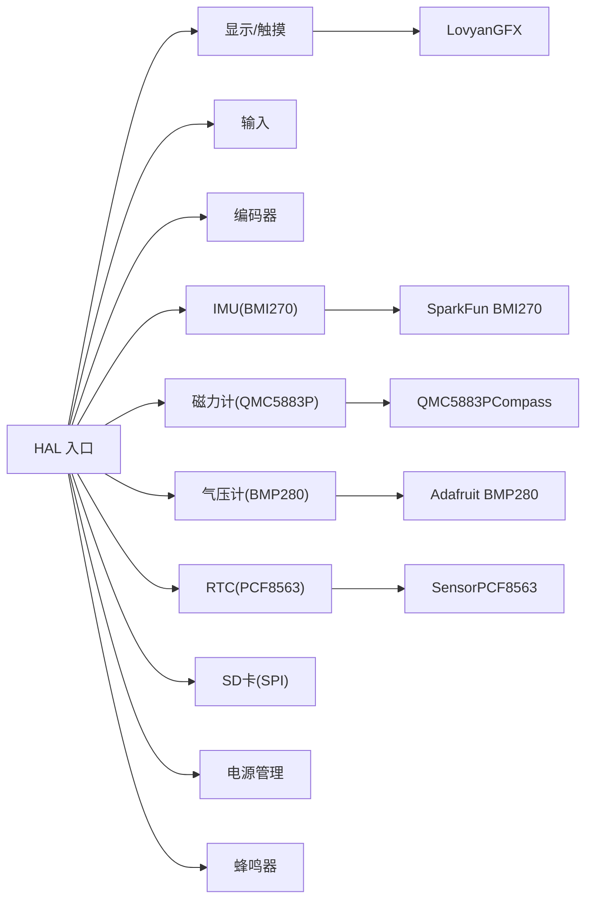

# 硬件抽象层 (HAL)

<cite>
**本文引用的文件**   
- [hal.h](file://src/hal/hal.h)
- [hal.cpp](file://src/hal/hal.cpp)
- [hal_config.h](file://src/hal/hal_config.h)
- [lgfx.h](file://include/lgfx.h)
- [hal_display.cpp](file://src/hal/hal_display.cpp)
- [hal_imu.cpp](file://src/hal/hal_imu.cpp)
- [hal_mag.cpp](file://src/hal/hal_mag.cpp)
- [hal_dps.cpp](file://src/hal/hal_dps.cpp)
- [hal_input.cpp](file://src/hal/hal_input.cpp)
- [hal_encoder.cpp](file://src/hal/hal_encoder.cpp)
- [Button.h](file://src/hal/Button.h)
- [Button.cpp](file://src/hal/Button.cpp)
- [hal_power.cpp](file://src/hal/hal_power.cpp)
- [hal_rtc.cpp](file://src/hal/hal_rtc.cpp)
- [hal_sdcard.cpp](file://src/hal/hal_sdcard.cpp)
- [hal_buzzer.cpp](file://src/hal/hal_buzzer.cpp)
</cite>

## 目录
1. [简介](#简介)
2. [项目结构](#项目结构)
3. [核心组件](#核心组件)
4. [架构总览](#架构总览)
5. [详细组件分析](#详细组件分析)
6. [依赖关系分析](#依赖关系分析)
7. [性能与功耗优化](#性能与功耗优化)
8. [故障排除指南](#故障排除指南)
9. [结论](#结论)
10. [附录：接口速查与引脚定义](#附录接口速查与引脚定义)

## 简介
本技术文档面向 ESP32 NullPod 的硬件抽象层（HAL），目标是提供统一、稳定、可扩展的底层驱动封装，屏蔽具体外设差异，向上层应用暴露一致的 API。HAL 覆盖显示控制、触摸输入、按键与编码器、IMU 传感器、磁力计、气压/温度/海拔传感器、RTC 时钟、SD 卡、电源管理、蜂鸣器、RGB LED 等模块，并提供系统初始化流程、内存日志、时间同步等通用能力。

设计目标：
- 统一接口：所有外设通过 HAL:: 命名空间下的函数访问，避免上层耦合具体驱动。
- 可配置化：引脚、分辨率、I2C、背光、NVS 配置键等集中在配置文件。
- 数据流清晰：传感器数据读取、滤波、校准、输出到上层数据结构。
- 健壮性：错误检测、日志、超时保护、参数校验。
- 可维护性：模块化实现，职责单一，便于替换或扩展。

## 项目结构
HAL 相关代码位于 src/hal 目录，顶层入口在 hal.cpp；配置集中在 hal_config.h；显示驱动封装在 include/lgfx.h；各外设分别由独立 .cpp 文件实现。

图表来源
- [hal.h:101-212](file://src/hal/hal.h#L101-L212)
- [hal.cpp:4-33](file://src/hal/hal.cpp#L4-L33)
- [hal_display.cpp:18-42](file://src/hal/hal_display.cpp#L18-L42)
- [hal_imu.cpp:57-74](file://src/hal/hal_imu.cpp#L57-L74)
- [hal_mag.cpp:233-246](file://src/hal/hal_mag.cpp#L233-L246)
- [hal_dps.cpp:10-27](file://src/hal/hal_dps.cpp#L10-L27)
- [hal_rtc.cpp:15-39](file://src/hal/hal_rtc.cpp#L15-L39)
- [hal_sdcard.cpp:16-59](file://src/hal/hal_sdcard.cpp#L16-L59)
- [hal_power.cpp:9-15](file://src/hal/hal_power.cpp#L9-L15)
- [hal_buzzer.cpp:4-7](file://src/hal/hal_buzzer.cpp#L4-L7)

章节来源
- [hal.h:1-215](file://src/hal/hal.h#L1-L215)
- [hal.cpp:1-72](file://src/hal/hal.cpp#L1-L72)
- [hal_config.h:1-123](file://src/hal/hal_config.h#L1-L123)
- [lgfx.h:1-118](file://include/lgfx.h#L1-L118)

## 核心组件
- 显示与触摸：基于 LovyanGFX 的 LGFX 封装，SPI 面板 + CST816S 触摸，支持亮度 PWM 调节与 NVS 持久化。
- 输入与编码器：GPIO 按键扫描 + PCNT 正交解码，非阻塞按键类 Button 提供短按/长按/连发。
- IMU：BMI270，固定采样率 100Hz，零偏校准 + 互补滤波，输出 roll/pitch/yaw 与鼠标增量。
- 磁力计：QMC5883P，硬铁/软铁校准，Flash 持久化，方位角计算。
- 气压传感器：BMP280，温度/气压/海拔读取，海平面气压可配置。
- RTC：PCF8563，系统时间同步，NTP 网络校时，编译时间回退。
- SD 卡：SPI 总线挂载，类型/容量识别，目录遍历。
- 电源管理：Hold 引脚控制关机，电池电压 ADC 测量并折算百分比。
- 蜂鸣器：tone/noTone 与软件方波两种发声方式。

章节来源
- [hal_display.cpp:18-127](file://src/hal/hal_display.cpp#L18-L127)
- [hal_input.cpp:7-59](file://src/hal/hal_input.cpp#L7-L59)
- [hal_encoder.cpp:37-129](file://src/hal/hal_encoder.cpp#L37-L129)
- [Button.h:48-183](file://src/hal/Button.h#L48-L183)
- [Button.cpp:12-169](file://src/hal/Button.cpp#L12-L169)
- [hal_imu.cpp:5-182](file://src/hal/hal_imu.cpp#L5-L182)
- [hal_mag.cpp:19-297](file://src/hal/hal_mag.cpp#L19-L297)
- [hal_dps.cpp:1-57](file://src/hal/hal_dps.cpp#L1-L57)
- [hal_rtc.cpp:1-133](file://src/hal/hal_rtc.cpp#L1-L133)
- [hal_sdcard.cpp:1-120](file://src/hal/hal_sdcard.cpp#L1-L120)
- [hal_power.cpp:1-39](file://src/hal/hal_power.cpp#L1-L39)
- [hal_buzzer.cpp:1-29](file://src/hal/hal_buzzer.cpp#L1-L29)

## 架构总览
HAL 作为中间层，向上提供统一的 Init/Update 生命周期与模块 API，向下封装具体驱动库与 ESP-IDF 外设。

图表来源
- [hal.cpp:4-25](file://src/hal/hal.cpp#L4-L25)
- [hal_display.cpp:18-42](file://src/hal/hal_display.cpp#L18-L42)
- [hal_encoder.cpp:37-71](file://src/hal/hal_encoder.cpp#L37-L71)
- [hal_input.cpp:7-24](file://src/hal/hal_input.cpp#L7-L24)
- [hal_rtc.cpp:15-39](file://src/hal/hal_rtc.cpp#L15-L39)
- [hal_imu.cpp:57-74](file://src/hal/hal_imu.cpp#L57-L74)
- [hal_sdcard.cpp:16-59](file://src/hal/hal_sdcard.cpp#L16-L59)
- [hal_mag.cpp:233-246](file://src/hal/hal_mag.cpp#L233-L246)
- [hal_dps.cpp:10-27](file://src/hal/hal_dps.cpp#L10-L27)
- [hal_power.cpp:9-15](file://src/hal/hal_power.cpp#L9-L15)

## 详细组件分析

### 显示与触摸（LGFX）
- 功能要点
  - SPI 面板 ST7789，CST816S 触摸，屏幕尺寸 240x280，旋转与偏移已配置。
  - 背光亮暗通过 PWM 控制，值持久化至 NVS。
  - 提供 GetDisplay()/GetCanvas() 供上层绘制。
- 关键接口
  - HAL::LCD_Init()
  - HAL::Backlight_Init()
  - HAL::setBrightness(uint8_t)
  - HAL::Backlight_Off()
  - HAL::GetDisplay()
  - HAL::GetCanvas()
- 使用示例（路径引用）
  - 初始化显示与画布：[hal_display.cpp:18-42](file://src/hal/hal_display.cpp#L18-L42)
  - 设置背光：[hal_display.cpp:81-127](file://src/hal/hal_display.cpp#L81-L127)
  - 获取显示对象：[hal_display.cpp:44-52](file://src/hal/hal_display.cpp#L44-L52)

图表来源
- [lgfx.h:34-115](file://include/lgfx.h#L34-L115)
- [hal_display.cpp:18-127](file://src/hal/hal_display.cpp#L18-L127)

章节来源
- [lgfx.h:1-118](file://include/lgfx.h#L1-L118)
- [hal_display.cpp:1-127](file://src/hal/hal_display.cpp#L1-L127)

### 输入处理（GPIO 按键）
- 功能要点
  - 将物理按键映射为统一枚举键码，上拉输入，消抖后返回按下/释放事件。
  - 提供 isReturn()/isEnter() 快捷方法。
- 关键接口
  - HAL::Input_Init()
  - HAL::GetButton(uint8_t)
  - HAL::isReturn()
  - HAL::isEnter()
- 使用示例（路径引用）
  - 按键映射与 GPIO 初始化：[hal_input.cpp:7-24](file://src/hal/hal_input.cpp#L7-L24)
  - 按键状态机与回调：[hal_input.cpp:26-59](file://src/hal/hal_input.cpp#L26-L59)

章节来源
- [hal_input.cpp:1-59](file://src/hal/hal_input.cpp#L1-L59)

### 编码器（PCNT + 非阻塞按键）
- 功能要点
  - 使用 PCNT 单元进行正交编码计数，A/B 相接入 pulse/control 引脚。
  - 方向键与确认键通过 Button 类统一管理，优先级：方向键 > 旋转 > 确认键。
  - 提供 getEncoder() 统一事件接口。
- 关键接口
  - HAL::Encoder_Init()
  - HAL::getEncoder(uint8_t*)
  - HAL::Encoder_Update()
  - HAL::Encoder_GetDiff()
  - HAL::Encoder_GetIsPush()
  - HAL::Encoder_SetEnable(bool)
- 使用示例（路径引用）
  - PCNT 配置与启动：[hal_encoder.cpp:37-71](file://src/hal/hal_encoder.cpp#L37-L71)
  - 事件聚合与优先级：[hal_encoder.cpp:74-129](file://src/hal/hal_encoder.cpp#L74-L129)

图表来源
- [hal_encoder.cpp:74-129](file://src/hal/hal_encoder.cpp#L74-L129)

章节来源
- [hal_encoder.cpp:1-129](file://src/hal/hal_encoder.cpp#L1-L129)
- [Button.h:48-183](file://src/hal/Button.h#L48-L183)
- [Button.cpp:12-169](file://src/hal/Button.cpp#L12-L169)

### IMU 传感器（BMI270）
- 功能要点
  - 固定采样率 100Hz，上电静置零偏校准，坐标变换适配安装方向。
  - 互补滤波融合加速度计角度与陀螺仪积分，输出 roll/pitch/yaw。
  - 根据角度增量生成鼠标 dx/dy，带限幅。
- 关键接口
  - HAL::IMU_Init()
  - HAL::updateImuData()
  - HAL::getImuData()
  - HAL::updateMouseDelta(float)
  - HAL::imu_calibrate_gyro()
  - HAL::imu_get_roll()/pitch()/yaw()
  - HAL::imu_get_mouse_dx()/dy()
- 数据处理算法
  - 零偏校准：多次采样求平均。
  - 坐标变换：根据安装方向翻转轴。
  - 角度计算：加速度计 atan2 得到 roll/pitch。
  - 互补滤波：陀螺仪主导高频，加速度计校正低频漂移。
  - 鼠标增量：角度差分乘以灵敏度与缩放系数，限幅。
- 使用示例（路径引用）
  - 初始化与零偏校准：[hal_imu.cpp:57-74](file://src/hal/hal_imu.cpp#L57-L74)
  - 数据更新与滤波：[hal_imu.cpp:88-149](file://src/hal/hal_imu.cpp#L88-L149)
  - 鼠标增量计算：[hal_imu.cpp:151-173](file://src/hal/hal_imu.cpp#L151-L173)

图表来源
- [hal_imu.cpp:88-149](file://src/hal/hal_imu.cpp#L88-L149)

章节来源
- [hal_imu.cpp:1-182](file://src/hal/hal_imu.cpp#L1-L182)

### 磁力计（QMC5883P）
- 功能要点
  - 采集 X/Y/Z 磁场强度，支持硬铁偏移与软铁缩放校准，结果持久化至 Flash。
  - 提供方位角计算与校准状态查询。
- 关键接口
  - HAL::MAG_Init()
  - HAL::updateMAG()
  - HAL::MAG_GetInfo(MAG_Info_t*)
  - HAL::MAG_StartCalibration()
  - HAL::MAG_StopCalibration()
  - HAL::MAG_ClearCalibration()
  - HAL::MAG_GetCalStatus()
- 校准流程
  - 进入校准模式 → 记录各轴最大最小值 → 有效性检查 → 计算偏移与缩放 → 保存至 Preferences。
- 使用示例（路径引用）
  - 初始化与加载校准：[hal_mag.cpp:233-246](file://src/hal/hal_mag.cpp#L233-L246)
  - 数据采集与应用校准：[hal_mag.cpp:248-274](file://src/hal/hal_mag.cpp#L248-L274)
  - 校准开始/结束/清除：[hal_mag.cpp:143-197](file://src/hal/hal_mag.cpp#L143-L197), [hal_mag.cpp:286-297](file://src/hal/hal_mag.cpp#L286-L297)

图表来源
- [hal_mag.cpp:143-197](file://src/hal/hal_mag.cpp#L143-L197)

章节来源
- [hal_mag.cpp:1-297](file://src/hal/hal_mag.cpp#L1-L297)

### 气压传感器（BMP280）
- 功能要点
  - 温度、气压（hPa）、海拔估算，海平面气压可配置。
- 关键接口
  - HAL::DPS_Init()
  - HAL::updateDPS()
  - HAL::dps_get_temperature()
  - HAL::dps_get_pressure()
  - HAL::dps_get_altitude()
  - HAL::dps_set_atmosphere(float)
- 使用示例（路径引用）
  - 初始化与采样率配置：[hal_dps.cpp:10-27](file://src/hal/hal_dps.cpp#L10-L27)
  - 数据读取与单位换算：[hal_dps.cpp:29-57](file://src/hal/hal_dps.cpp#L29-L57)

章节来源
- [hal_dps.cpp:1-57](file://src/hal/hal_dps.cpp#L1-L57)

### RTC 时钟（PCF8563）
- 功能要点
  - 初始化 RTC，若时间无效则从编译时间回退；支持 NTP 网络校时并写回 RTC。
- 关键接口
  - HAL::RTC_Init()
  - HAL::adjustSysTime()
  - HAL::syncNetworkTime()
  - HAL::setTimeFromCompileTime()
  - HAL::GetLocalTime()
- 使用示例（路径引用）
  - 初始化与默认时间处理：[hal_rtc.cpp:15-39](file://src/hal/hal_rtc.cpp#L15-L39)
  - 系统时间同步：[hal_rtc.cpp:41-48](file://src/hal/hal_rtc.cpp#L41-L48)
  - NTP 校时与写回 RTC：[hal_rtc.cpp:50-97](file://src/hal/hal_rtc.cpp#L50-L97)
  - 编译时间回退：[hal_rtc.cpp:99-126](file://src/hal/hal_rtc.cpp#L99-L126)

章节来源
- [hal_rtc.cpp:1-133](file://src/hal/hal_rtc.cpp#L1-L133)

### SD 卡
- 功能要点
  - 使用独立 SPI 总线挂载 SD 卡，识别类型与容量，支持目录遍历。
- 关键接口
  - HAL::SD_Init()
  - HAL::SD_isReady()
  - HAL::SD_ListDir()
  - HAL::tryInitSD()
- 使用示例（路径引用）
  - 初始化与类型/容量打印：[hal_sdcard.cpp:16-59](file://src/hal/hal_sdcard.cpp#L16-L59)
  - 目录遍历：[hal_sdcard.cpp:61-67](file://src/hal/hal_sdcard.cpp#L61-L67), [hal_sdcard.cpp:82-119](file://src/hal/hal_sdcard.cpp#L82-L119)

章节来源
- [hal_sdcard.cpp:1-120](file://src/hal/hal_sdcard.cpp#L1-L120)

### 电源管理
- 功能要点
  - Hold 引脚控制设备供电；ADC 分压测量电池电压并折算百分比。
- 关键接口
  - HAL::Power_Init()
  - HAL::PowerOff()
  - HAL::Reboot()
  - HAL::getVoltage()
- 使用示例（路径引用）
  - Hold 引脚初始化：[hal_power.cpp:9-15](file://src/hal/hal_power.cpp#L9-L15)
  - 关机与重启：[hal_power.cpp:17-26](file://src/hal/hal_power.cpp#L17-L26)
  - 电压测量与百分比折算：[hal_power.cpp:28-39](file://src/hal/hal_power.cpp#L28-L39)

章节来源
- [hal_power.cpp:1-39](file://src/hal/hal_power.cpp#L1-L39)

### 蜂鸣器
- 功能要点
  - tone/noTone 与软件方波两种发声方式，用于提示音与简单音效。
- 关键接口
  - HAL::beep(float, uint32_t)
  - HAL::beepStop()
  - HAL::buzz(float, uint32_t)
- 使用示例（路径引用）
  - 发声与停止：[hal_buzzer.cpp:4-12](file://src/hal/hal_buzzer.cpp#L4-L12)
  - 软件方波：[hal_buzzer.cpp:14-29](file://src/hal/hal_buzzer.cpp#L14-L29)

章节来源
- [hal_buzzer.cpp:1-29](file://src/hal/hal_buzzer.cpp#L1-L29)

## 依赖关系分析
- 模块耦合
  - HAL 入口集中调用各模块 Init，Update 预留扩展点。
  - 显示与触摸依赖 LovyanGFX；输入与编码器依赖 Button 类与 ESP-IDF PCNT。
  - IMU/MAG/DPS 均通过 I2C 通信，需先初始化 I2C。
  - RTC 依赖 WiFi/NTP 进行网络校时。
  - SD 卡使用独立 SPI 总线，避免与显示冲突。
- 外部依赖
  - SparkFun_BMI270_Arduino_Library
  - QMC5883PCompass
  - Adafruit_BMP280
  - SensorPCF8563
  - LovyanGFX

图表来源
- [hal.cpp:4-25](file://src/hal/hal.cpp#L4-L25)
- [hal_display.cpp:18-42](file://src/hal/hal_display.cpp#L18-L42)
- [hal_imu.cpp:57-74](file://src/hal/hal_imu.cpp#L57-L74)
- [hal_mag.cpp:233-246](file://src/hal/hal_mag.cpp#L233-L246)
- [hal_dps.cpp:10-27](file://src/hal/hal_dps.cpp#L10-L27)
- [hal_rtc.cpp:15-39](file://src/hal/hal_rtc.cpp#L15-L39)
- [hal_sdcard.cpp:16-59](file://src/hal/hal_sdcard.cpp#L16-L59)

章节来源
- [hal.cpp:1-72](file://src/hal/hal.cpp#L1-L72)

## 性能与功耗优化
- 显示
  - 合理设置背光亮度，避免长时间高亮；必要时关闭背光以省电。
  - 减少全屏刷新，优先局部刷新或使用 canvas 缓存。
- IMU
  - 保持 100Hz 采样，避免频繁初始化；零偏校准在上电静置时执行一次。
  - 调整互补滤波系数以平衡响应速度与稳定性。
- 磁力计
  - 定期重新校准以补偿环境变化；避免强磁干扰。
- 气压计
  - 使用正常模式与合适过采样，避免过高 ODR 导致功耗增加。
- RTC
  - 仅在需要时连接 WiFi 进行 NTP 校时，完成后断开以省电。
- SD 卡
  - 仅在读写时激活 SPI，避免空闲占用总线。
- 电源
  - 合理使用 PowerOff/Reboot，降低待机功耗；ADC 采样可降频。

[本节为通用指导，不直接分析具体文件]

## 故障排除指南
- 显示异常
  - 现象：黑屏或乱码。
  - 排查：检查 SPI 引脚与 CS/DC/RST 配置；确认背光 PWM 通道与频率；查看 NVS 中背光值是否异常。
  - 参考：[hal_display.cpp:18-42](file://src/hal/hal_display.cpp#L18-L42), [hal_display.cpp:81-127](file://src/hal/hal_display.cpp#L81-L127)
- 触摸无响应
  - 现象：触摸坐标不变或无事件。
  - 排查：确认 I2C 地址与引脚；检查 Touch_RST/INT 引脚；查看 LGFX 配置中的 i2c_addr/i2c_port。
  - 参考：[lgfx.h:90-110](file://include/lgfx.h#L90-L110)
- IMU 初始化失败
  - 现象：IMU init failed。
  - 排查：检查 I2C 地址与连线；确保上电静置完成零偏校准。
  - 参考：[hal_imu.cpp:57-74](file://src/hal/hal_imu.cpp#L57-L74)
- 磁力计校准失败
  - 现象：valid=0 或方位角跳变。
  - 排查：确保旋转覆盖各轴范围足够；检查硬铁/软铁参数是否有效；清除旧校准后重试。
  - 参考：[hal_mag.cpp:143-197](file://src/hal/hal_mag.cpp#L143-L197), [hal_mag.cpp:286-297](file://src/hal/hal_mag.cpp#L286-L297)
- 气压计无数据
  - 现象：BMP280 not found。
  - 排查：检查 I2C 地址 0x77 与连线；确认 I2C 已初始化。
  - 参考：[hal_dps.cpp:10-27](file://src/hal/hal_dps.cpp#L10-L27)
- RTC 时间不正确
  - 现象：年份小于预期或时间漂移。
  - 排查：检查 RTC 电池；使用 compile time 回退或 NTP 校时。
  - 参考：[hal_rtc.cpp:15-39](file://src/hal/hal_rtc.cpp#L15-L39), [hal_rtc.cpp:50-97](file://src/hal/hal_rtc.cpp#L50-L97)
- SD 卡无法挂载
  - 现象：sd card mount failed。
  - 排查：检查 SPI 引脚与 CS；确认卡类型与容量；尝试 tryInitSD 重试。
  - 参考：[hal_sdcard.cpp:16-59](file://src/hal/hal_sdcard.cpp#L16-L59), [hal_sdcard.cpp:69-80](file://src/hal/hal_sdcard.cpp#L69-L80)
- 按键误触发
  - 现象：短按变长按或抖动。
  - 排查：调整 Button 消抖时间与长按阈值；检查上拉电阻与接线。
  - 参考：[Button.cpp:28-70](file://src/hal/Button.cpp#L28-L70)

章节来源
- [hal_display.cpp:18-127](file://src/hal/hal_display.cpp#L18-L127)
- [lgfx.h:90-110](file://include/lgfx.h#L90-L110)
- [hal_imu.cpp:57-74](file://src/hal/hal_imu.cpp#L57-L74)
- [hal_mag.cpp:143-197](file://src/hal/hal_mag.cpp#L143-L197)
- [hal_dps.cpp:10-27](file://src/hal/hal_dps.cpp#L10-L27)
- [hal_rtc.cpp:15-39](file://src/hal/hal_rtc.cpp#L15-L39)
- [hal_sdcard.cpp:16-59](file://src/hal/hal_sdcard.cpp#L16-L59)
- [Button.cpp:28-70](file://src/hal/Button.cpp#L28-L70)

## 结论
本 HAL 为 ESP32 NullPod 提供了完整、统一且可扩展的硬件抽象层。通过清晰的模块划分、稳定的数据流与完善的校准/容错机制，上层应用可以专注于业务逻辑，而无需关心底层细节。建议在实际项目中结合场景调优滤波参数、采样率与背光策略，以获得最佳体验与功耗表现。

[本节为总结性内容，不直接分析具体文件]

## 附录：接口速查与引脚定义

### HAL 统一接口速查（节选）
- 系统
  - HAL::Init(), HAL::Update(), HAL::logMemory(), HAL::isSwipeOut()
- 显示
  - HAL::LCD_Init(), HAL::Disp_Logo(), HAL::GetDisplay(), HAL::GetCanvas()
- I2C
  - HAL::I2C_Init(), HAL::I2C_Scan(), bsp_i2c_reg8_read/write()
- 触摸
  - HAL::Touch_Init(), HAL::updateTouch(), HAL::getGesture()
- 按键
  - HAL::Input_Init(), HAL::GetButton()
- IMU
  - HAL::IMU_Init(), HAL::updateImuData(), HAL::getImuData(), HAL::updateMouseDelta()
- 磁力计
  - HAL::MAG_Init(), HAL::updateMAG(), HAL::MAG_GetInfo()
- 气压计
  - HAL::DPS_Init(), HAL::updateDPS(), dps_get_temperature/pressure/altitude()
- RTC
  - HAL::RTC_Init(), HAL::adjustSysTime(), HAL::syncNetworkTime()
- SD
  - HAL::SD_Init(), HAL::SD_isReady(), HAL::SD_ListDir()
- 电源
  - HAL::Power_Init(), HAL::PowerOff(), HAL::Reboot(), HAL::getVoltage()
- 蜂鸣器
  - HAL::beep(), HAL::beepStop(), HAL::buzz()

章节来源
- [hal.h:101-212](file://src/hal/hal.h#L101-L212)

### 引脚定义（节选）
- 显示
  - MOSI=7, MISO=-1, SCLK=6, DC=4, CS=5, RST=8, BL=15
- 电源
  - BOOT=0, KEY=17, HOLD=18
- 编码器
  - UP=16, DOWN=12, LEFT=21, RIGHT=2, CHA=9, CHB=3, SEL=0
- SD
  - CS=41, MOSI=38, MISO=40, CLK=39
- I2C
  - SCL=10, SDA=11
- 触摸
  - SCL=10, SDA=11, RST=13, IRQ=14
- 电池
  - ADC=1
- 蜂鸣器
  - PIN=46, CHANNEL=2
- RGB
  - PIN=45
- IR
  - PIN=42

章节来源
- [hal_config.h:7-66](file://src/hal/hal_config.h#L7-L66)