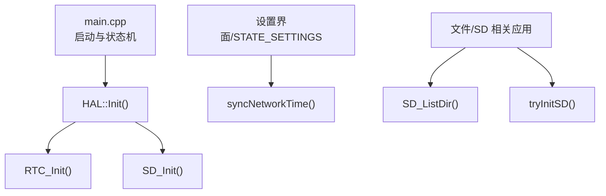
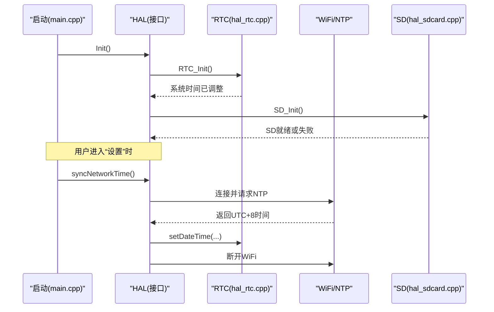
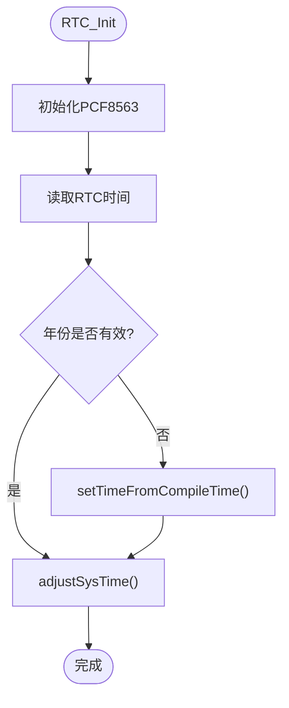
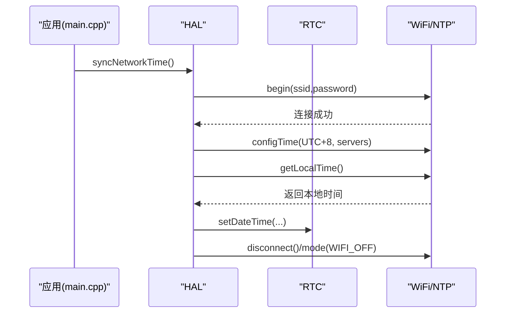
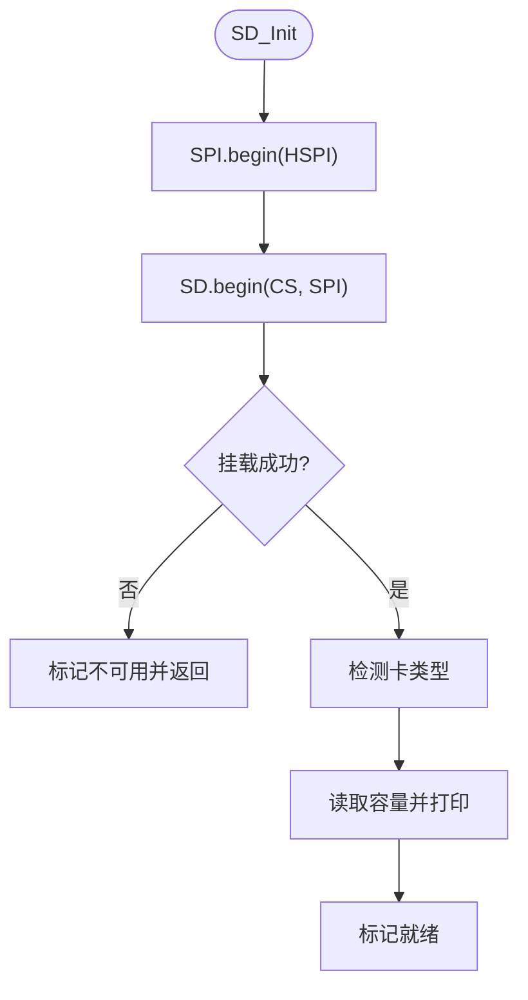
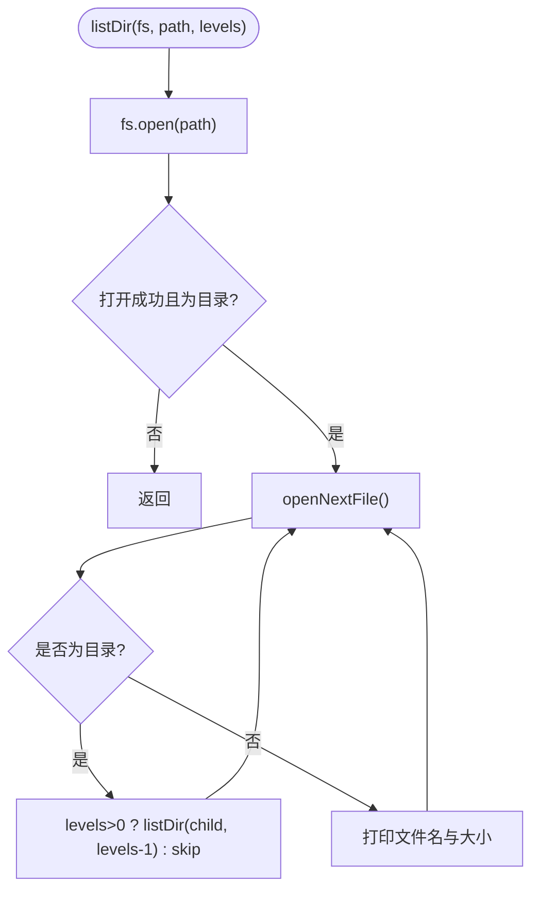
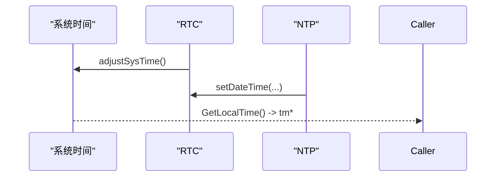
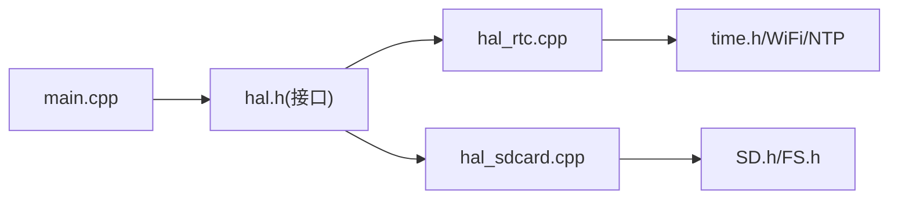

# 系统服务

<cite>
**本文引用的文件**   
- [src/hal/hal_rtc.cpp](file://src/hal/hal_rtc.cpp)
- [src/hal/hal_sdcard.cpp](file://src/hal/hal_sdcard.cpp)
- [src/hal/hal.h](file://src/hal/hal.h)
- [src/hal/hal_config.h](file://src/hal/hal_config.h)
- [src/main.cpp](file://src/main.cpp)
</cite>

## 目录
1. [简介](#简介)
2. [项目结构](#项目结构)
3. [核心组件](#核心组件)
4. [架构总览](#架构总览)
5. [详细组件分析](#详细组件分析)
6. [依赖关系分析](#依赖关系分析)
7. [性能与可靠性考虑](#性能与可靠性考虑)
8. [故障排查指南](#故障排查指南)
9. [结论](#结论)
10. [附录：时间戳处理与日期格式化示例](#附录时间戳处理与日期格式化示例)

## 简介
本文件为系统服务模块的综合文档，聚焦以下能力：
- RTC（实时时钟）初始化、系统时间同步与网络时间同步（NTP）
- SD 卡初始化、文件系统访问与存储管理
- 系统时间的获取与调整机制
- 文件系统使用方法与路径管理
- 时间戳处理与日期格式化示例
- SD 卡故障恢复与数据备份策略

## 项目结构
本项目采用分层 HAL（硬件抽象层）组织方式，将外设驱动与系统服务封装在 HAL 命名空间下，应用通过统一接口调用。与本文相关的核心文件如下：
- RTC 服务：src/hal/hal_rtc.cpp
- SD 卡服务：src/hal/hal_sdcard.cpp
- HAL 接口声明：src/hal/hal.h
- 引脚与宏配置：src/hal/hal_config.h
- 主循环入口与状态机：src/main.cpp

图表来源
- [src/main.cpp:19-24](file://src/main.cpp#L19-L24)
- [src/main.cpp:105-115](file://src/main.cpp#L105-L115)
- [src/hal/hal_rtc.cpp:15-39](file://src/hal/hal_rtc.cpp#L15-L39)
- [src/hal/hal_sdcard.cpp:16-59](file://src/hal/hal_sdcard.cpp#L16-L59)

章节来源
- [src/main.cpp:19-24](file://src/main.cpp#L19-L24)
- [src/hal/hal.h:101-212](file://src/hal/hal.h#L101-L212)
- [src/hal/hal_config.h:38-42](file://src/hal/hal_config.h#L38-L42)

## 核心组件
- RTC 服务
  - 负责 PCF8563 初始化、系统时间与 RTC 的互同步、NTP 网络时间同步、从编译时间回退等。
- SD 卡服务
  - 负责 SPI 初始化、SD 挂载、类型与容量检测、目录遍历、重试初始化等。
- HAL 接口
  - 对外暴露统一的 HAL 方法，包括 RTC、SD、系统时间获取等。
- 配置与引脚
  - 定义 SD 卡引脚、日志宏等。

章节来源
- [src/hal/hal_rtc.cpp:1-133](file://src/hal/hal_rtc.cpp#L1-L133)
- [src/hal/hal_sdcard.cpp:1-120](file://src/hal/hal_sdcard.cpp#L1-L120)
- [src/hal/hal.h:159-169](file://src/hal/hal.h#L159-L169)
- [src/hal/hal_config.h:38-42](file://src/hal/hal_config.h#L38-L42)

## 架构总览
下图展示了系统启动后，HAL 初始化、RTC 与 SD 服务的协作关系，以及设置界面触发 NTP 同步的流程。

图表来源
- [src/main.cpp:19-24](file://src/main.cpp#L19-L24)
- [src/main.cpp:105-115](file://src/main.cpp#L105-L115)
- [src/hal/hal_rtc.cpp:15-97](file://src/hal/hal_rtc.cpp#L15-L97)
- [src/hal/hal_sdcard.cpp:16-59](file://src/hal/hal_sdcard.cpp#L16-L59)

## 详细组件分析

### RTC 服务（实时时钟）
职责
- 初始化 PCF8563 并通过 I2C 读取当前时间
- 若检测到 RTC 掉电（年份异常），使用编译时间作为回退
- 将 RTC 时间同步到系统时间
- 支持通过 NTP 进行网络时间同步，并将结果写回 RTC
- 提供获取本地时间的接口

关键流程
- 初始化与回退
  - 尝试初始化 PCF8563；若失败记录错误
  - 读取 RTC 时间；若年份小于阈值则从编译时间设置
  - 将 RTC 时间转换为 time_t 并设置系统时间
- 网络时间同步
  - 连接 WiFi，配置 NTP（UTC+8），等待同步
  - 将本地时间写入 RTC，随后关闭 WiFi
- 获取本地时间
  - 基于系统时间返回 tm 指针供上层使用

图表来源
- [src/hal/hal_rtc.cpp:15-48](file://src/hal/hal_rtc.cpp#L15-L48)
- [src/hal/hal_rtc.cpp:99-126](file://src/hal/hal_rtc.cpp#L99-L126)

NTP 同步时序

图表来源
- [src/hal/hal_rtc.cpp:50-97](file://src/hal/hal_rtc.cpp#L50-L97)
- [src/main.cpp:105-115](file://src/main.cpp#L105-L115)

接口与实现要点
- HAL 接口声明：RTC_Init、adjustSysTime、syncNetworkTime、setTimeFromCompileTime、GetLocalTime
- 实现细节：I2C 驱动 SensorPCF8563、time.h 与 WiFi/NTP API 的使用

章节来源
- [src/hal/hal_rtc.cpp:1-133](file://src/hal/hal_rtc.cpp#L1-L133)
- [src/hal/hal.h:159-169](file://src/hal/hal.h#L159-L169)
- [src/hal/hal.h:206-208](file://src/hal/hal.h#L206-L208)

### SD 卡服务（文件系统）
职责
- 初始化 SPI 总线并挂载 SD 卡
- 检测卡类型与容量，标记就绪状态
- 提供目录遍历与重试初始化能力
- 对外暴露 SD_isReady、SD_ListDir、tryInitSD 等方法

关键流程
- 初始化
  - 初始化 SPI（HSPI），调用 SD.begin 挂载
  - 判断 CARD_NONE 与卡类型（MMC/SDSC/SDHC）
  - 打印容量并标记就绪
- 目录遍历
  - 打开根目录，递归列出子目录与文件信息
- 重试初始化
  - 提供 tryInitSD 用于运行时重新挂载

图表来源
- [src/hal/hal_sdcard.cpp:16-59](file://src/hal/hal_sdcard.cpp#L16-L59)

目录遍历流程

图表来源
- [src/hal/hal_sdcard.cpp:82-119](file://src/hal/hal_sdcard.cpp#L82-L119)

章节来源
- [src/hal/hal_sdcard.cpp:1-120](file://src/hal/hal_sdcard.cpp#L1-L120)
- [src/hal/hal.h:165-169](file://src/hal/hal.h#L165-L169)
- [src/hal/hal_config.h:38-42](file://src/hal/hal_config.h#L38-L42)

### 系统时间的获取与调整机制
- 从 RTC 调整系统时间
  - 读取 RTC 时间至 struct tm，转换为 time_t，调用 settimeofday 设置系统时间
- 从 NTP 同步时间
  - 配置时区 UTC+8，连接 NTP 服务器，获取本地时间后写回 RTC
- 获取本地时间
  - 通过 time() 与 localtime() 返回 tm 指针

图表来源
- [src/hal/hal_rtc.cpp:41-48](file://src/hal/hal_rtc.cpp#L41-L48)
- [src/hal/hal_rtc.cpp:85-90](file://src/hal/hal_rtc.cpp#L85-L90)
- [src/hal/hal_rtc.cpp:128-132](file://src/hal/hal_rtc.cpp#L128-L132)

章节来源
- [src/hal/hal_rtc.cpp:41-48](file://src/hal/hal_rtc.cpp#L41-L48)
- [src/hal/hal_rtc.cpp:85-90](file://src/hal/hal_rtc.cpp#L85-L90)
- [src/hal/hal_rtc.cpp:128-132](file://src/hal/hal_rtc.cpp#L128-L132)

### 文件系统使用与路径管理
- 使用 ESP32 Arduino 框架的 FS/SD 库
- 通过 fs::FS 抽象访问 SD 文件系统
- 常用操作
  - 打开目录：fs.open("/")
  - 遍历条目：root.openNextFile()
  - 判断目录/文件：isDirectory()
  - 获取名称与大小：name(), size()
- 路径建议
  - 根目录 "/" 作为起点
  - 按业务划分子目录（如 /logs、/media、/config）

章节来源
- [src/hal/hal_sdcard.cpp:82-119](file://src/hal/hal_sdcard.cpp#L82-L119)

## 依赖关系分析
- HAL 接口层
  - 定义 RTC、SD、系统时间等统一接口
- RTC 实现
  - 依赖 I2C 驱动 SensorPCF8563、time.h、WiFi/NTP
- SD 实现
  - 依赖 SPI（HSPI）、SD 库、FS 抽象
- 主程序
  - 调用 HAL::Init() 完成外设初始化
  - 在设置界面触发 NTP 同步

图表来源
- [src/hal/hal.h:159-169](file://src/hal/hal.h#L159-L169)
- [src/hal/hal_rtc.cpp:1-6](file://src/hal/hal_rtc.cpp#L1-L6)
- [src/hal/hal_sdcard.cpp:1-5](file://src/hal/hal_sdcard.cpp#L1-L5)
- [src/main.cpp:19-24](file://src/main.cpp#L19-L24)

章节来源
- [src/hal/hal.h:159-169](file://src/hal/hal.h#L159-L169)
- [src/hal/hal_rtc.cpp:1-6](file://src/hal/hal_rtc.cpp#L1-L6)
- [src/hal/hal_sdcard.cpp:1-5](file://src/hal/hal_sdcard.cpp#L1-L5)
- [src/main.cpp:19-24](file://src/main.cpp#L19-L24)

## 性能与可靠性考虑
- RTC
  - 首次上电若 RTC 掉电，自动回退到编译时间，避免长时间无效时间
  - NTP 同步仅在需要时执行，完成后关闭 WiFi 以节省功耗
- SD
  - 使用独立 SPI 总线（HSPI）减少与其他 SPI 设备冲突
  - 提供 tryInitSD 以便在热插拔或挂载失败后重试
  - 目录遍历采用递归，注意层级深度以避免栈溢出
- 系统时间
  - 优先使用 RTC 作为本地时间源，NTP 仅用于校准

[本节为通用指导，不直接分析具体文件]

## 故障排查指南
- RTC 初始化失败
  - 现象：串口打印初始化失败
  - 排查：检查 I2C 接线与地址；确认 SensorPCF8563 库可用
  - 参考：[src/hal/hal_rtc.cpp:15-24](file://src/hal/hal_rtc.cpp#L15-L24)
- RTC 时间异常（年份过小）
  - 现象：年份小于预期阈值
  - 处理：自动从编译时间设置；如需固定默认值可修改逻辑
  - 参考：[src/hal/hal_rtc.cpp:31-36](file://src/hal/hal_rtc.cpp#L31-L36), [src/hal/hal_rtc.cpp:99-126](file://src/hal/hal_rtc.cpp#L99-L126)
- NTP 同步超时
  - 现象：WiFi 连接或 NTP 请求超时
  - 排查：确认 SSID/密码、NTP 服务器可达与时区配置
  - 参考：[src/hal/hal_rtc.cpp:50-97](file://src/hal/hal_rtc.cpp#L50-L97)
- SD 卡无法挂载
  - 现象：打印挂载失败或无卡
  - 排查：检查 SPI 引脚、CS 电平、卡类型与容量；调用 tryInitSD 重试
  - 参考：[src/hal/hal_sdcard.cpp:16-59](file://src/hal/hal_sdcard.cpp#L16-L59), [src/hal/hal_sdcard.cpp:69-80](file://src/hal/hal_sdcard.cpp#L69-L80)
- 目录遍历为空或报错
  - 现象：无法打开目录或非目录
  - 排查：确认路径存在且为目录；检查权限与文件系统格式
  - 参考：[src/hal/hal_sdcard.cpp:82-119](file://src/hal/hal_sdcard.cpp#L82-L119)

章节来源
- [src/hal/hal_rtc.cpp:15-24](file://src/hal/hal_rtc.cpp#L15-L24)
- [src/hal/hal_rtc.cpp:31-36](file://src/hal/hal_rtc.cpp#L31-L36)
- [src/hal/hal_rtc.cpp:50-97](file://src/hal/hal_rtc.cpp#L50-L97)
- [src/hal/hal_rtc.cpp:99-126](file://src/hal/hal_rtc.cpp#L99-L126)
- [src/hal/hal_sdcard.cpp:16-59](file://src/hal/hal_sdcard.cpp#L16-L59)
- [src/hal/hal_sdcard.cpp:69-80](file://src/hal/hal_sdcard.cpp#L69-L80)
- [src/hal/hal_sdcard.cpp:82-119](file://src/hal/hal_sdcard.cpp#L82-L119)

## 结论
本系统服务模块通过 HAL 抽象统一了 RTC 与 SD 卡的初始化与管理，提供了可靠的系统时间同步机制与文件系统访问能力。结合 NTP 与编译时间回退，系统在断电与网络不可用时仍能保持基本可用性；SD 卡提供重试初始化与目录遍历能力，便于扩展文件管理与数据备份功能。建议在应用中遵循路径规划与错误处理最佳实践，确保稳定性与可维护性。

[本节为总结性内容，不直接分析具体文件]

## 附录：时间戳处理与日期格式化示例
说明
- 获取本地时间：调用 HAL::GetLocalTime() 获取 tm 指针
- 时间戳转字符串：使用 strftime 将 tm 格式化为可读字符串
- 字符串转时间戳：使用 strptime 将字符串解析为 tm，再 mktime 得到 time_t
- 时区：NTP 同步使用 UTC+8，显示时请保持一致

示例步骤（概念性描述）
- 获取本地时间
  - 调用 HAL::GetLocalTime()
  - 从返回的 tm 中读取年、月、日、时、分、秒
- 格式化输出
  - 使用 strftime 生成形如 “YYYY-MM-DD HH:MM:SS” 的字符串
- 解析输入
  - 使用 strptime 解析用户输入的日期时间字符串
  - 使用 mktime 转换为 time_t，必要时再写回 RTC

章节来源
- [src/hal/hal_rtc.cpp:128-132](file://src/hal/hal_rtc.cpp#L128-L132)