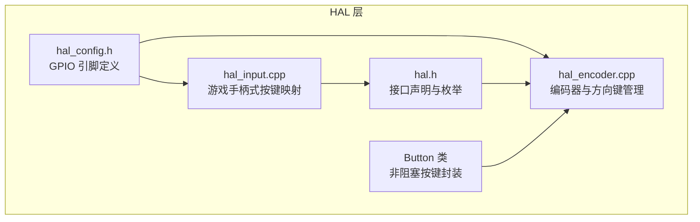
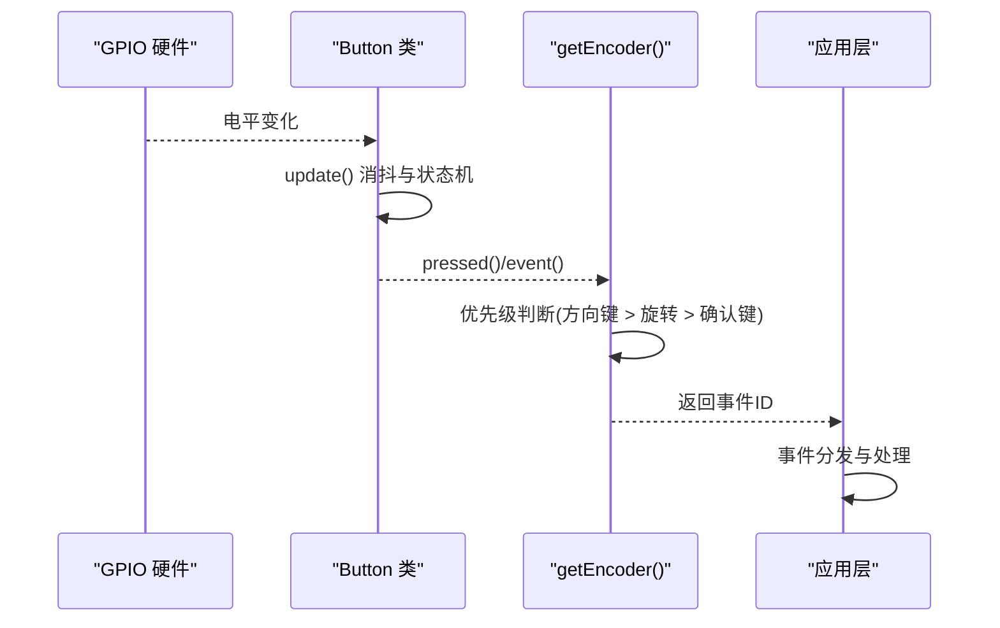
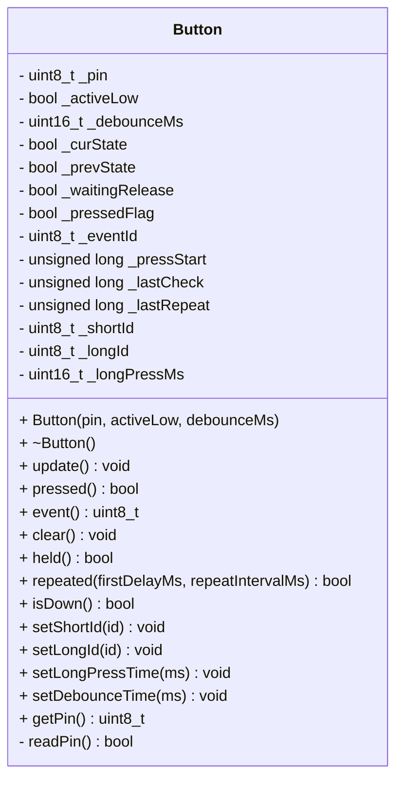
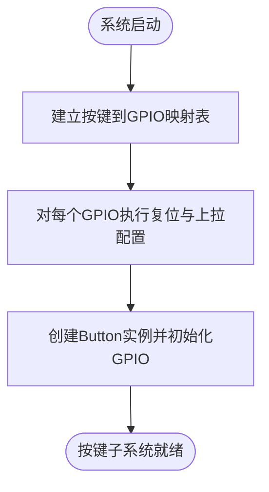
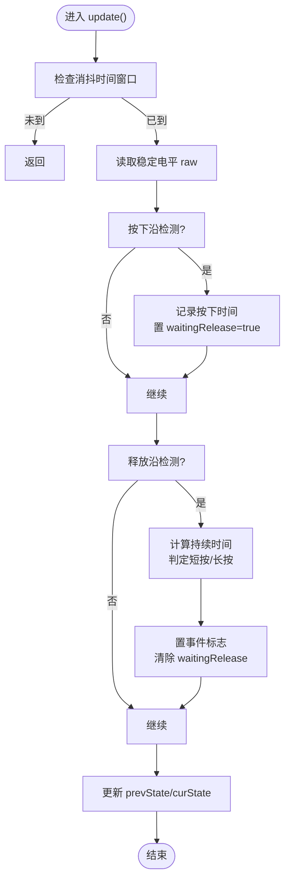
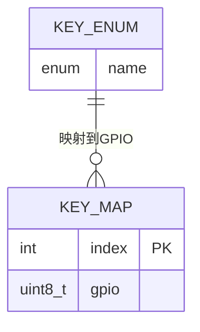
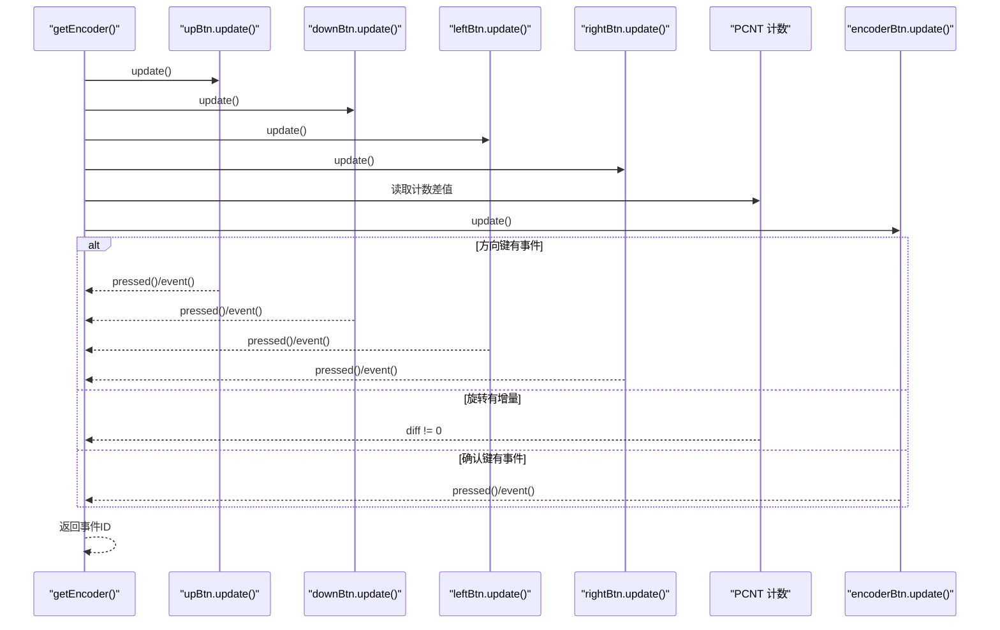
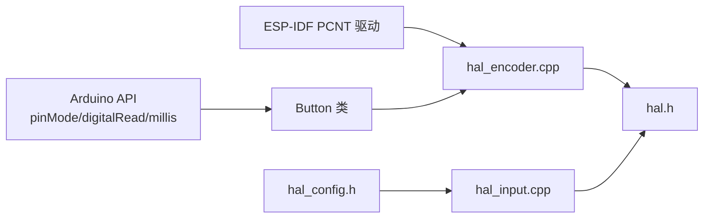

# 物理按键处理

<cite>
**本文引用的文件**   
- [Button.h](file://src/hal/Button.h)
- [Button.cpp](file://src/hal/Button.cpp)
- [hal_encoder.cpp](file://src/hal/hal_encoder.cpp)
- [hal_input.cpp](file://src/hal/hal_input.cpp)
- [hal.h](file://src/hal/hal.h)
- [hal_config.h](file://src/hal/hal_config.h)
</cite>

## 目录
1. [引言](#引言)
2. [项目结构](#项目结构)
3. [核心组件](#核心组件)
4. [架构总览](#架构总览)
5. [详细组件分析](#详细组件分析)
6. [依赖关系分析](#依赖关系分析)
7. [性能与实时性](#性能与实时性)
8. [故障排查指南](#故障排查指南)
9. [结论](#结论)
10. [附录：扩展与自定义指南](#附录扩展与自定义指南)

## 引言
本文件面向 ESP32 设备上的物理按键处理子系统，围绕 Button 类的设计模式、GPIO 引脚配置与初始化、按键状态管理（短按/长按/按住持续触发/连发）、软件消抖算法、按键映射表设计、以及事件分发机制进行系统化说明。文档同时提供扩展方法与自定义按键行为的实践指南，帮助开发者在不侵入业务逻辑的前提下，灵活接入新的按键或调整行为策略。

## 项目结构
本项目中与按键相关的代码主要位于 hal 层，采用“硬件抽象 + 面向对象封装”的分层方式：
- Button 类：封装单个物理按键的非阻塞扫描、消抖、事件识别与状态查询。
- HAL 输入层：维护按键到 GPIO 的映射表，统一初始化 GPIO，并提供简单按键读取接口。
- 编码器与方向键：使用 PCNT 硬件计数器处理旋转编码，同时为方向键和确认键创建 Button 实例，并通过优先级规则统一输出事件。

图表来源
- [Button.h:48-182](file://src/hal/Button.h#L48-L182)
- [Button.cpp:12-168](file://src/hal/Button.cpp#L12-L168)
- [hal_encoder.cpp:13-24](file://src/hal/hal_encoder.cpp#L13-L24)
- [hal_input.cpp:4-23](file://src/hal/hal_input.cpp#L4-L23)
- [hal_config.h:24-36](file://src/hal/hal_config.h#L24-L36)
- [hal.h:13-29](file://src/hal/hal.h#L13-L29)

章节来源
- [hal_config.h:24-36](file://src/hal/hal_config.h#L24-L36)
- [hal.h:13-29](file://src/hal/hal.h#L13-L29)

## 核心组件
- Button 类：面向对象封装单个按键，支持低电平有效/高电平有效、可配置消抖时间、短按/长按事件 ID、长按阈值、连发模式等。
- HAL 输入层：通过按键映射表将逻辑按键名映射到具体 GPIO，统一初始化并读取按键状态。
- 编码器与方向键：在 hal_encoder.cpp 中集中管理多个 Button 实例，结合 PCNT 计数值生成统一的事件流，并按优先级输出。

章节来源
- [Button.h:48-182](file://src/hal/Button.h#L48-L182)
- [Button.cpp:12-168](file://src/hal/Button.cpp#L12-L168)
- [hal_encoder.cpp:13-24](file://src/hal/hal_encoder.cpp#L13-L24)
- [hal_input.cpp:4-23](file://src/hal/hal_input.cpp#L4-L23)

## 架构总览
下图展示从 GPIO 到应用层的按键事件流程：GPIO 电平变化经 Button 类消抖与状态机处理后产生事件；上层通过 getEncoder 或 GetButton 获取事件并进行分发。

图表来源
- [Button.cpp:28-70](file://src/hal/Button.cpp#L28-L70)
- [hal_encoder.cpp:74-128](file://src/hal/hal_encoder.cpp#L74-L128)

## 详细组件分析

### Button 类设计与面向对象封装
Button 类以单一职责原则封装一个物理按键的全部行为：
- 构造时完成 GPIO 模式设置（上拉或普通输入）与初始状态同步。
- update() 实现非阻塞扫描，内部维护按下/释放沿检测、等待释放标志、事件标志与时间戳。
- 提供 pressed()/event()/clear() 事件接口，held()/repeated() 状态接口，以及 setShortId()/setLongId()/setLongPressTime()/setDebounceTime() 配置接口。

图表来源
- [Button.h:48-182](file://src/hal/Button.h#L48-L182)
- [Button.cpp:12-168](file://src/hal/Button.cpp#L12-L168)

章节来源
- [Button.h:48-182](file://src/hal/Button.h#L48-L182)
- [Button.cpp:12-168](file://src/hal/Button.cpp#L12-L168)

### GPIO 引脚配置与初始化
- hal_config.h 定义了电源键、方向键、编码器通道等 GPIO 宏。
- hal_input.cpp 的 Input_Init() 将逻辑按键名映射到具体 GPIO，并对每个映射引脚执行 gpio_reset_pin 与 pinMode(INPUT_PULLUP)。
- hal_encoder.cpp 中的 Button 实例在构造时自动调用 pinMode，根据 activeLow 选择 INPUT_PULLUP 或 INPUT。

图表来源
- [hal_input.cpp:7-23](file://src/hal/hal_input.cpp#L7-L23)
- [hal_config.h:24-36](file://src/hal/hal_config.h#L24-L36)
- [Button.cpp:12-24](file://src/hal/Button.cpp#L12-L24)

章节来源
- [hal_config.h:24-36](file://src/hal/hal_config.h#L24-L36)
- [hal_input.cpp:7-23](file://src/hal/hal_input.cpp#L7-L23)
- [Button.cpp:12-24](file://src/hal/Button.cpp#L12-L24)

### 按键状态管理与事件识别
Button::update() 的核心逻辑如下：
- 基于 millis() 的时间窗口控制消抖，未到间隔直接返回。
- 读取稳定后的 raw 电平，检测按下沿（prev=false→cur=true）记录按下起始时间与等待释放标志。
- 检测释放沿（prev=true→cur=false），计算持续时间并与长按阈值比较，决定短按或长按事件 ID。
- 更新 prevState 与 curState，确保下一次扫描正确判断边沿。

图表来源
- [Button.cpp:28-70](file://src/hal/Button.cpp#L28-L70)

章节来源
- [Button.cpp:28-70](file://src/hal/Button.cpp#L28-L70)

### 按键消抖算法与时间窗口控制
- 消抖由 _debounceMs 控制，每次 update() 仅允许一次采样，避免抖动导致的误判。
- 首次按下后等待释放再置事件标志，确保短按/长按只在释放时刻确定。
- 可通过 setDebounceTime() 动态调整消抖时间，适配不同机械按键特性。

章节来源
- [Button.cpp:28-70](file://src/hal/Button.cpp#L28-L70)
- [Button.h:143-147](file://src/hal/Button.h#L143-L147)

### 按键映射表与统一管理
- hal_input.cpp 使用 std::array<uint8_t, ENCODER_BUTTON_NUM> 作为按键到 GPIO 的映射表，并在 Input_Init() 中填充。
- 该表支持统一的 GPIO 初始化与按键读取，GetButton() 通过查表访问对应引脚，并结合蜂鸣器反馈按键动作。

图表来源
- [hal_input.cpp:4-23](file://src/hal/hal_input.cpp#L4-L23)
- [hal.h:13-29](file://src/hal/hal.h#L13-L29)

章节来源
- [hal_input.cpp:4-23](file://src/hal/hal_input.cpp#L4-L23)
- [hal.h:13-29](file://src/hal/hal.h#L13-L29)

### 编码器与方向键的事件分发
- hal_encoder.cpp 中为确认键与四个方向键分别创建 Button 实例，并为确认键设置短按/长按事件 ID 与长按阈值。
- getEncoder() 周期性调用各 Button::update()，然后按优先级顺序判断事件：方向键 > 旋转（PCNT）> 确认键。
- 方向键与确认键事件通过 *key 返回，旋转方向依据 diff 正负判断。

图表来源
- [hal_encoder.cpp:37-71](file://src/hal/hal_encoder.cpp#L37-L71)
- [hal_encoder.cpp:74-128](file://src/hal/hal_encoder.cpp#L74-L128)

章节来源
- [hal_encoder.cpp:37-71](file://src/hal/hal_encoder.cpp#L37-L71)
- [hal_encoder.cpp:74-128](file://src/hal/hal_encoder.cpp#L74-L128)

### 按键回调机制与事件分发系统
当前实现未使用函数指针回调，而是通过返回值与事件 ID 进行事件分发：
- Button::pressed() 表示本次检测到一次有效按键事件，配合 Button::event() 获取事件类型（短按/长按）。
- hal_encoder.cpp 的 getEncoder() 将事件 ID 写回调用方，由上层根据 ID 分派到具体业务逻辑。
- hal_input.cpp 的 GetButton() 则直接返回布尔值表示按键是否被按下，并在按下/释放时触发蜂鸣器反馈。

章节来源
- [Button.h:71-93](file://src/hal/Button.h#L71-L93)
- [Button.cpp:74-87](file://src/hal/Button.cpp#L74-L87)
- [hal_encoder.cpp:74-128](file://src/hal/hal_encoder.cpp#L74-L128)
- [hal_input.cpp:26-48](file://src/hal/hal_input.cpp#L26-L48)

## 依赖关系分析
- Button 类依赖 Arduino 的 pinMode/digitalRead/millis 等基础 API。
- hal_encoder.cpp 依赖 Button 类与 ESP-IDF 的 PCNT 驱动处理旋转编码器。
- hal_input.cpp 依赖 hal_config.h 的 GPIO 宏与蜂鸣器 beep 接口。
- hal.h 提供 Button 句柄获取接口与事件枚举，供上层统一调用。

图表来源
- [Button.cpp:12-168](file://src/hal/Button.cpp#L12-L168)
- [hal_encoder.cpp:1-4](file://src/hal/hal_encoder.cpp#L1-L4)
- [hal_input.cpp:1-2](file://src/hal/hal_input.cpp#L1-L2)
- [hal.h:8-9](file://src/hal/hal.h#L8-L9)

章节来源
- [Button.cpp:12-168](file://src/hal/Button.cpp#L12-L168)
- [hal_encoder.cpp:1-4](file://src/hal/hal_encoder.cpp#L1-L4)
- [hal_input.cpp:1-2](file://src/hal/hal_input.cpp#L1-L2)
- [hal.h:8-9](file://src/hal/hal.h#L8-L9)

## 性能与实时性
- 非阻塞设计：Button::update() 基于时间窗口控制，适合放在 loop() 或定时器回调中，避免阻塞主循环。
- 消抖开销：默认 5ms 消抖间隔，可根据按键质量调整，平衡响应速度与抗抖能力。
- 事件优先级：方向键优先于旋转与确认键，保证导航操作的即时性。
- PCNT 硬件计数：旋转编码器使用硬件计数器，降低 CPU 负载，提高旋转检测精度。

[本节为通用指导，不直接分析具体文件]

## 故障排查指南
- 按键无响应：
  - 检查 GPIO 是否正确配置为 INPUT_PULLUP 或 INPUT。
  - 确认 Button 构造时的 activeLow 参数与硬件电路匹配。
- 误触发或抖动严重：
  - 增大 setDebounceTime() 的值，观察是否改善。
  - 检查外部上拉电阻与按键接触质量。
- 长按阈值不准确：
  - 调整 setLongPressTime()，确保符合用户预期。
- 事件未清除导致重复触发：
  - 在 pressed()==true 后立即调用 clear()，或在 getEncoder() 中已自动 clear()。
- 编码器旋转异常：
  - 检查 PCNT 单元配置与滤波值，必要时调整 pcnt_set_filter_value()。

章节来源
- [Button.cpp:12-168](file://src/hal/Button.cpp#L12-L168)
- [hal_encoder.cpp:37-71](file://src/hal/hal_encoder.cpp#L37-L71)

## 结论
Button 类以面向对象的方式封装了物理按键的非阻塞扫描、消抖与事件识别，配合 HAL 层的按键映射表与编码器管理，形成了清晰、可扩展的按键处理体系。通过合理配置 GPIO、消抖时间与长按阈值，并结合事件优先级，系统能够在保证实时性的同时提供稳定的用户体验。未来可通过引入回调机制进一步解耦事件处理逻辑，提升系统的可维护性与扩展性。

[本节为总结性内容，不直接分析具体文件]

## 附录：扩展与自定义指南

### 新增物理按键的步骤
- 在 hal_config.h 中新增 GPIO 宏定义。
- 在 hal_input.cpp 的 Input_Init() 中将新按键加入映射表并完成 GPIO 初始化。
- 若需使用 Button 类的完整功能，可在 hal_encoder.cpp 或独立模块中创建 Button 实例，并设置事件 ID 与阈值。
- 在上层调用处添加对新事件的识别与处理逻辑。

章节来源
- [hal_config.h:24-36](file://src/hal/hal_config.h#L24-L36)
- [hal_input.cpp:7-23](file://src/hal/hal_input.cpp#L7-L23)
- [hal_encoder.cpp:37-71](file://src/hal/hal_encoder.cpp#L37-L71)

### 自定义按键行为
- 修改长按阈值：调用 setLongPressTime() 调整短按/长按分界。
- 启用连发模式：调用 repeated(firstDelayMs, repeatIntervalMs) 实现 NES 风格连发。
- 自定义事件 ID：通过 setShortId()/setLongId() 为不同按键分配唯一事件标识，便于上层分发。

章节来源
- [Button.h:125-147](file://src/hal/Button.h#L125-L147)
- [Button.cpp:147-155](file://src/hal/Button.cpp#L147-L155)
- [Button.cpp:97-128](file://src/hal/Button.cpp#L97-L128)