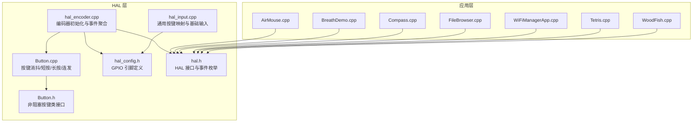
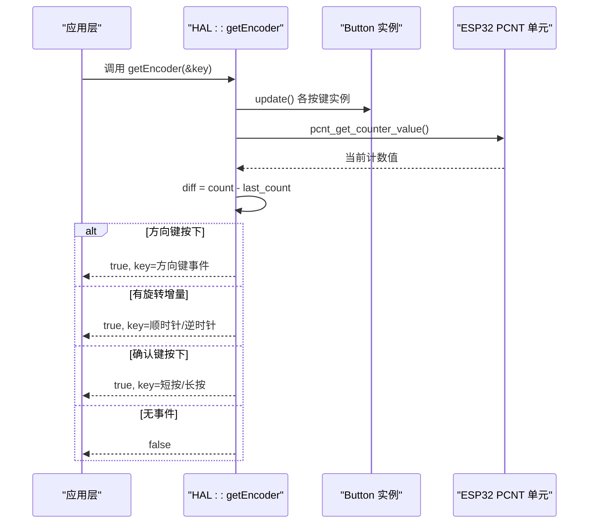
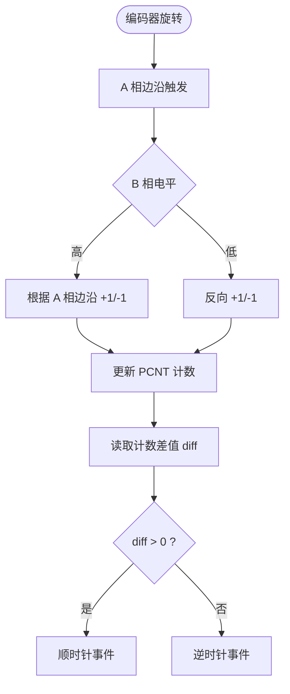
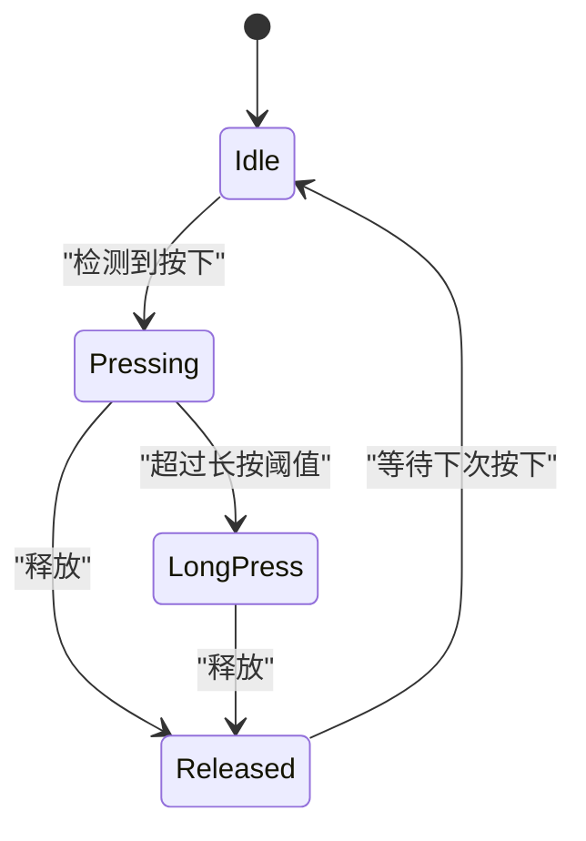
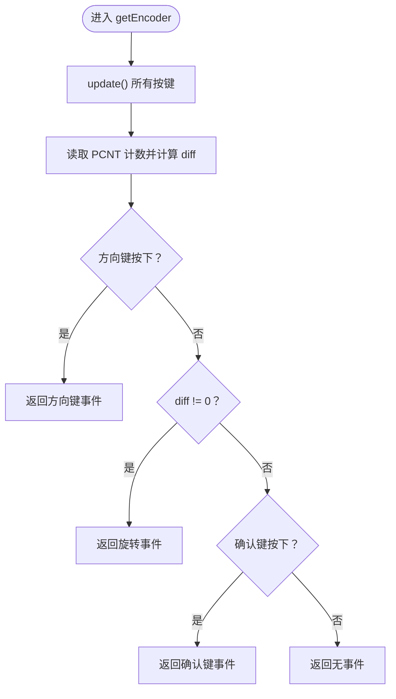
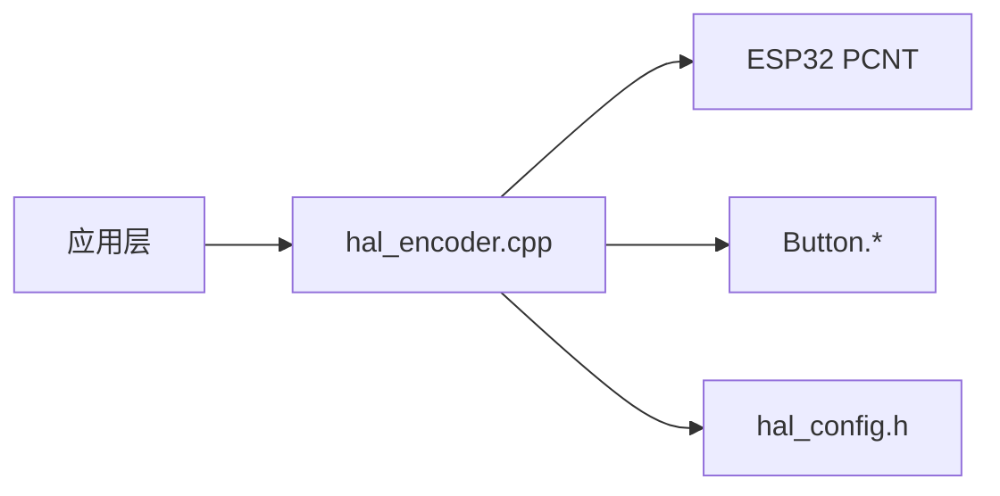
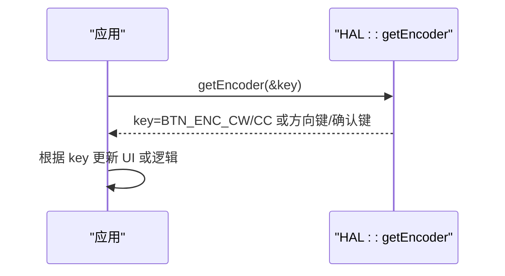

# 编码器输入处理

<cite>
**本文引用的文件**   
- [hal_encoder.cpp](file://src/hal/hal_encoder.cpp)
- [hal.h](file://src/hal/hal.h)
- [Button.h](file://src/hal/Button.h)
- [Button.cpp](file://src/hal/Button.cpp)
- [hal_config.h](file://src/hal/hal_config.h)
- [hal_input.cpp](file://src/hal/hal_input.cpp)
- [AirMouse.cpp](file://src/apps/AirMouse.cpp)
- [BreathDemo.cpp](file://src/apps/BreathDemo.cpp)
- [Compass.cpp](file://src/apps/Compass.cpp)
- [FileBrowser.cpp](file://src/apps/FileBrowser.cpp)
- [WiFiManagerApp.cpp](file://src/apps/WiFiManagerApp.cpp)
- [Tetris.cpp](file://src/apps/game/Tetris.cpp)
- [WoodFish.cpp](file://src/apps/game/WoodFish.cpp)
</cite>

## 目录
1. [简介](#简介)
2. [项目结构](#项目结构)
3. [核心组件](#核心组件)
4. [架构总览](#架构总览)
5. [详细组件分析](#详细组件分析)
6. [依赖关系分析](#依赖关系分析)
7. [性能与可靠性](#性能与可靠性)
8. [故障排查指南](#故障排查指南)
9. [结论](#结论)
10. [附录：应用示例与参数配置](#附录应用示例与参数配置)

## 简介
本文件面向旋转编码器输入处理的软硬件实现，覆盖以下主题：
- 硬件接口定义与引脚分配
- 基于 ESP32 PCNT 的 A/B 相正交解码与方向检测
- 按键扫描、消抖与事件分发
- 轮询模式下的统一事件获取流程
- 可配置参数（消抖时间、长按阈值、PCNT 滤波等）
- 在 UI 导航中的应用示例（菜单滚动、数值调节、游戏控制）

## 项目结构
编码器相关代码主要位于 HAL 层与应用层：
- HAL 层负责底层硬件抽象与事件聚合
- 应用层通过统一接口获取编码器事件并驱动 UI 或业务逻辑

**图表来源**
- [hal_encoder.cpp:37-71](file://src/hal/hal_encoder.cpp#L37-L71)
- [hal_encoder.cpp:74-128](file://src/hal/hal_encoder.cpp#L74-L128)
- [hal.h:77-92](file://src/hal/hal.h#L77-L92)
- [hal_config.h:29-36](file://src/hal/hal_config.h#L29-L36)
- [Button.h:48-182](file://src/hal/Button.h#L48-L182)
- [Button.cpp:12-169](file://src/hal/Button.cpp#L12-L169)
- [hal_input.cpp:7-24](file://src/hal/hal_input.cpp#L7-L24)

**章节来源**
- [hal_encoder.cpp:1-129](file://src/hal/hal_encoder.cpp#L1-L129)
- [hal.h:1-215](file://src/hal/hal.h#L1-L215)
- [hal_config.h:1-123](file://src/hal/hal_config.h#L1-L123)
- [Button.h:1-183](file://src/hal/Button.h#L1-L183)
- [Button.cpp:1-169](file://src/hal/Button.cpp#L1-L169)
- [hal_input.cpp:1-58](file://src/hal/hal_input.cpp#L1-L58)

## 核心组件
- 编码器硬件抽象与事件聚合：封装 PCNT 计数与按键状态，提供统一 getEncoder 接口
- 非阻塞按键类 Button：支持短按、长按、持续按住、连发，内置消抖
- 引脚配置：集中定义编码器 A/B 相、方向键与确认键的 GPIO
- 事件枚举：标准化编码器旋转方向与按键事件 ID

关键职责划分：
- hal_encoder.cpp：初始化 PCNT、配置按键事件 ID、读取增量、优先级调度
- Button.*：消抖、边沿检测、长短按判定、连发计时
- hal_config.h：引脚常量
- hal.h：事件枚举与 HAL 接口声明

**章节来源**
- [hal_encoder.cpp:37-71](file://src/hal/hal_encoder.cpp#L37-L71)
- [hal_encoder.cpp:74-128](file://src/hal/hal_encoder.cpp#L74-L128)
- [Button.h:48-182](file://src/hal/Button.h#L48-L182)
- [Button.cpp:28-70](file://src/hal/Button.cpp#L28-L70)
- [hal_config.h:29-36](file://src/hal/hal_config.h#L29-L36)
- [hal.h:77-92](file://src/hal/hal.h#L77-L92)

## 架构总览
编码器输入的整体数据流如下：

**图表来源**
- [hal_encoder.cpp:74-128](file://src/hal/hal_encoder.cpp#L74-L128)

**章节来源**
- [hal_encoder.cpp:74-128](file://src/hal/hal_encoder.cpp#L74-L128)

## 详细组件分析

### 硬件接口与引脚定义
- A 相脉冲输入：HAL_PIN_ENCODER_CHA
- B 相控制输入：HAL_PIN_ENCODER_CHB
- 方向键：上/下/左/右分别映射到独立 GPIO
- 确认键（编码器按键）：HAL_PIN_ENCODER_SEL

这些引脚在 hal_config.h 中集中定义，便于移植与修改。

**章节来源**
- [hal_config.h:29-36](file://src/hal/hal_config.h#L29-L36)

### 旋转方向检测算法（A/B 相时序）
- 使用 ESP32 PCNT 模块进行正交解码
- A 相作为脉冲输入，上升沿 +1，下降沿 -1
- B 相作为控制输入：低电平反转加减方向，高电平保持原方向
- 启用毛刺滤波以抑制高频抖动
- 通过周期读取计数器差值判断旋转方向与步数

该方案将方向与时序解耦，由硬件完成 A/B 相时序解析，软件仅做增量计算与方向判定。

**图表来源**
- [hal_encoder.cpp:49-70](file://src/hal/hal_encoder.cpp#L49-L70)
- [hal_encoder.cpp:83-86](file://src/hal/hal_encoder.cpp#L83-L86)
- [hal_encoder.cpp:114-117](file://src/hal/hal_encoder.cpp#L114-L117)

**章节来源**
- [hal_encoder.cpp:49-70](file://src/hal/hal_encoder.cpp#L49-L70)
- [hal_encoder.cpp:83-86](file://src/hal/hal_encoder.cpp#L83-L86)
- [hal_encoder.cpp:114-117](file://src/hal/hal_encoder.cpp#L114-L117)

### 按键扫描机制与消抖处理
- 每个按键对应一个 Button 实例，采用非阻塞 update() 扫描
- 内部状态机实现：
  - 消抖：固定间隔采样，避免机械抖动误触发
  - 边沿检测：记录按下/释放时刻，区分短按与长按
  - 事件标志：pressed()/event()/clear() 配合消费事件
  - 连发：支持首次延迟与重复间隔，适合 NES 风格移动
- 默认低电平有效，适配上拉电阻电路

**图表来源**
- [Button.cpp:28-70](file://src/hal/Button.cpp#L28-L70)
- [Button.cpp:97-128](file://src/hal/Button.cpp#L97-L128)

**章节来源**
- [Button.h:48-182](file://src/hal/Button.h#L48-L182)
- [Button.cpp:12-169](file://src/hal/Button.cpp#L12-L169)

### 编码器中断处理与轮询模式的差异
- 当前实现为轮询模式：应用层周期性调用 HAL::getEncoder()
- PCNT 硬件计数在后台运行，软件仅在需要时读取计数差值
- 未使用外部中断或定时器回调直接处理编码器事件
- 优势：简单可靠，易于与主循环集成；劣势：需保证足够高的轮询频率以避免丢步

若未来引入中断模式，建议：
- 使用 PCNT 事件或 GPIO 中断捕获 A/B 相变化
- 在中断中累加计数，主循环仅消费结果
- 注意临界区保护与原子操作

**章节来源**
- [hal_encoder.cpp:74-128](file://src/hal/hal_encoder.cpp#L74-L128)

### 事件优先级与统一接口
- 优先级顺序：方向键 > 旋转增量 > 确认键
- getEncoder() 返回布尔值表示是否产生事件，并通过指针输出事件 ID
- 事件 ID 包括：
  - 旋转：顺时针/逆时针
  - 按键：短按/长按（方向键与确认键）

**图表来源**
- [hal_encoder.cpp:74-128](file://src/hal/hal_encoder.cpp#L74-L128)

**章节来源**
- [hal_encoder.cpp:74-128](file://src/hal/hal_encoder.cpp#L74-L128)

## 依赖关系分析
- HAL 层依赖：
  - ESP32 PCNT 驱动用于正交解码
  - Button 类用于按键消抖与事件生成
  - hal_config.h 提供引脚常量
- 应用层依赖：
  - 通过 HAL::getEncoder() 获取事件
  - 根据事件类型执行 UI 导航或业务逻辑

**图表来源**
- [hal_encoder.cpp:1-4](file://src/hal/hal_encoder.cpp#L1-L4)
- [hal_config.h:29-36](file://src/hal/hal_config.h#L29-L36)

**章节来源**
- [hal_encoder.cpp:1-129](file://src/hal/hal_encoder.cpp#L1-L129)
- [hal_config.h:29-36](file://src/hal/hal_config.h#L29-L36)

## 性能与可靠性
- PCNT 硬件计数降低 CPU 负载，适合高频旋转输入
- 毛刺滤波可抑制高频噪声，提高稳定性
- 按键消抖时间可调，平衡响应速度与抗抖能力
- 轮询模式需保证足够频率，避免在高转速下丢失脉冲

优化建议：
- 根据实际硬件调整 PCNT 滤波值
- 合理设置按键消抖时间与长按阈值
- 在高刷新率 UI 中确保 getEncoder() 被频繁调用

[本节为通用指导，不直接分析具体文件]

## 故障排查指南
常见问题与定位要点：
- 旋转方向错误：检查 A/B 相接线与 PCNT 配置（lctrl_mode/hctrl_mode）
- 计数跳变或漏计：增大 PCNT 滤波值或检查信号质量
- 按键误触发：调整 Button 消抖时间或检查上拉电阻
- 事件优先级冲突：确认方向键优先于旋转与确认键的逻辑未被覆盖

参考实现位置：
- PCNT 配置与滤波：[hal_encoder.cpp:49-70](file://src/hal/hal_encoder.cpp#L49-L70)
- 按键消抖与长短按：[Button.cpp:28-70](file://src/hal/Button.cpp#L28-L70)
- 事件优先级调度：[hal_encoder.cpp:88-127](file://src/hal/hal_encoder.cpp#L88-L127)

**章节来源**
- [hal_encoder.cpp:49-70](file://src/hal/hal_encoder.cpp#L49-L70)
- [hal_encoder.cpp:88-127](file://src/hal/hal_encoder.cpp#L88-L127)
- [Button.cpp:28-70](file://src/hal/Button.cpp#L28-L70)

## 结论
本项目通过 ESP32 PCNT 硬件解码与 Button 非阻塞按键类，构建了稳定高效的编码器输入处理方案。轮询模式简化了系统集成，同时保留了扩展中断模式的潜力。应用层通过统一事件接口，轻松实现菜单滚动、数值调节与游戏控制等功能。

[本节为总结性内容，不直接分析具体文件]

## 附录：应用示例与参数配置

### 应用层使用示例
多个应用通过 HAL::getEncoder() 获取事件并驱动交互：
- AirMouse：旋转控制光标移动
- BreathDemo：旋转调节呼吸动画参数
- Compass：旋转调节罗盘显示角度
- FileBrowser：旋转滚动文件列表
- WiFiManagerApp：旋转选择网络项
- Tetris/WoodFish：旋转控制游戏动作

**图表来源**
- [AirMouse.cpp:74-84](file://src/apps/AirMouse.cpp#L74-L84)
- [BreathDemo.cpp:104-113](file://src/apps/BreathDemo.cpp#L104-L113)
- [Compass.cpp:644-652](file://src/apps/Compass.cpp#L644-L652)
- [FileBrowser.cpp:302-335](file://src/apps/FileBrowser.cpp#L302-L335)
- [WiFiManagerApp.cpp:447-454](file://src/apps/WiFiManagerApp.cpp#L447-L454)
- [Tetris.cpp:525-528](file://src/apps/game/Tetris.cpp#L525-L528)
- [WoodFish.cpp:239-240](file://src/apps/game/WoodFish.cpp#L239-L240)

**章节来源**
- [AirMouse.cpp:74-84](file://src/apps/AirMouse.cpp#L74-L84)
- [BreathDemo.cpp:104-113](file://src/apps/BreathDemo.cpp#L104-L113)
- [Compass.cpp:644-652](file://src/apps/Compass.cpp#L644-L652)
- [FileBrowser.cpp:302-335](file://src/apps/FileBrowser.cpp#L302-L335)
- [WiFiManagerApp.cpp:447-454](file://src/apps/WiFiManagerApp.cpp#L447-L454)
- [Tetris.cpp:525-528](file://src/apps/game/Tetris.cpp#L525-L528)
- [WoodFish.cpp:239-240](file://src/apps/game/WoodFish.cpp#L239-L240)

### 参数配置选项
- 旋转速度阈值：当前实现未显式实现速度阈值，可通过上层逻辑对单位时间内 diff 累计值进行判断
- 按键灵敏度：Button 消抖时间 setDebounceTime(ms) 可调
- 长按阈值：Button.setLongPressTime(ms) 可调，编码器确认键默认 300ms
- PCNT 滤波值：pcnt_set_filter_value(unit, value) 可调，默认约 1.25μs

可在以下位置调整：
- 按键消抖与长按阈值：[Button.cpp:147-155](file://src/hal/Button.cpp#L147-L155)
- 编码器确认键长按阈值：[hal_encoder.cpp:40-42](file://src/hal/hal_encoder.cpp#L40-L42)
- PCNT 滤波值：[hal_encoder.cpp:63-65](file://src/hal/hal_encoder.cpp#L63-L65)

**章节来源**
- [Button.cpp:147-155](file://src/hal/Button.cpp#L147-L155)
- [hal_encoder.cpp:40-42](file://src/hal/hal_encoder.cpp#L40-L42)
- [hal_encoder.cpp:63-65](file://src/hal/hal_encoder.cpp#L63-L65)