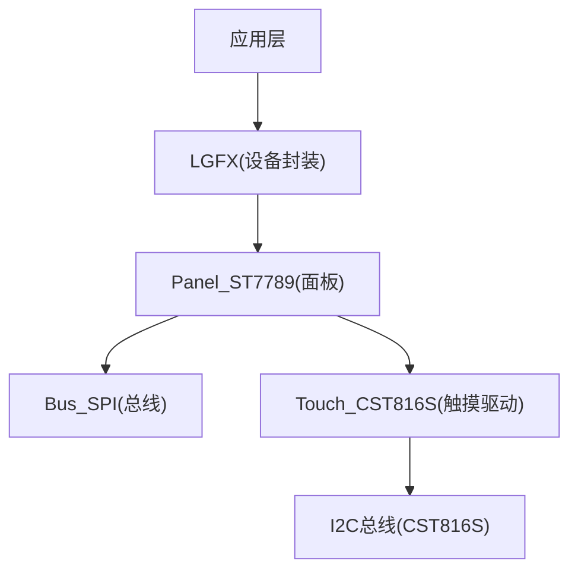
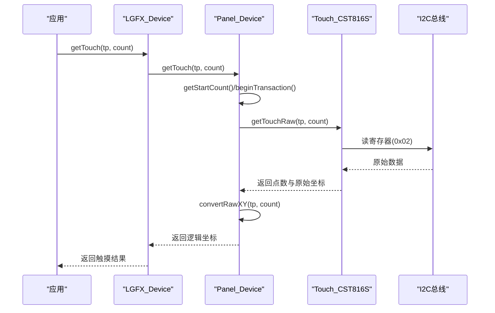
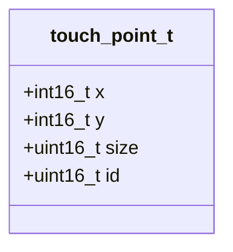
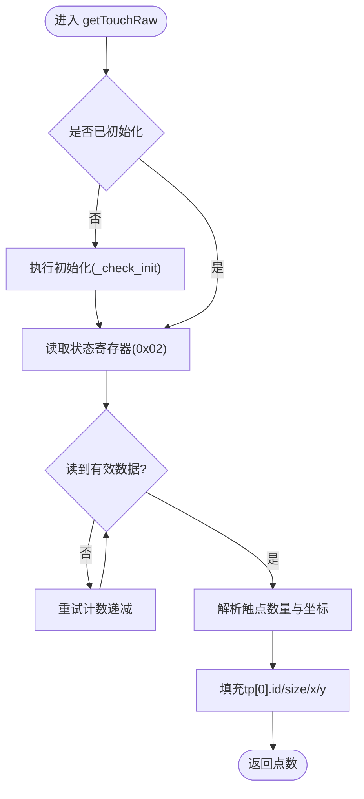
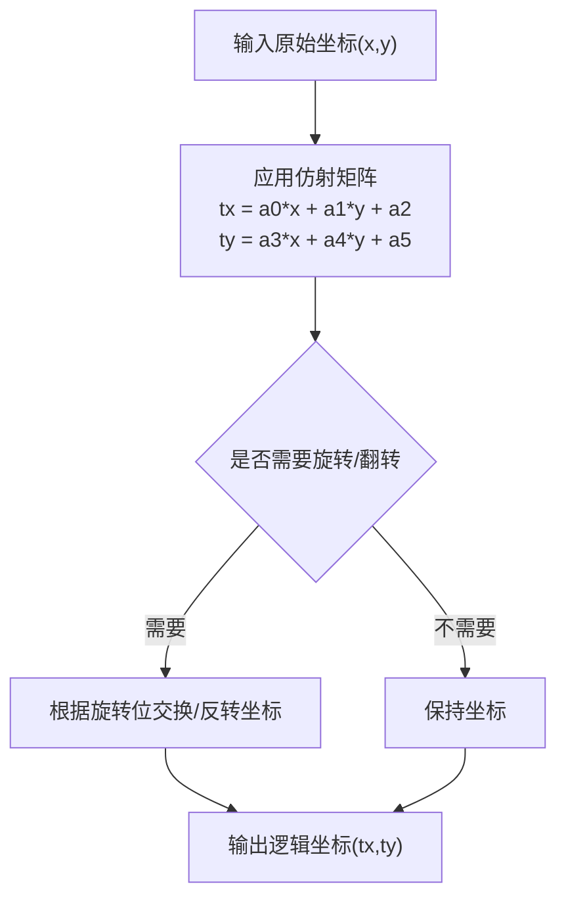
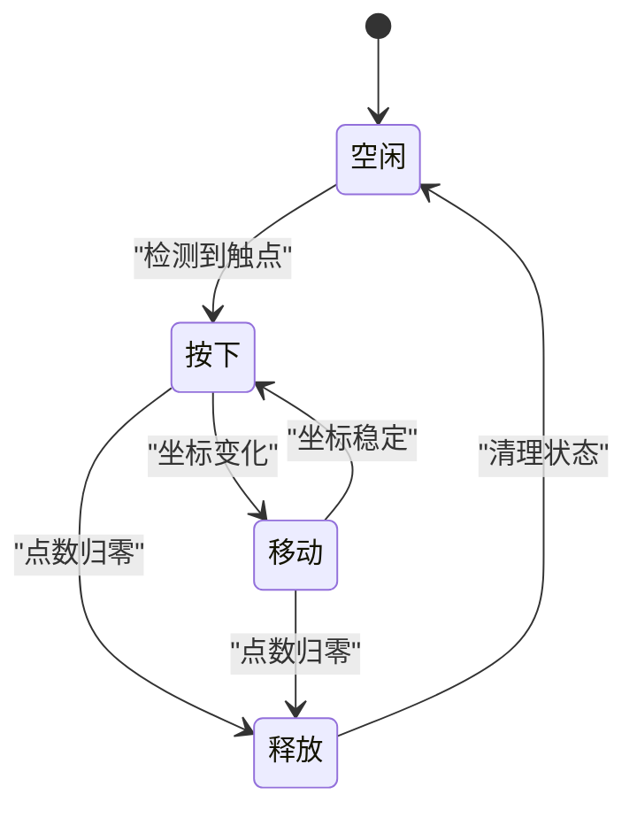
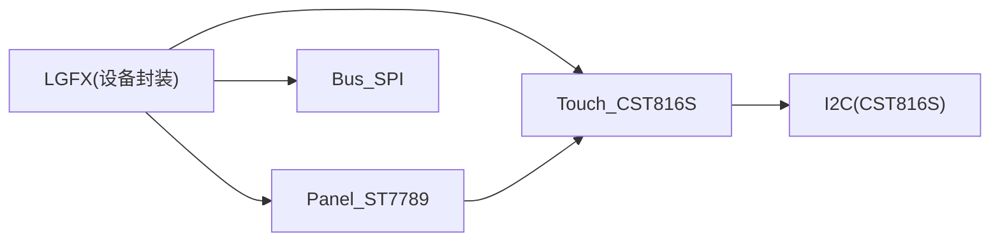

# 触摸输入处理

<cite>
**本文引用的文件**   
- [include/lgfx.h](file://include/lgfx.h)
- [lib/LovyanGFX/src/lgfx/v1/Touch.hpp](file://lib/LovyanGFX/src/lgfx/v1/Touch.hpp)
- [lib/LovyanGFX/src/lgfx/v1/touch/Touch_CST816S.hpp](file://lib/LovyanGFX/src/lgfx/v1/touch/Touch_CST816S.hpp)
- [lib/LovyanGFX/src/lgfx/v1/touch/Touch_CST816S.cpp](file://lib/LovyanGFX/src/lgfx/v1/touch/Touch_CST816S.cpp)
- [lib/LovyanGFX/src/lgfx/v1/panel/Panel_Device.cpp](file://lib/LovyanGFX/src/lgfx/v1/panel/Panel_Device.cpp)
- [lib/LovyanGFX/src/lgfx/v0/LGFX_Device.hpp](file://lib/LovyanGFX/src/lgfx/v0/LGFX_Device.hpp)
</cite>

## 目录
1. [简介](#简介)
2. [项目结构](#项目结构)
3. [核心组件](#核心组件)
4. [架构总览](#架构总览)
5. [详细组件分析](#详细组件分析)
6. [依赖关系分析](#依赖关系分析)
7. [性能与灵敏度配置](#性能与灵敏度配置)
8. [故障排查指南](#故障排查指南)
9. [结论](#结论)

## 简介
本文件面向 LovyanGFX 在 ESP32 平台上的触摸输入处理，系统性说明：
- 触摸检测机制（单点与多点）
- 坐标转换算法（从屏幕像素到应用逻辑坐标）
- 触摸事件生命周期（开始、移动、释放）
- 去抖与误触过滤策略
- 灵敏度配置与自定义手势识别方法
- 触摸事件的优先级与与其他输入的冲突解决

本项目通过 LGFX 类组合面板、总线、背光与触摸驱动，使用 CST816S 作为触摸控制器，借助 LovyanGFX 的抽象层完成原始坐标到逻辑坐标的转换。

## 项目结构
- 顶层包含头文件定义 LCD 与触摸引脚、I2C 地址、屏幕尺寸，并构建 LGFX 设备对象，将触摸实例挂载到面板上。
- LovyanGFX 库提供触摸抽象接口 ITouch、触摸点数据结构 touch_point_t，以及面板层的坐标转换与事务管理。
- 具体触摸驱动 Touch_CST816S 实现 I2C 通信、中断轮询、原始数据读取与点数解析。

图表来源
- [include/lgfx.h:34-114](file://include/lgfx.h#L34-L114)
- [lib/LovyanGFX/src/lgfx/v1/panel/Panel_Device.cpp:434-474](file://lib/LovyanGFX/src/lgfx/v1/panel/Panel_Device.cpp#L434-L474)
- [lib/LovyanGFX/src/lgfx/v1/touch/Touch_CST816S.cpp:99-173](file://lib/LovyanGFX/src/lgfx/v1/touch/Touch_CST816S.cpp#L99-L173)

章节来源
- [include/lgfx.h:1-118](file://include/lgfx.h#L1-L118)

## 核心组件
- LGFX 设备封装：负责初始化 SPI 总线、ST7789 面板、PWM 背光（可选）、CST816S 触摸驱动，并将触摸实例设置到面板。
- 触摸抽象与数据结构：ITouch 接口与 touch_point_t 结构体，统一多触控点的数据格式。
- 触摸驱动 Touch_CST816S：实现 I2C 读写、INT 引脚轮询、原始坐标解析、基础去抖与重试。
- 面板层坐标转换：根据旋转、翻转与仿射矩阵将原始坐标映射为逻辑坐标。

章节来源
- [include/lgfx.h:34-114](file://include/lgfx.h#L34-L114)
- [lib/LovyanGFX/src/lgfx/v1/Touch.hpp:29-35](file://lib/LovyanGFX/src/lgfx/v1/Touch.hpp#L29-L35)
- [lib/LovyanGFX/src/lgfx/v1/touch/Touch_CST816S.hpp:28-70](file://lib/LovyanGFX/src/lgfx/v1/touch/Touch_CST816S.hpp#L28-L70)
- [lib/LovyanGFX/src/lgfx/v1/panel/Panel_Device.cpp:434-474](file://lib/LovyanGFX/src/lgfx/v1/panel/Panel_Device.cpp#L434-L474)

## 架构总览
LovyanGFX 的触摸管线如下：
- 应用调用 getTouch/getTouchRaw 获取触摸点。
- 面板层先通过 _touch->getTouchRaw 读取原始数据，再执行 convertRawXY 进行坐标变换。
- 触摸驱动内部对 I2C 访问做重试与 INT 轮询，返回有效点数与坐标。

图表来源
- [lib/LovyanGFX/src/lgfx/v1/panel/Panel_Device.cpp:458-474](file://lib/LovyanGFX/src/lgfx/v1/panel/Panel_Device.cpp#L458-L474)
- [lib/LovyanGFX/src/lgfx/v1/touch/Touch_CST816S.cpp:127-173](file://lib/LovyanGFX/src/lgfx/v1/touch/Touch_CST816S.cpp#L127-L173)

## 详细组件分析

### 触摸数据结构与多点支持
- touch_point_t 包含 x、y、size、id，用于描述每个触摸点的坐标、接触面积与多点 ID。
- 当前 Touch_CST816S 驱动中 max_touch_points=1，仅支持单点；但接口层面允许多点数组，便于扩展。

图表来源
- [lib/LovyanGFX/src/lgfx/v1/Touch.hpp:29-35](file://lib/LovyanGFX/src/lgfx/v1/Touch.hpp#L29-L35)

章节来源
- [lib/LovyanGFX/src/lgfx/v1/Touch.hpp:29-35](file://lib/LovyanGFX/src/lgfx/v1/Touch.hpp#L29-L35)
- [lib/LovyanGFX/src/lgfx/v1/touch/Touch_CST816S.hpp:57-70](file://lib/LovyanGFX/src/lgfx/v1/touch/Touch_CST816S.hpp#L57-L70)

### 触摸驱动 Touch_CST816S
- 初始化流程：复位引脚、配置 INT 为上拉、初始化 I2C、写入芯片相关寄存器以启用变化触发中断与 INT 低脉冲长度。
- 数据读取：优先通过 I2C 读取状态寄存器判断是否有触摸；若未检测到则进入等待周期以减少总线压力。
- 原始坐标解析：从寄存器拼装 x/y 坐标，填充 tp[0] 的 id、size 与坐标。
- 去抖与重试：对 I2C 无响应或异常状态进行重试；基于时间差与 INT 电平进行快速返回，避免频繁轮询。

图表来源
- [lib/LovyanGFX/src/lgfx/v1/touch/Touch_CST816S.cpp:53-70](file://lib/LovyanGFX/src/lgfx/v1/touch/Touch_CST816S.cpp#L53-L70)
- [lib/LovyanGFX/src/lgfx/v1/touch/Touch_CST816S.cpp:99-173](file://lib/LovyanGFX/src/lgfx/v1/touch/Touch_CST816S.cpp#L99-L173)

章节来源
- [lib/LovyanGFX/src/lgfx/v1/touch/Touch_CST816S.cpp:53-70](file://lib/LovyanGFX/src/lgfx/v1/touch/Touch_CST816S.cpp#L53-L70)
- [lib/LovyanGFX/src/lgfx/v1/touch/Touch_CST816S.cpp:99-173](file://lib/LovyanGFX/src/lgfx/v1/touch/Touch_CST816S.cpp#L99-L173)

### 坐标转换算法（原始坐标→逻辑坐标）
- 面板层维护仿射矩阵 _affine，由校准过程计算得到，用于将原始坐标线性变换到屏幕逻辑坐标。
- convertRawXY 会考虑旋转与垂直翻转标志，按位掩码决定交换轴、反转 X/Y。
- getTouch 先调用 getTouchRaw 获取原始坐标，再统一转换为逻辑坐标返回。

图表来源
- [lib/LovyanGFX/src/lgfx/v1/panel/Panel_Device.cpp:404-456](file://lib/LovyanGFX/src/lgfx/v1/panel/Panel_Device.cpp#L404-L456)
- [lib/LovyanGFX/src/lgfx/v1/panel/Panel_Device.cpp:469-474](file://lib/LovyanGFX/src/lgfx/v1/panel/Panel_Device.cpp#L469-L474)

章节来源
- [lib/LovyanGFX/src/lgfx/v1/panel/Panel_Device.cpp:404-456](file://lib/LovyanGFX/src/lgfx/v1/panel/Panel_Device.cpp#L404-L456)
- [lib/LovyanGFX/src/lgfx/v1/panel/Panel_Device.cpp:469-474](file://lib/LovyanGFX/src/lgfx/v1/panel/Panel_Device.cpp#L469-L474)

### 触摸事件生命周期管理
- 开始：首次检测到有效触点时，驱动返回点数>0，应用可记录“按下”状态。
- 移动：后续循环中持续读取，若坐标变化且仍有点数，视为“移动”。
- 释放：当点数归零或无效时，视为“抬起”，应用应清理状态机。
- 在 v0 版本 LGFX_Device 中提供了内置校准流程，包含多次采样与去抖阈值，可用于辅助理解事件稳定性。

图表来源
- [lib/LovyanGFX/src/lgfx/v0/LGFX_Device.hpp:578-610](file://lib/LovyanGFX/src/lgfx/v0/LGFX_Device.hpp#L578-L610)

章节来源
- [lib/LovyanGFX/src/lgfx/v0/LGFX_Device.hpp:578-610](file://lib/LovyanGFX/src/lgfx/v0/LGFX_Device.hpp#L578-L610)

### 触摸去抖与误触过滤
- 驱动侧：
  - 基于时间差与 INT 电平的快速返回，减少无效 I2C 访问。
  - 对 I2C 无响应或异常状态进行有限次重试，避免误判。
  - 设置 wait_cycle 在无触摸时降低轮询频率。
- 应用侧建议：
  - 对连续 N 帧坐标变化小于阈值才判定为移动，抑制抖动。
  - 对短时间内的重复点击进行合并或忽略，防止误触。
  - 结合 size 字段（接触面积）过滤微小噪声点。

章节来源
- [lib/LovyanGFX/src/lgfx/v1/touch/Touch_CST816S.cpp:133-173](file://lib/LovyanGFX/src/lgfx/v1/touch/Touch_CST816S.cpp#L133-L173)

### 灵敏度配置与校准
- 硬件与驱动配置：
  - include/lgfx.h 中设置触摸 I2C 端口、地址、引脚、时钟频率等。
  - Touch_CST816S 默认 x_min/x_max/y_min/y_max 范围可在驱动构造器中调整。
- 校准流程：
  - v0 版本的 LGFX_Device 提供 set_touch_calibrate 与内置校准交互，采集四角点并计算仿射矩阵参数。
  - 建议在产品出厂或用户校准场景下运行，以获得更精确的坐标映射。

章节来源
- [include/lgfx.h:90-110](file://include/lgfx.h#L90-L110)
- [lib/LovyanGFX/src/lgfx/v1/touch/Touch_CST816S.hpp:41-48](file://lib/LovyanGFX/src/lgfx/v1/touch/Touch_CST816S.hpp#L41-L48)
- [lib/LovyanGFX/src/lgfx/v0/LGFX_Device.hpp:578-615](file://lib/LovyanGFX/src/lgfx/v0/LGFX_Device.hpp#L578-L615)

### 自定义手势识别
- 驱动层枚举了常见手势类型（滑动、单击、双击、长按），但当前 Touch_CST816S 实现主要返回坐标与点数，未直接暴露手势回调。
- 应用层可通过以下规则实现自定义手势：
  - 滑动：在一定时间内沿某方向位移超过阈值。
  - 单击/双击：单位时间内点击次数统计。
  - 长按：触点持续时间超过阈值。
- 注意：由于当前驱动只支持单点，多点手势需扩展驱动或选择支持多点的触摸控制器。

章节来源
- [lib/LovyanGFX/src/lgfx/v1/touch/Touch_CST816S.hpp:30-39](file://lib/LovyanGFX/src/lgfx/v1/touch/Touch_CST816S.hpp#L30-L39)
- [lib/LovyanGFX/src/lgfx/v1/touch/Touch_CST816S.hpp:57-70](file://lib/LovyanGFX/src/lgfx/v1/touch/Touch_CST816S.hpp#L57-L70)

### 触摸事件优先级与冲突解决
- 总线事务：
  - 面板层在读取触摸前检查 beginTransaction/endTransaction，确保与显示总线互斥，避免 I2C/SPI 冲突。
- 触摸与按键：
  - 项目中按键通过 HAL 层独立处理，触摸与按键并行工作，互不干扰。
- 建议：
  - 在高负载渲染期间，适当降低触摸采样频率或采用中断触发方式减少 CPU 占用。
  - 对 UI 层增加输入优先级队列，确保关键操作（如返回、确认）不被触摸延迟阻塞。

章节来源
- [lib/LovyanGFX/src/lgfx/v1/panel/Panel_Device.cpp:458-467](file://lib/LovyanGFX/src/lgfx/v1/panel/Panel_Device.cpp#L458-L467)
- [src/hal/hal_input.cpp:7-59](file://src/hal/hal_input.cpp#L7-L59)

## 依赖关系分析
- LGFX 设备封装依赖：
  - Panel_ST7789：显示面板
  - Bus_SPI：SPI 总线
  - Light_PWM：背光控制（可选）
  - Touch_CST816S：触摸驱动
- LovyanGFX 库依赖：
  - ITouch 接口与 touch_point_t 数据结构
  - Panel_Device 的坐标转换与事务管理

图表来源
- [include/lgfx.h:34-114](file://include/lgfx.h#L34-L114)

章节来源
- [include/lgfx.h:34-114](file://include/lgfx.h#L34-L114)

## 性能与灵敏度配置
- I2C 频率：
  - include/lgfx.h 中设置触摸 I2C 频率为 400kHz，可根据实际硬件与时序要求调整。
- 轮询与等待：
  - Touch_CST816S 在无触摸时设置 wait_cycle，降低轮询频率，节省功耗与总线带宽。
- 去抖阈值：
  - 应用层可依据场景设定坐标变化阈值与时间窗口，平衡灵敏度与稳定性。
- 校准精度：
  - 使用内置校准流程更新仿射矩阵，提高坐标映射准确性。

章节来源
- [include/lgfx.h:90-110](file://include/lgfx.h#L90-L110)
- [lib/LovyanGFX/src/lgfx/v1/touch/Touch_CST816S.cpp:133-173](file://lib/LovyanGFX/src/lgfx/v1/touch/Touch_CST816S.cpp#L133-L173)
- [lib/LovyanGFX/src/lgfx/v0/LGFX_Device.hpp:578-615](file://lib/LovyanGFX/src/lgfx/v0/LGFX_Device.hpp#L578-L615)

## 故障排查指南
- 触摸无响应：
  - 检查 I2C 地址与引脚配置是否正确（include/lgfx.h）。
  - 确认触摸驱动初始化成功（_check_init 与 I2C 初始化）。
- 坐标偏移或不准确：
  - 重新执行校准流程，更新仿射矩阵参数。
  - 检查旋转与翻转配置（offset_rotation）。
- 触摸抖动严重：
  - 增大应用层去抖阈值或缩短时间窗口。
  - 调整 I2C 频率与驱动重试策略。
- 触摸与显示冲突：
  - 确认面板层事务管理正常（beginTransaction/endTransaction）。
  - 在高负载场景降低触摸采样频率。

章节来源
- [include/lgfx.h:90-110](file://include/lgfx.h#L90-L110)
- [lib/LovyanGFX/src/lgfx/v1/touch/Touch_CST816S.cpp:53-70](file://lib/LovyanGFX/src/lgfx/v1/touch/Touch_CST816S.cpp#L53-L70)
- [lib/LovyanGFX/src/lgfx/v1/panel/Panel_Device.cpp:458-474](file://lib/LovyanGFX/src/lgfx/v1/panel/Panel_Device.cpp#L458-L474)

## 结论
本项目通过 LGFX 与 CST816S 驱动实现了稳定的单点触摸输入，具备完整的原始坐标读取、去抖与坐标转换能力。虽然当前驱动限制为单点，但接口设计支持多点扩展。应用层可通过校准、去抖与手势识别进一步提升用户体验。在系统层面，面板层的事务管理与 HAL 层的按键处理确保了触摸与其他输入源的协同工作。