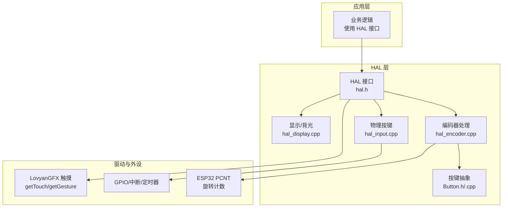
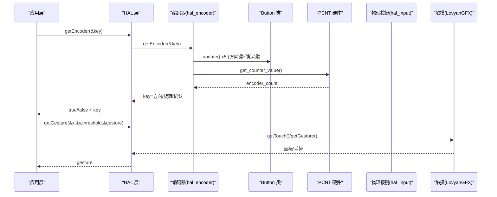
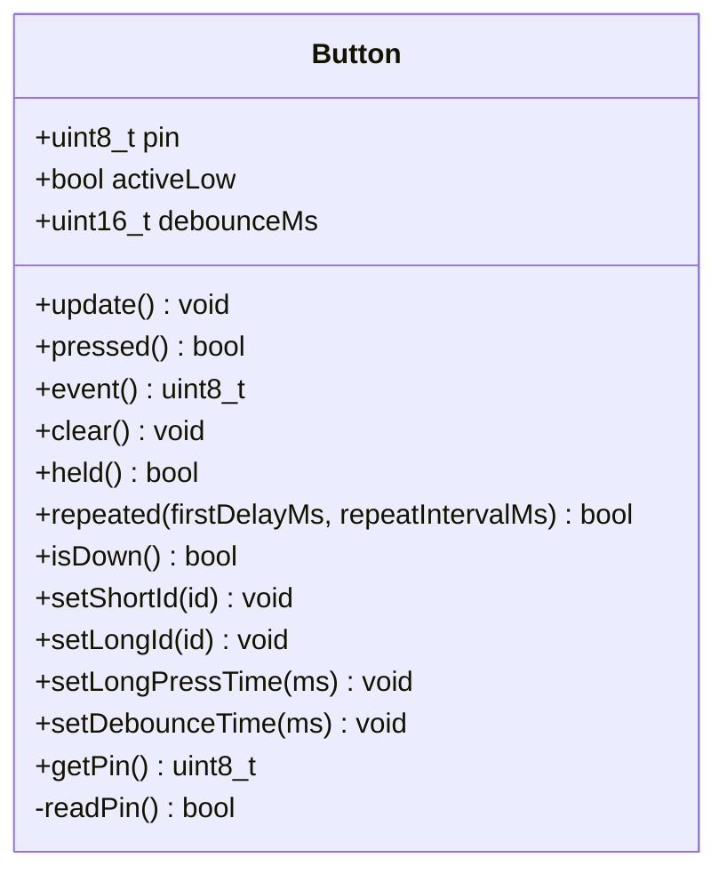
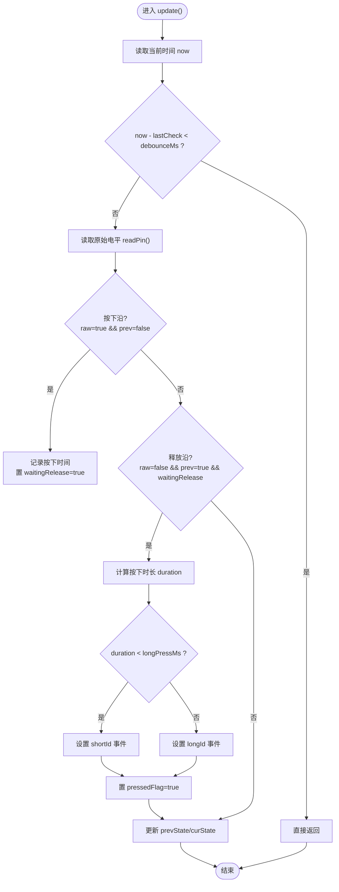
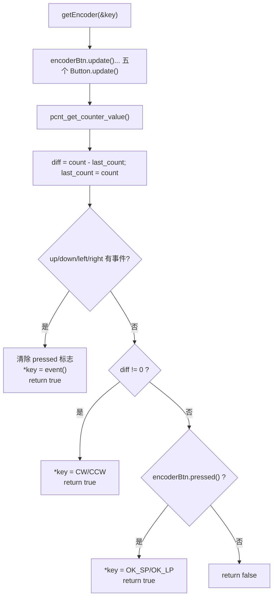
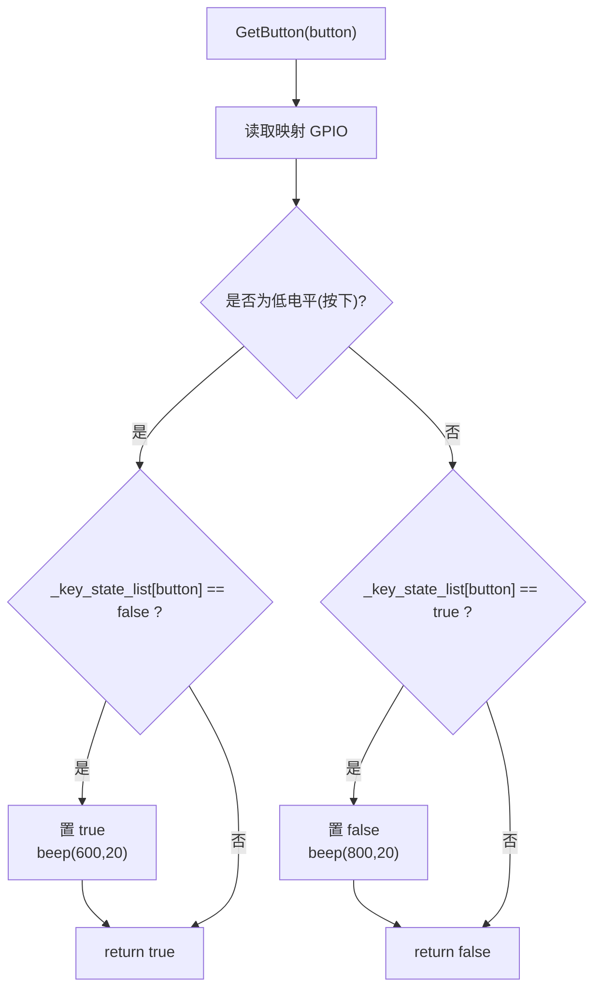
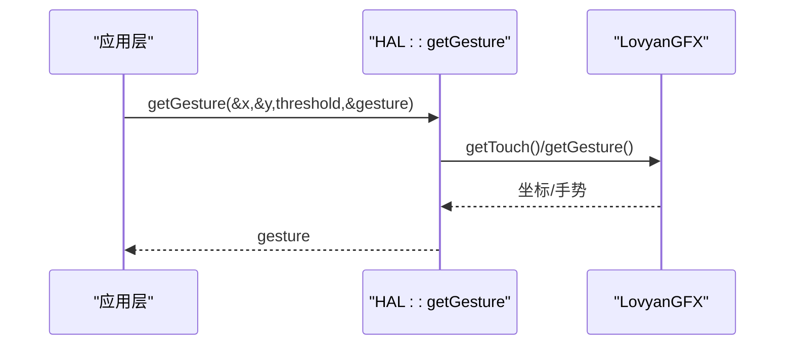
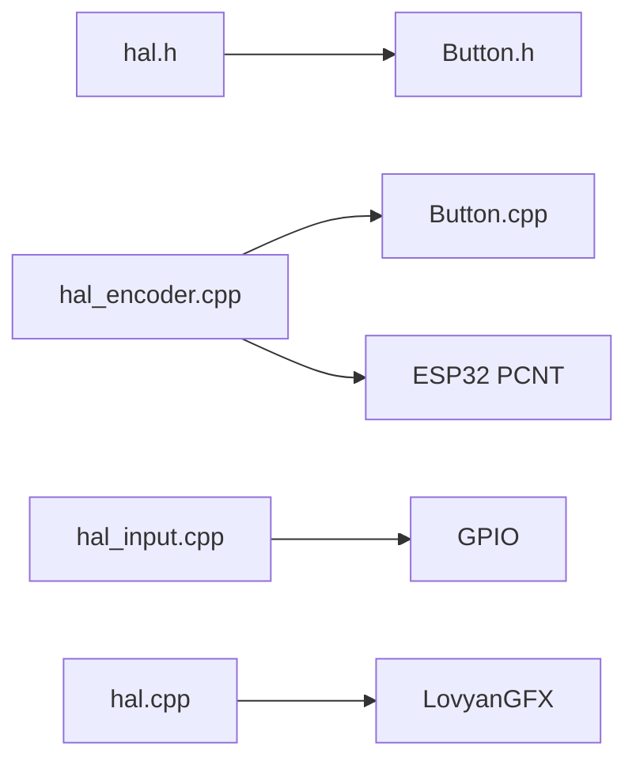

# 输入处理

<cite>
**本文引用的文件**   
- [Button.h](file://src/hal/Button.h)
- [Button.cpp](file://src/hal/Button.cpp)
- [hal_encoder.cpp](file://src/hal/hal_encoder.cpp)
- [hal_input.cpp](file://src/hal/hal_input.cpp)
- [hal.h](file://src/hal/hal.h)
- [hal.cpp](file://src/hal/hal.cpp)
- [hal_display.cpp](file://src/hal/hal_display.cpp)
</cite>

## 目录
1. [简介](#简介)
2. [项目结构](#项目结构)
3. [核心组件](#核心组件)
4. [架构总览](#架构总览)
5. [详细组件分析](#详细组件分析)
6. [依赖关系分析](#依赖关系分析)
7. [性能与实时性](#性能与实时性)
8. [故障排查指南](#故障排查指南)
9. [结论](#结论)
10. [附录：配置与扩展](#附录配置与扩展)

## 简介
本文件为“输入处理系统”的技术文档，覆盖以下能力：
- 触摸输入检测、手势识别与多点触控处理（基于 LovyanGFX/TouchDrvGT9895）
- 编码器输入处理：旋转检测、按键事件（短按/长按）、连发模式
- 物理按键扫描机制与消抖算法
- Button 类设计与使用方法
- 输入事件优先级与冲突解决策略
- 输入设备配置选项与自定义手势定义

## 项目结构
输入相关代码主要位于 src/hal 目录，关键文件如下：
- hal.h：HAL 接口声明、枚举（触摸手势、编码器事件等）
- Button.h/.cpp：非阻塞按键抽象类，实现消抖、短按/长按、按住持续、连发
- hal_encoder.cpp：编码器初始化、PCNT 旋转计数、方向键与确认键统一事件接口
- hal_input.cpp：物理按键映射、GPIO 初始化、按键状态机与蜂鸣反馈
- hal.cpp：系统初始化流程、触摸手势调用入口
- hal_display.cpp：显示与背光初始化（与输入无直接耦合，但影响交互体验）

图表来源
- [hal.h:101-212](file://src/hal/hal.h#L101-L212)
- [hal_encoder.cpp:37-128](file://src/hal/hal_encoder.cpp#L37-L128)
- [hal_input.cpp:7-58](file://src/hal/hal_input.cpp#L7-L58)
- [Button.h:48-182](file://src/hal/Button.h#L48-L182)
- [hal.cpp:4-25](file://src/hal/hal.cpp#L4-L25)

章节来源
- [hal.h:101-212](file://src/hal/hal.h#L101-L212)
- [hal_encoder.cpp:37-128](file://src/hal/hal_encoder.cpp#L37-L128)
- [hal_input.cpp:7-58](file://src/hal/hal_input.cpp#L7-L58)
- [Button.h:48-182](file://src/hal/Button.h#L48-L182)
- [hal.cpp:4-25](file://src/hal/hal.cpp#L4-L25)

## 核心组件
- Button 类：封装单按键的非阻塞扫描、消抖、短按/长按、按住持续、连发；支持高/低电平有效。
- 编码器模块：通过 ESP32 PCNT 硬件计数器实现旋转方向与增量检测；将方向键与确认键统一为 getEncoder() 事件接口。
- 物理按键模块：维护按键映射表与状态数组，提供 GetButton() 去重触发与蜂鸣提示。
- 触摸与手势：通过 LovyanGFX 的 getTouch/getGesture 获取坐标与手势类型，上层可据此实现滑动、轻点、长按等。

章节来源
- [Button.h:48-182](file://src/hal/Button.h#L48-L182)
- [Button.cpp:12-168](file://src/hal/Button.cpp#L12-L168)
- [hal_encoder.cpp:37-128](file://src/hal/hal_encoder.cpp#L37-L128)
- [hal_input.cpp:7-58](file://src/hal/hal_input.cpp#L7-L58)
- [hal.h:66-92](file://src/hal/hal.h#L66-L92)

## 架构总览
输入子系统由三层组成：
- 驱动层：ESP32 PCNT、I2C 触摸驱动（LovyanGFX/TouchDrvGT9895）、GPIO
- HAL 层：统一抽象（Button、编码器、物理按键、触摸手势）
- 应用层：根据事件执行具体逻辑（菜单导航、游戏控制等）

图表来源
- [hal_encoder.cpp:74-128](file://src/hal/hal_encoder.cpp#L74-L128)
- [Button.cpp:28-128](file://src/hal/Button.cpp#L28-L128)
- [hal.h:121-124](file://src/hal/hal.h#L121-L124)

## 详细组件分析

### Button 类设计和使用方法
- 功能要点
  - 非阻塞 update()：在 loop() 或定时器中周期性调用
  - 消抖：内部时间戳判断，避免抖动误触发
  - 短按/长按：释放沿时根据按下时长判定
  - held()：返回当前是否处于“按住未释放”状态
  - repeated(firstDelayMs, repeatIntervalMs)：连发模式（首帧延迟 + 固定间隔）
  - 配置：短按/长按事件 ID、长按阈值、消抖时间、引脚号
- 典型用法
  - 构造时指定引脚与有效电平（默认低电平有效）
  - 设置短按/长按事件 ID 与长按阈值
  - 循环中调用 update()，并检查 pressed()/held()/repeated()

图表来源
- [Button.h:48-182](file://src/hal/Button.h#L48-L182)

章节来源
- [Button.h:48-182](file://src/hal/Button.h#L48-L182)
- [Button.cpp:12-168](file://src/hal/Button.cpp#L12-L168)

#### 按键扫描与消抖流程图

图表来源
- [Button.cpp:28-70](file://src/hal/Button.cpp#L28-L70)

### 编码器输入处理（旋转检测与按键事件）
- 初始化
  - 配置各方向键与确认键的事件 ID 与长按阈值
  - 配置 PCNT 单元：A/B 相接线、正负沿计数、B 相控制方向、限幅、毛刺滤波
  - 启动计数器
- 事件获取
  - 统一接口 getEncoder(&key)：先更新所有 Button 实例，再读取 PCNT 增量
  - 优先级：方向键 > 旋转 > 确认键
  - 返回布尔值表示是否有事件，并通过 out 参数返回事件码

图表来源
- [hal_encoder.cpp:37-128](file://src/hal/hal_encoder.cpp#L37-L128)

章节来源
- [hal_encoder.cpp:37-128](file://src/hal/hal_encoder.cpp#L37-L128)
- [hal.h:77-92](file://src/hal/hal.h#L77-L92)

### 物理按键扫描机制与消抖
- 按键映射
  - 使用 _gamepad_key_map 将逻辑按键（电源、选择、上下左右）映射到具体 GPIO
- GPIO 初始化
  - 全部设置为 INPUT_PULLUP（上拉）
- 状态机
  - _key_state_list 记录每个按键的“已按下”状态
  - GetButton(button)：
    - 若检测到按下且之前未按下：置位状态、蜂鸣提示、返回 true
    - 若检测到释放且之前已按下：清状态、蜂鸣提示
    - 否则返回 false
- 说明
  - 该函数本身不包含软件消抖延时，实际消抖通常在上层以固定频率轮询或使用硬件消抖

图表来源
- [hal_input.cpp:7-58](file://src/hal/hal_input.cpp#L7-L58)

章节来源
- [hal_input.cpp:7-58](file://src/hal/hal_input.cpp#L7-L58)

### 触摸输入检测、手势识别与多点触控
- 触摸数据获取
  - LovyanGFX 提供 getTouch/getTouchRaw 获取触点坐标，支持多触点
  - 坐标转换 convertRawXY 考虑屏幕旋转与偏移
- 手势识别
  - HAL 暴露 getGesture(x,y,threshold,gesture) 接口
  - TouchGesture 枚举包含轻点、长按、四向滑动等
- 上层使用
  - isSwipeOut() 示例：调用 getGesture 并判断 GESTURE_SWIPE_LEFT

图表来源
- [hal.h:66-75](file://src/hal/hal.h#L66-L75)
- [hal.h:121-124](file://src/hal/hal.h#L121-L124)
- [hal.cpp:35-54](file://src/hal/hal.cpp#L35-L54)

章节来源
- [hal.h:66-75](file://src/hal/hal.h#L66-L75)
- [hal.h:121-124](file://src/hal/hal.h#L121-L124)
- [hal.cpp:35-54](file://src/hal/hal.cpp#L35-L54)

## 依赖关系分析
- 组件耦合
  - hal_encoder.cpp 依赖 Button 类与 PCNT 硬件
  - hal_input.cpp 依赖 GPIO 与蜂鸣器
  - hal.cpp 依赖 LovyanGFX 触摸接口
- 外部依赖
  - LovyanGFX：触摸驱动与坐标转换
  - ESP32 PCNT：旋转编码器硬件计数
  - Preferences：保存背光亮度等配置（间接影响交互）

图表来源
- [hal.h:101-212](file://src/hal/hal.h#L101-L212)
- [hal_encoder.cpp:1-128](file://src/hal/hal_encoder.cpp#L1-L128)
- [hal_input.cpp:1-58](file://src/hal/hal_input.cpp#L1-L58)
- [hal.cpp:1-72](file://src/hal/hal.cpp#L1-L72)

章节来源
- [hal.h:101-212](file://src/hal/hal.h#L101-L212)
- [hal_encoder.cpp:1-128](file://src/hal/hal_encoder.cpp#L1-L128)
- [hal_input.cpp:1-58](file://src/hal/hal_input.cpp#L1-L58)
- [hal.cpp:1-72](file://src/hal/hal.cpp#L1-L72)

## 性能与实时性
- 非阻塞设计
  - Button::update() 基于时间戳判断，避免阻塞
  - 编码器事件统一在 getEncoder() 中一次性处理，减少分支开销
- 硬件辅助
  - PCNT 硬件计数降低 CPU 负担，提高旋转检测精度
  - 毛刺滤波参数可调，平衡抗干扰与响应速度
- 建议
  - 合理设置消抖时间与长按阈值，避免误触发
  - 在高刷新率场景下，确保 getEncoder()/getGesture() 调用频率稳定

[本节为通用指导，不直接分析具体文件]

## 故障排查指南
- 按键无响应或误触发
  - 检查引脚配置与有效电平（activeLow）
  - 调整消抖时间 setDebounceTime()
  - 确认物理按键为上拉或下拉正确
- 编码器旋转异常
  - 检查 A/B 相接线与 PCNT 配置
  - 调整毛刺滤波值 pcnt_set_filter_value()
  - 验证方向键事件优先级是否符合预期
- 触摸手势不灵敏
  - 检查 getGesture 阈值参数
  - 确认屏幕旋转与坐标转换正常
- 蜂鸣提示异常
  - 检查 beep() 调用路径与音量/频率参数

章节来源
- [Button.cpp:28-128](file://src/hal/Button.cpp#L28-L128)
- [hal_encoder.cpp:37-128](file://src/hal/hal_encoder.cpp#L37-L128)
- [hal_input.cpp:26-58](file://src/hal/hal_input.cpp#L26-L58)
- [hal.cpp:35-54](file://src/hal/hal.cpp#L35-L54)

## 结论
本输入处理系统通过 Button 类与 PCNT 硬件实现了可靠的按键与编码器输入，结合 LovyanGFX 触摸接口提供了手势识别能力。系统采用非阻塞设计、明确的优先级策略与可扩展的配置项，便于在不同应用场景中复用与定制。

[本节为总结性内容，不直接分析具体文件]

## 附录：配置与扩展
- 输入设备配置
  - 物理按键映射：修改 _gamepad_key_map 与 HAL_PIN_* 宏
  - 编码器参数：PCNT 单位、通道、滤波值、计数限幅
  - 触摸手势阈值：getGesture 的 threshold 参数
- 自定义手势定义
  - 在 TouchGesture 枚举中添加新手势
  - 在 getGesture 实现中解析底层手势并映射为新枚举值
- 事件优先级与冲突解决
  - 在 getEncoder() 中调整方向键、旋转、确认键的判断顺序
  - 对同时发生的多个事件，优先输出方向键，其次旋转，最后确认键

章节来源
- [hal.h:66-92](file://src/hal/hal.h#L66-L92)
- [hal_encoder.cpp:37-128](file://src/hal/hal_encoder.cpp#L37-L128)
- [hal_input.cpp:7-24](file://src/hal/hal_input.cpp#L7-L24)