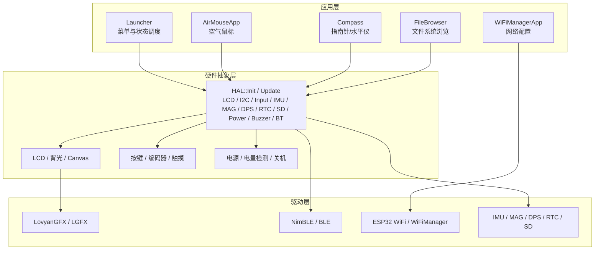
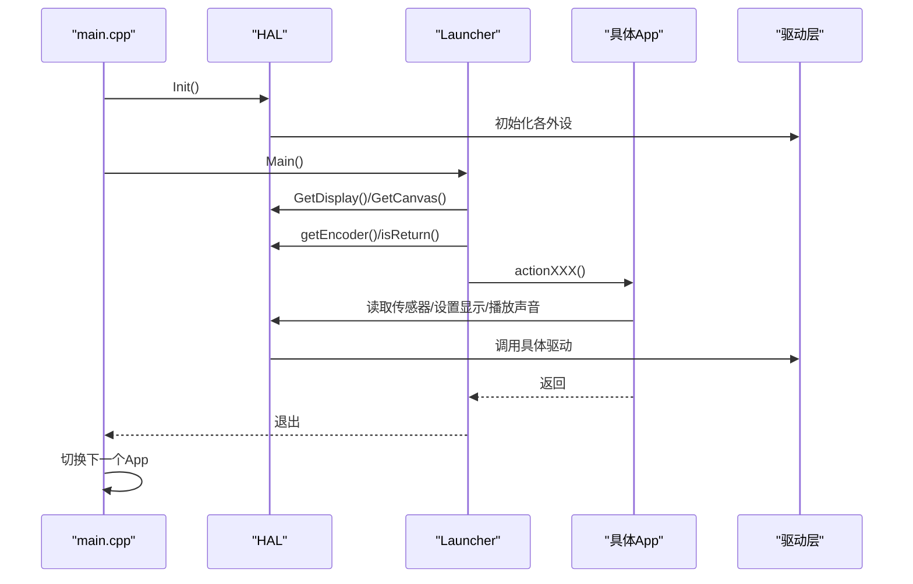
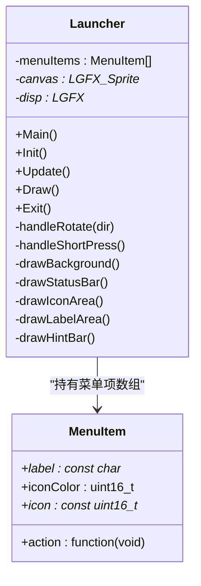
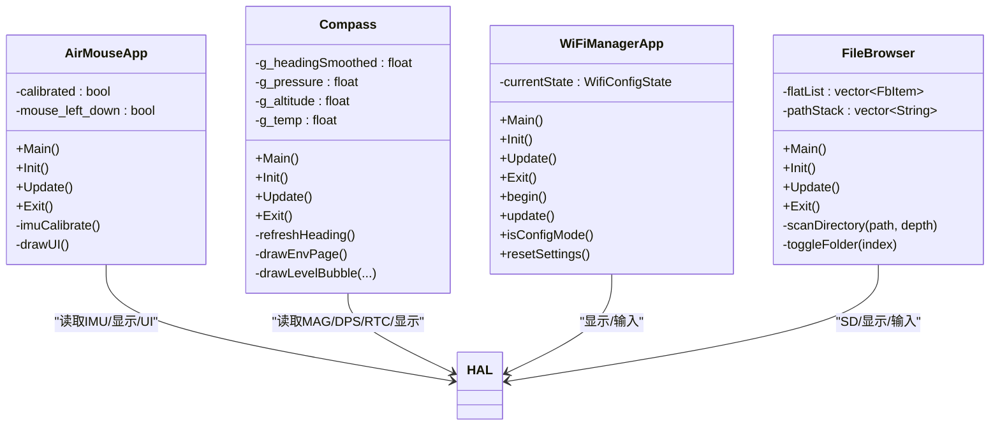
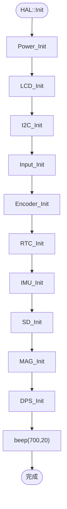
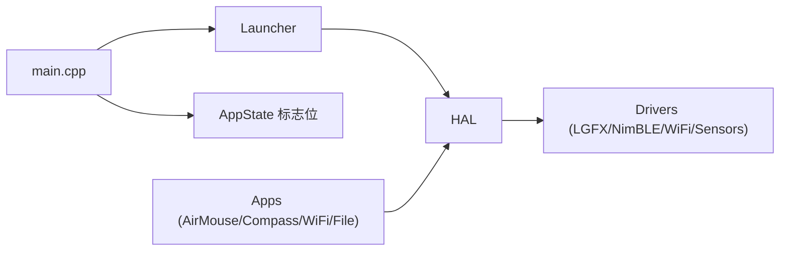

# 分层架构设计

<cite>
**本文引用的文件**   
- [main.cpp](file://src/main.cpp)
- [launcher.h](file://src/launcher.h)
- [launcher.cpp](file://src/launcher.cpp)
- [app_state.h](file://src/app_state.h)
- [app_state.cpp](file://src/app_state.cpp)
- [hal.h](file://src/hal/hal.h)
- [hal.cpp](file://src/hal/hal.cpp)
- [hal_display.cpp](file://src/hal/hal_display.cpp)
- [hal_input.cpp](file://src/hal/hal_input.cpp)
- [hal_power.cpp](file://src/hal/hal_power.cpp)
- [AirMouse.h](file://src/apps/AirMouse.h)
- [Compass.h](file://src/apps/Compass.h)
- [WiFiManagerApp.h](file://src/apps/WiFiManagerApp.h)
- [FileBrowser.h](file://src/apps/FileBrowser.h)
</cite>

## 目录
1. [引言](#引言)
2. [项目结构](#项目结构)
3. [核心组件](#核心组件)
4. [架构总览](#架构总览)
5. [详细组件分析](#详细组件分析)
6. [依赖关系分析](#依赖关系分析)
7. [性能与资源考虑](#性能与资源考虑)
8. [故障排查指南](#故障排查指南)
9. [结论](#结论)
10. [附录：层间调用示例路径](#附录层间调用示例路径)

## 引言
本文件面向 ESP32 NullPod 固件的分层架构，系统性说明应用层（Applications）、硬件抽象层（HAL）与驱动层（Drivers）的职责边界、依赖关系与通信机制。重点解释数据在各层之间的流向和处理过程，阐述采用分层设计的动机与收益（可维护性、可测试性、可扩展性），并通过架构图和代码级调用序列展示层间交互模式。

## 项目结构
项目采用“应用 + HAL + 驱动”的三层组织方式：
- 应用层位于 src/apps，包含具体业务功能（如空气鼠标、指南针、WiFi 管理、文件浏览器等）。
- 硬件抽象层位于 src/hal，统一封装显示、输入、传感器、电源、I2C、RTC、SD 等能力。
- 驱动层由第三方库与底层外设驱动组成，被 HAL 聚合使用（例如 LovyanGFX、NimBLE、WiFiManager、各类传感器库）。

图示来源
- [launcher.h:85-148](file://src/launcher.h#L85-L148)
- [hal.h:101-212](file://src/hal/hal.h#L101-L212)
- [hal_display.cpp:18-52](file://src/hal/hal_display.cpp#L18-L52)
- [hal_input.cpp:7-24](file://src/hal/hal_input.cpp#L7-L24)
- [hal_power.cpp:9-38](file://src/hal/hal_power.cpp#L9-L38)

章节来源
- [main.cpp:19-24](file://src/main.cpp#L19-L24)
- [launcher.h:85-148](file://src/launcher.h#L85-L148)
- [hal.h:101-212](file://src/hal/hal.h#L101-L212)

## 核心组件
- 启动与主循环
  - main.cpp 负责初始化 HAL，并进入 Launcher 的主流程；随后在 loop() 中根据全局请求标志切换不同 App。
- 应用启动器（Launcher）
  - 提供菜单 UI、图标滚动、状态栏绘制、长按关机逻辑，并通过回调触发各 App 入口。
- 应用状态机（AppState）
  - 以 volatile 全局标志位实现跨层异步请求，避免直接耦合。
- 硬件抽象层（HAL）
  - 统一对外暴露 LCD、I2C、Touch、Button、IMU、MAG、DPS、RTC、SD、Power、Buzzer、BT 等接口，屏蔽底层差异。
- 典型应用
  - AirMouseApp、Compass、WiFiManagerApp、FileBrowser 等，均通过 HAL 获取输入、显示、传感器与系统能力。

章节来源
- [main.cpp:19-24](file://src/main.cpp#L19-L24)
- [launcher.cpp:57-79](file://src/launcher.cpp#L57-L79)
- [app_state.h:4-21](file://src/app_state.h#L4-L21)
- [app_state.cpp:21-36](file://src/app_state.cpp#L21-L36)
- [hal.h:101-212](file://src/hal/hal.h#L101-L212)

## 架构总览
分层职责与边界：
- 应用层（Applications）
  - 关注业务逻辑与 UI 呈现，不直接操作寄存器或第三方库细节。
  - 通过 HAL 提供的稳定接口访问硬件能力。
- 硬件抽象层（HAL）
  - 聚合驱动层能力，向上提供稳定的 API；向下屏蔽驱动差异。
  - 负责设备初始化顺序、资源分配、错误处理与日志输出。
- 驱动层（Drivers）
  - 第三方库与底层驱动，负责具体协议与时序（如 I2C、SPI、BLE、WiFi、传感器驱动）。

数据流与控制流：
- 控制流：main -> HAL::Init -> Launcher.Main -> App.Main -> HAL 能力调用。
- 数据流：传感器/输入 -> HAL -> App 计算/渲染 -> HAL 显示输出。
- 跨层通信：通过函数调用与全局请求标志（volatile bool）进行解耦。

图示来源
- [main.cpp:19-24](file://src/main.cpp#L19-L24)
- [launcher.cpp:45-50](file://src/launcher.cpp#L45-L50)
- [launcher.cpp:82-107](file://src/launcher.cpp#L82-L107)
- [hal_display.cpp:44-52](file://src/hal/hal_display.cpp#L44-L52)
- [hal_input.cpp:50-58](file://src/hal/hal_input.cpp#L50-L58)

## 详细组件分析

### 应用层：Launcher（菜单与状态调度）
- 职责
  - 构建菜单项、处理旋转与短按、平滑滚动、状态栏绘制、长按关机。
  - 通过回调将用户选择转换为 App 请求，交由 main.cpp 的状态机执行。
- 关键行为
  - 从 HAL 获取显示与画布对象，用于 UI 绘制。
  - 读取编码器事件，更新选中项与滚动偏移。
  - 长按电源键触发关机流程（蜂鸣、清屏、关闭背光、调用 HAL::PowerOff）。
- 层间调用
  - 调用 HAL::GetDisplay()/GetCanvas() 获取绘图上下文。
  - 调用 HAL::getEncoder()/beep()/Backlight_Off()/PowerOff() 完成输入与电源控制。
  - 通过 App_RequestXXX() 设置全局请求标志，通知 main.cpp 切换 App。

图示来源
- [launcher.h:85-148](file://src/launcher.h#L85-L148)
- [launcher.cpp:28-50](file://src/launcher.cpp#L28-L50)

章节来源
- [launcher.h:85-148](file://src/launcher.h#L85-L148)
- [launcher.cpp:57-79](file://src/launcher.cpp#L57-L79)
- [launcher.cpp:82-107](file://src/launcher.cpp#L82-L107)
- [launcher.cpp:109-155](file://src/launcher.cpp#L109-L155)
- [launcher.cpp:230-238](file://src/launcher.cpp#L230-L238)
- [launcher.cpp:331-368](file://src/launcher.cpp#L331-L368)
- [launcher.cpp:427-443](file://src/launcher.cpp#L427-L443)

### 应用层：典型 App（AirMouse / Compass / WiFiManagerApp / FileBrowser）
- AirMouseApp
  - 通过 HAL 获取 IMU 数据、显示界面、处理校准与鼠标移动。
- Compass
  - 通过 HAL 读取磁力计、气压/温度/海拔、陀螺仪角度，绘制罗盘与环境信息。
- WiFiManagerApp
  - 基于 WiFiManager 库进行网络配置与连接状态管理，结合 HAL 显示状态。
- FileBrowser
  - 通过 HAL 的 SD 能力扫描目录、展平列表、绘制文件树。

图示来源
- [AirMouse.h:8-44](file://src/apps/AirMouse.h#L8-L44)
- [Compass.h:43-128](file://src/apps/Compass.h#L43-L128)
- [WiFiManagerApp.h:20-95](file://src/apps/WiFiManagerApp.h#L20-L95)
- [FileBrowser.h:38-83](file://src/apps/FileBrowser.h#L38-L83)

章节来源
- [AirMouse.h:8-44](file://src/apps/AirMouse.h#L8-L44)
- [Compass.h:43-128](file://src/apps/Compass.h#L43-L128)
- [WiFiManagerApp.h:20-95](file://src/apps/WiFiManagerApp.h#L20-L95)
- [FileBrowser.h:38-83](file://src/apps/FileBrowser.h#L38-L83)

### 硬件抽象层：HAL（统一能力出口）
- 职责
  - 集中初始化所有外设（电源、LCD、I2C、输入、编码器、RTC、IMU、SD、磁力计、气压计、RGB LED、蜂鸣器、蓝牙）。
  - 提供统一的 API 供上层应用调用，屏蔽底层驱动差异。
  - 提供系统级工具（时间获取、内存日志、手势识别等）。
- 关键模块
  - 显示：LCD_Init、GetDisplay、GetCanvas、Backlight_Init、setBrightness、Backlight_Off。
  - 输入：Input_Init、GetButton、isReturn、isEnter、getGesture。
  - 电源：Power_Init、PowerOff、Reboot、getVoltage。
  - 传感器：IMU/MAG/DPS/RTC/SD 的初始化与数据读取。

图示来源
- [hal.cpp:4-25](file://src/hal/hal.cpp#L4-L25)
- [hal_display.cpp:18-42](file://src/hal/hal_display.cpp#L18-L42)
- [hal_input.cpp:7-24](file://src/hal/hal_input.cpp#L7-L24)
- [hal_power.cpp:9-15](file://src/hal/hal_power.cpp#L9-L15)

章节来源
- [hal.h:101-212](file://src/hal/hal.h#L101-L212)
- [hal.cpp:4-33](file://src/hal/hal.cpp#L4-L33)
- [hal_display.cpp:18-52](file://src/hal/hal_display.cpp#L18-L52)
- [hal_input.cpp:7-58](file://src/hal/hal_input.cpp#L7-L58)
- [hal_power.cpp:9-38](file://src/hal/hal_power.cpp#L9-L38)

### 驱动层：第三方库与底层驱动
- LovyanGFX/LGFX：屏幕驱动与图形库，被 HAL 封装为 GetDisplay/GetCanvas。
- NimBLE/BLE：蓝牙能力，HAL 提供 BT_Init/BT_Update。
- WiFiManager/ESP32 WiFi：网络配置与连接，被 WiFiManagerApp 直接使用。
- 传感器驱动：IMU/MAG/DPS/RTC/SD，被 HAL 聚合并提供统一数据接口。

章节来源
- [hal_display.cpp:1-6](file://src/hal/hal_display.cpp#L1-L6)
- [hal.h:202-205](file://src/hal/hal.h#L202-L205)
- [WiFiManagerApp.h:6](file://src/apps/WiFiManagerApp.h#L6)

## 依赖关系分析
- 应用层对 HAL 的依赖是单向且松耦合的：应用只调用 HAL 暴露的 API，不感知底层驱动实现。
- HAL 对驱动层的依赖是聚合式的：HAL 组合多个驱动，向上提供稳定接口。
- main.cpp 作为系统入口，依赖 Launcher 与 AppState 的全局标志位，实现 App 切换。

图示来源
- [main.cpp:19-24](file://src/main.cpp#L19-L24)
- [launcher.h:4-7](file://src/launcher.h#L4-L7)
- [app_state.h:4-21](file://src/app_state.h#L4-L21)
- [hal.h:101-212](file://src/hal/hal.h#L101-L212)

章节来源
- [main.cpp:19-24](file://src/main.cpp#L19-L24)
- [launcher.h:4-7](file://src/launcher.h#L4-L7)
- [app_state.h:4-21](file://src/app_state.h#L4-L21)
- [hal.h:101-212](file://src/hal/hal.h#L101-L212)

## 性能与资源考虑
- 显示刷新策略
  - Launcher 在非滚动时每秒重绘一次状态栏，减少频繁刷新带来的开销。
  - 使用双缓冲（Sprite）提升绘制效率。
- 输入采样与防抖
  - 编码器事件有最小间隔判断，避免重复触发。
  - 长按关机逻辑通过时间阈值与提示进度条提升用户体验。
- 传感器数据节流
  - Compass 对环境数据（气压/海拔/气温）采用定时刷新，降低 I2C 与计算压力。
- 内存与 PSRAM
  - HAL 提供内存日志接口，便于监控堆与 PSRAM 使用情况。

章节来源
- [launcher.cpp:189-195](file://src/launcher.cpp#L189-L195)
- [launcher.cpp:199-228](file://src/launcher.cpp#L199-L228)
- [launcher.cpp:109-155](file://src/launcher.cpp#L109-L155)
- [Compass.h:19-23](file://src/apps/Compass.h#L19-L23)
- [hal.cpp:56-71](file://src/hal/hal.cpp#L56-L71)

## 故障排查指南
- 无法进入菜单或显示异常
  - 检查 HAL::Init 是否成功初始化 LCD 与背光；确认 GetDisplay/GetCanvas 返回值有效。
- 按键无响应
  - 检查 Input_Init 引脚映射与 GPIO 初始化；确认 isReturn/isEnter 返回值。
- 关机无反应
  - 检查长按逻辑与 PowerOff 调用；确认蜂鸣与背光关闭流程。
- 传感器数据异常
  - 检查 IMU/MAG/DPS 初始化与 update 调用；确认数据读取接口返回值。
- WiFi 连接失败
  - 检查 WiFiManagerApp 的连接状态与配置模式；查看串口日志与信号强度显示。

章节来源
- [hal_display.cpp:18-42](file://src/hal/hal_display.cpp#L18-L42)
- [hal_input.cpp:7-58](file://src/hal/hal_input.cpp#L7-L58)
- [launcher.cpp:109-155](file://src/launcher.cpp#L109-L155)
- [hal.h:130-158](file://src/hal/hal.h#L130-L158)
- [WiFiManagerApp.h:51-79](file://src/apps/WiFiManagerApp.h#L51-L79)

## 结论
NullPod 固件采用清晰的分层架构：应用层专注业务与 UI，HAL 统一封装硬件能力，驱动层提供具体实现。该设计显著提升了可维护性（职责分离）、可测试性（HAL 可替换模拟）、可扩展性（新增 App 或传感器只需扩展对应层）。通过全局请求标志与稳定 HAL 接口，系统实现了低耦合、高内聚的模块化结构，便于后续迭代与维护。

## 附录：层间调用示例路径
- 应用请求切换至空气鼠标
  - [launcher.cpp:434](file://src/launcher.cpp#L434) -> [app_state.cpp:27](file://src/app_state.cpp#L27) -> [main.cpp:158-162](file://src/main.cpp#L158-L162) -> [AirMouse.h:10-16](file://src/apps/AirMouse.h#L10-L16)
- 应用请求切换至指南针
  - [launcher.cpp:436](file://src/launcher.cpp#L436) -> [app_state.cpp:29](file://src/app_state.cpp#L29) -> [main.cpp:168-172](file://src/main.cpp#L168-L172) -> [Compass.h:46-49](file://src/apps/Compass.h#L46-L49)
- 应用请求切换至 WiFi 管理
  - [launcher.cpp:441](file://src/launcher.cpp#L441) -> [app_state.cpp:34](file://src/app_state.cpp#L34) -> [main.cpp:193-197](file://src/main.cpp#L193-L197) -> [WiFiManagerApp.h:23-28](file://src/apps/WiFiManagerApp.h#L23-L28)
- 应用请求切换至文件浏览器
  - [launcher.cpp:439](file://src/launcher.cpp#L439) -> [app_state.cpp:32](file://src/app_state.cpp#L32) -> [main.cpp:183-187](file://src/main.cpp#L183-L187) -> [FileBrowser.h:42-47](file://src/apps/FileBrowser.h#L42-L47)
- Launcher 获取显示与画布
  - [launcher.cpp:45-46](file://src/launcher.cpp#L45-L46) -> [hal_display.cpp:44-52](file://src/hal/hal_display.cpp#L44-L52)
- Launcher 读取编码器与按键
  - [launcher.cpp:88-107](file://src/launcher.cpp#L88-L107) -> [hal_input.cpp:50-58](file://src/hal/hal_input.cpp#L50-L58)
- Launcher 长按关机
  - [launcher.cpp:109-155](file://src/launcher.cpp#L109-L155) -> [hal_power.cpp:17-21](file://src/hal/hal_power.cpp#L17-L21)