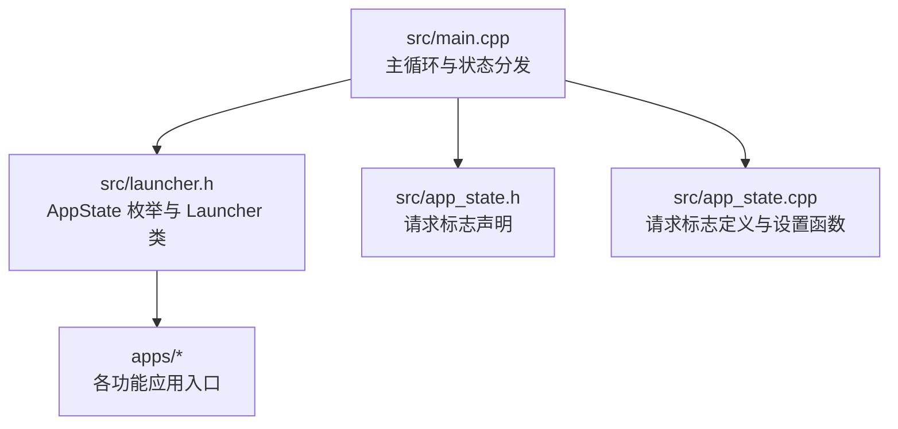
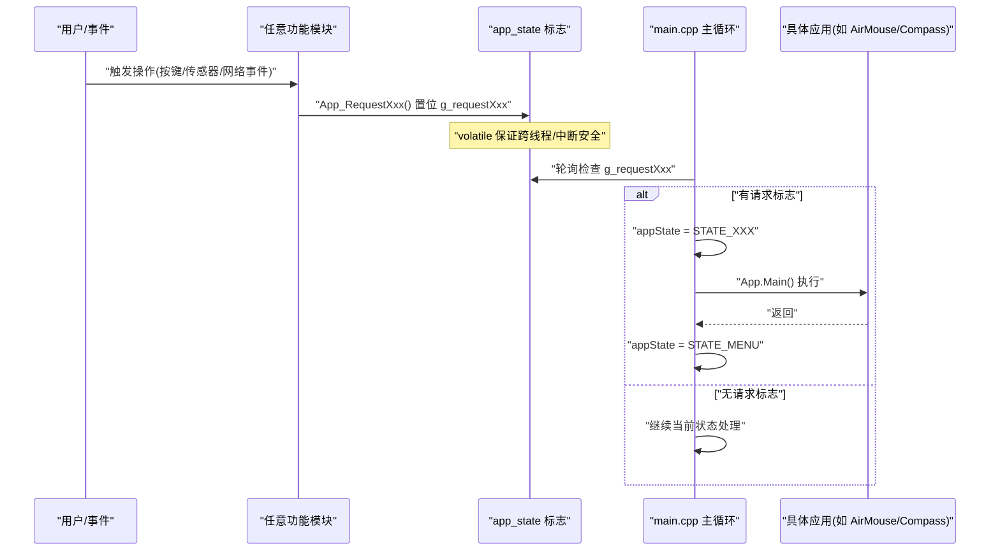
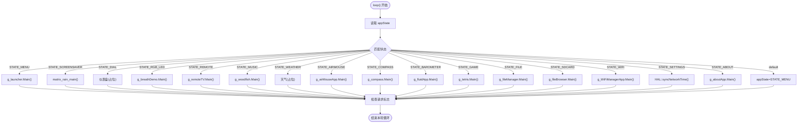
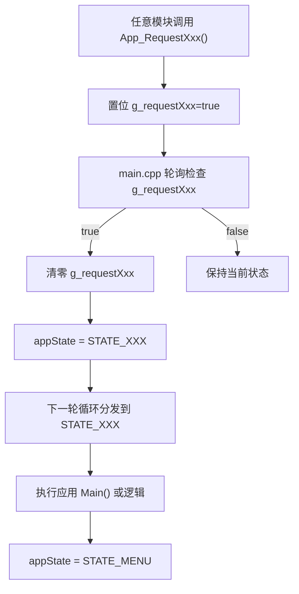
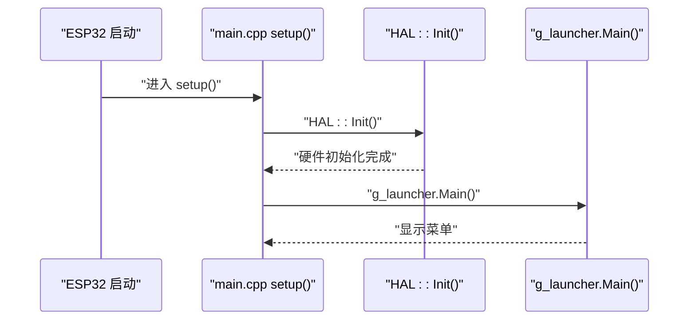
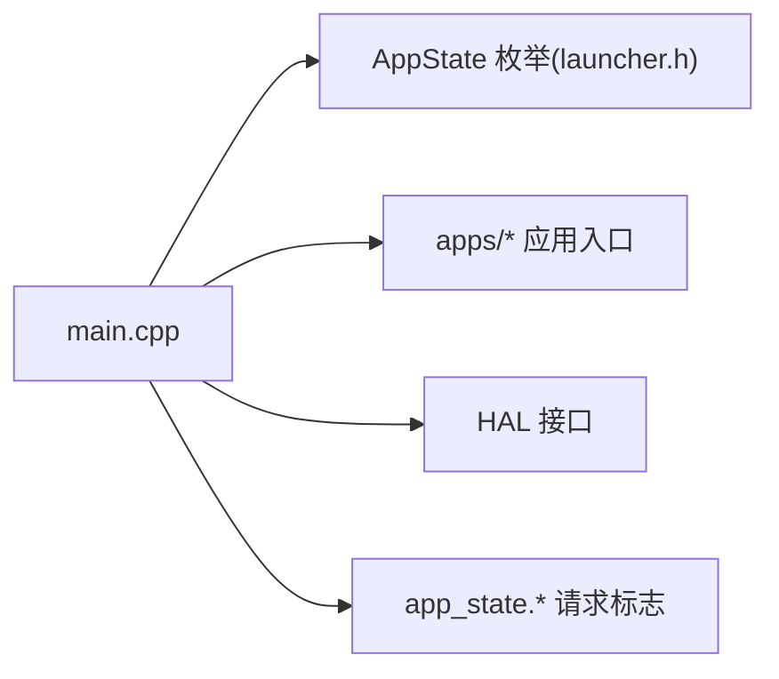

# 状态机模式实现

<cite>
**本文引用的文件**   
- [main.cpp](file://src/main.cpp)
- [app_state.h](file://src/app_state.h)
- [app_state.cpp](file://src/app_state.cpp)
- [launcher.h](file://src/launcher.h)
</cite>

## 目录
1. [简介](#简介)
2. [项目结构](#项目结构)
3. [核心组件](#核心组件)
4. [架构总览](#架构总览)
5. [详细组件分析](#详细组件分析)
6. [依赖关系分析](#依赖关系分析)
7. [性能与可维护性](#性能与可维护性)
8. [故障排查指南](#故障排查指南)
9. [结论](#结论)
10. [附录：添加新状态的步骤与最佳实践](#附录添加新状态的步骤与最佳实践)

## 简介
本文面向 ESP32 NullPod 固件中的“应用状态机”实现，系统性说明 AppState 枚举定义、状态转换逻辑、初始化流程、全局状态变量管理方式，以及典型使用场景。文档同时给出状态转换图与流程图，帮助读者理解状态机模式如何简化复杂的应用生命周期管理，并提供扩展新状态的步骤与最佳实践。

## 项目结构
本项目的状态机相关代码集中在以下文件：
- src/main.cpp：主循环与状态分发（switch-case）
- src/launcher.h：AppState 枚举定义与菜单启动器接口
- src/app_state.h / app_state.cpp：跨模块请求标志与设置函数

图表来源
- [main.cpp:15-126](file://src/main.cpp#L15-L126)
- [launcher.h:45-65](file://src/launcher.h#L45-L65)
- [app_state.h:4-21](file://src/app_state.h#L4-L21)
- [app_state.cpp:3-19](file://src/app_state.cpp#L3-L19)

章节来源
- [main.cpp:15-126](file://src/main.cpp#L15-L126)
- [launcher.h:45-65](file://src/launcher.h#L45-L65)
- [app_state.h:4-21](file://src/app_state.h#L4-L21)
- [app_state.cpp:3-19](file://src/app_state.cpp#L3-L19)

## 核心组件
- AppState 枚举：定义所有应用状态常量，如 STATE_MENU、STATE_SCREENSAVER、STATE_COMPASS、STATE_AIRMOUSE 等，并包含 STATE_COUNT 用于边界统计。
- 全局状态变量 appState：在 main.cpp 中维护当前应用状态，初始化为 STATE_MENU。
- 请求标志与设置函数：通过 volatile bool 标志位（如 g_requestCompass）和 App_Request* 函数，从任意模块触发状态切换。
- 主循环 switch-case：根据 appState 调用对应应用的 Main() 或处理逻辑，并在结束后将 appState 重置为 STATE_MENU。

章节来源
- [launcher.h:45-65](file://src/launcher.h#L45-L65)
- [main.cpp:15-126](file://src/main.cpp#L15-L126)
- [app_state.h:4-21](file://src/app_state.h#L4-L21)
- [app_state.cpp:3-19](file://src/app_state.cpp#L3-L19)

## 架构总览
下图展示状态机的整体交互：上层输入或事件设置请求标志；主循环读取标志并切换到目标状态；目标状态执行后返回菜单。

图表来源
- [app_state.cpp:21-36](file://src/app_state.cpp#L21-L36)
- [main.cpp:128-207](file://src/main.cpp#L128-L207)

## 详细组件分析

### AppState 枚举与应用状态
AppState 枚举定义了系统支持的所有应用状态，包括：
- STATE_MENU：主菜单
- STATE_SCREENSAVER：屏保（矩阵动画）
- STATE_DIAL：仪表盘
- STATE_RGB_LED：RGB LED 呼吸灯
- STATE_REMOTE：红外遥控
- STATE_MUSIC：音乐
- STATE_WEATHER：天气
- STATE_AIRMOUSE：空中鼠标
- STATE_GYROSCOPE：陀螺仪
- STATE_COMPASS：电子罗盘
- STATE_BAROMETER：气压计
- STATE_GAME：游戏
- STATE_FILE：文件管理
- STATE_SDCARD：SD 卡浏览
- STATE_WIFI：WiFi 管理
- STATE_SETTINGS：设置
- STATE_ABOUT：关于
- STATE_COUNT：状态数量（用于边界校验）

该枚举是状态机的“命名空间”，使 switch-case 分支清晰且易于维护。

章节来源
- [launcher.h:45-65](file://src/launcher.h#L45-L65)

### 主循环与状态分发（switch-case）
main.cpp 的 loop() 以 appState 作为分派键，进入对应分支：
- 每个状态分支负责调用相应应用的 Main() 或执行特定逻辑
- 每个状态分支在执行完毕后，将 appState 重置为 STATE_MENU，确保回到菜单
- default 分支兜底，防止非法状态导致死锁

图表来源
- [main.cpp:27-126](file://src/main.cpp#L27-L126)

章节来源
- [main.cpp:27-126](file://src/main.cpp#L27-L126)

### 请求标志与状态切换流程
- 任意模块通过 App_RequestXxx() 设置对应的 volatile bool 标志（如 g_requestCompass）。
- main.cpp 在主循环末尾顺序检查这些标志，若为真则：
  - 清零标志位
  - 设置 appState 为目标状态
- 下一轮循环时，switch-case 将分发到对应状态，执行其 Main() 或逻辑，最后再回到 STATE_MENU

图表来源
- [app_state.cpp:21-36](file://src/app_state.cpp#L21-L36)
- [main.cpp:128-207](file://src/main.cpp#L128-L207)

章节来源
- [app_state.cpp:21-36](file://src/app_state.cpp#L21-L36)
- [main.cpp:128-207](file://src/main.cpp#L128-L207)

### 初始化流程
- setup() 中调用 HAL::Init() 完成硬件初始化
- 随后 Serial 输出就绪信息
- 首次进入菜单：调用 g_launcher.Main()
- appState 初始化为 STATE_MENU

图表来源
- [main.cpp:19-24](file://src/main.cpp#L19-L24)

章节来源
- [main.cpp:19-24](file://src/main.cpp#L19-L24)

### 全局状态变量 appState 的管理
- 定义位置：main.cpp 中 static AppState appState = STATE_MENU;
- 作用域：仅 main.cpp 可见，避免外部直接修改
- 更新路径：
  - 由 main.cpp 自身在 switch-case 分支内设置
  - 由请求标志检查段设置
- 设计要点：
  - 每个状态分支执行完成后统一复位为 STATE_MENU，形成“菜单为中心”的状态机拓扑
  - default 分支兜底，防止非法状态导致程序挂起

章节来源
- [main.cpp:15-16](file://src/main.cpp#L15-L16)
- [main.cpp:27-126](file://src/main.cpp#L27-L126)
- [main.cpp:128-207](file://src/main.cpp#L128-L207)

### 典型使用场景
- 用户按下“罗盘”按钮：
  - 罗盘模块调用 App_RequestCompass()
  - main.cpp 检测到 g_requestCompass，设置 appState = STATE_COMPASS
  - 下一轮循环进入 STATE_COMPASS，调用 g_compass.Main()
  - 罗盘退出后，appState 被重置为 STATE_MENU
- 用户选择“空中鼠标”：
  - 菜单或子系统调用 App_RequestAirMouse()
  - 主循环切换到 STATE_AIRMOUSE，执行 g_airMouseApp.Main()
  - 返回菜单

章节来源
- [app_state.cpp:21-36](file://src/app_state.cpp#L21-L36)
- [main.cpp:69-79](file://src/main.cpp#L69-L79)
- [main.cpp:168-172](file://src/main.cpp#L168-L172)

## 依赖关系分析
- main.cpp 依赖：
  - launcher.h：AppState 枚举与 Launcher 类
  - apps/*：各应用实例与 Main() 方法
  - hal/hal.h：HAL::syncNetworkTime() 等
- app_state.*：提供跨模块的请求标志与设置函数，解耦业务模块与状态机调度
- 耦合度：
  - 状态机与具体应用松耦合：通过枚举与函数指针/对象 Main() 调用
  - 请求标志与状态机松耦合：通过 volatile bool 标志通信

图表来源
- [main.cpp:1-13](file://src/main.cpp#L1-L13)
- [launcher.h:45-65](file://src/launcher.h#L45-L65)
- [app_state.h:4-21](file://src/app_state.h#L4-L21)
- [app_state.cpp:3-19](file://src/app_state.cpp#L3-L19)

章节来源
- [main.cpp:1-13](file://src/main.cpp#L1-L13)
- [launcher.h:45-65](file://src/launcher.h#L45-L65)
- [app_state.h:4-21](file://src/app_state.h#L4-L21)
- [app_state.cpp:3-19](file://src/app_state.cpp#L3-L19)

## 性能与可维护性
- 性能
  - 主循环为简单轮询，开销极低
  - 使用 volatile bool 标志减少锁与同步开销
- 可维护性
  - 新增状态只需：
    - 在 AppState 枚举中添加新值
    - 在 main.cpp 的 switch-case 中添加分支
    - 在 app_state.* 中添加请求标志与设置函数
    - 在菜单或业务模块中调用 App_RequestXxx()
  - 清晰的“菜单为中心”拓扑便于回归测试与调试

[本节为通用指导，不直接分析具体文件]

## 故障排查指南
- 症状：状态无法切换
  - 检查是否调用了 App_RequestXxx()
  - 确认 g_requestXxx 是否被正确置位与清零
  - 查看 main.cpp 中对应分支是否已添加
- 症状：卡在某个状态不返回菜单
  - 检查该状态分支是否在结束时将 appState 重置为 STATE_MENU
  - 检查 default 分支是否存在
- 症状：多任务/中断下状态异常
  - 确认使用 volatile bool 标志
  - 避免在中断中长时间阻塞

章节来源
- [app_state.cpp:3-19](file://src/app_state.cpp#L3-L19)
- [main.cpp:123-126](file://src/main.cpp#L123-L126)
- [main.cpp:128-207](file://src/main.cpp#L128-L207)

## 结论
ESP32 NullPod 采用简洁而稳健的状态机模式：以 AppState 枚举为状态命名空间，以 volatile bool 标志为跨模块通信机制，以 main.cpp 的 switch-case 为核心调度器。该设计将复杂的应用生命周期管理分解为“菜单为中心”的离散状态，显著降低了耦合度与复杂度，便于扩展与维护。

[本节为总结性内容，不直接分析具体文件]

## 附录：添加新状态的步骤与最佳实践

### 步骤清单
1. 在 AppState 枚举中新增状态值（例如 STATE_NEWAPP）
   - 参考位置：[launcher.h:45-65](file://src/launcher.h#L45-L65)
2. 在 app_state.h 中声明新的请求标志（例如 g_requestNewApp）
   - 参考位置：[app_state.h:4-21](file://src/app_state.h#L4-L21)
3. 在 app_state.cpp 中定义并初始化该标志，并新增 App_RequestNewApp() 设置函数
   - 参考位置：[app_state.cpp:3-19](file://src/app_state.cpp#L3-L19), [app_state.cpp:21-36](file://src/app_state.cpp#L21-L36)
4. 在 main.cpp 的 switch-case 中添加 STATE_NEWAPP 分支，调用对应应用的 Main()，并在结束时将 appState 重置为 STATE_MENU
   - 参考位置：[main.cpp:27-126](file://src/main.cpp#L27-L126)
5. 在 main.cpp 的请求标志检查段中添加对 g_requestNewApp 的处理，将其清零并设置 appState = STATE_NEWAPP
   - 参考位置：[main.cpp:128-207](file://src/main.cpp#L128-L207)
6. 在菜单或业务模块中调用 App_RequestNewApp() 触发状态切换
   - 参考位置：[app_state.cpp:21-36](file://src/app_state.cpp#L21-L36)

### 最佳实践
- 保持“菜单为中心”：每个状态执行完后必须回到 STATE_MENU，避免状态悬挂
- 使用 volatile bool 标志进行跨模块/中断通信，避免竞态条件
- 在 switch-case 中为每个状态提供明确的日志输出，便于调试
- 为新状态编写最小可用实现，逐步完善功能
- 在菜单中注册新状态项，确保用户可访问

章节来源
- [launcher.h:45-65](file://src/launcher.h#L45-L65)
- [app_state.h:4-21](file://src/app_state.h#L4-L21)
- [app_state.cpp:3-19](file://src/app_state.cpp#L3-L19)
- [app_state.cpp:21-36](file://src/app_state.cpp#L21-L36)
- [main.cpp:27-126](file://src/main.cpp#L27-L126)
- [main.cpp:128-207](file://src/main.cpp#L128-L207)