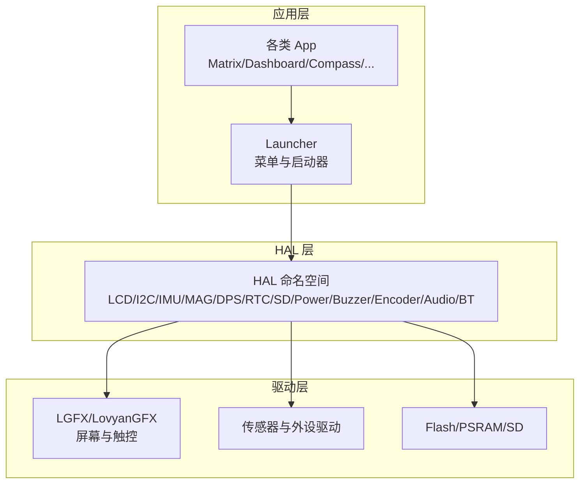
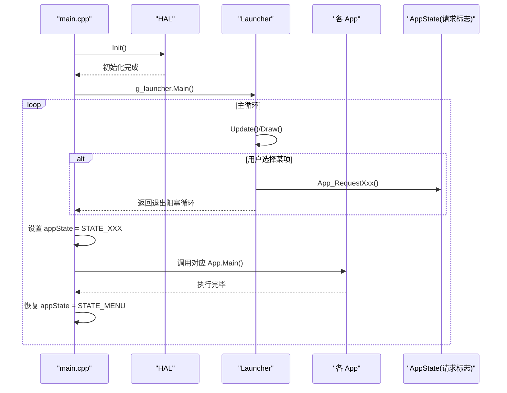
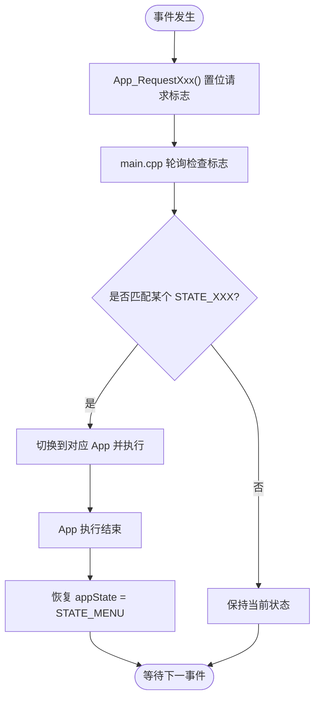
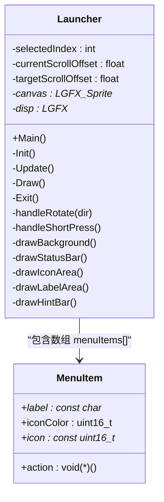
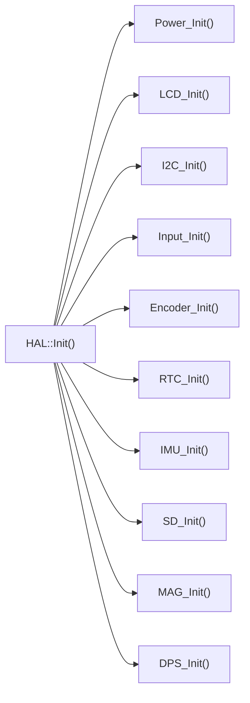
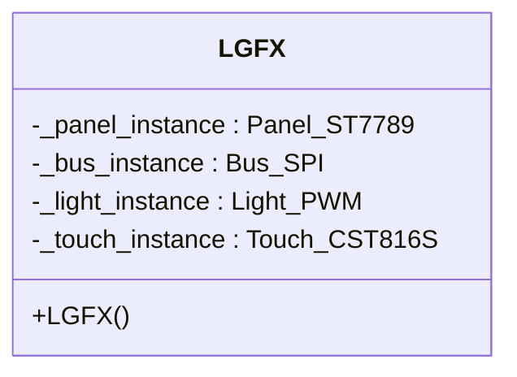
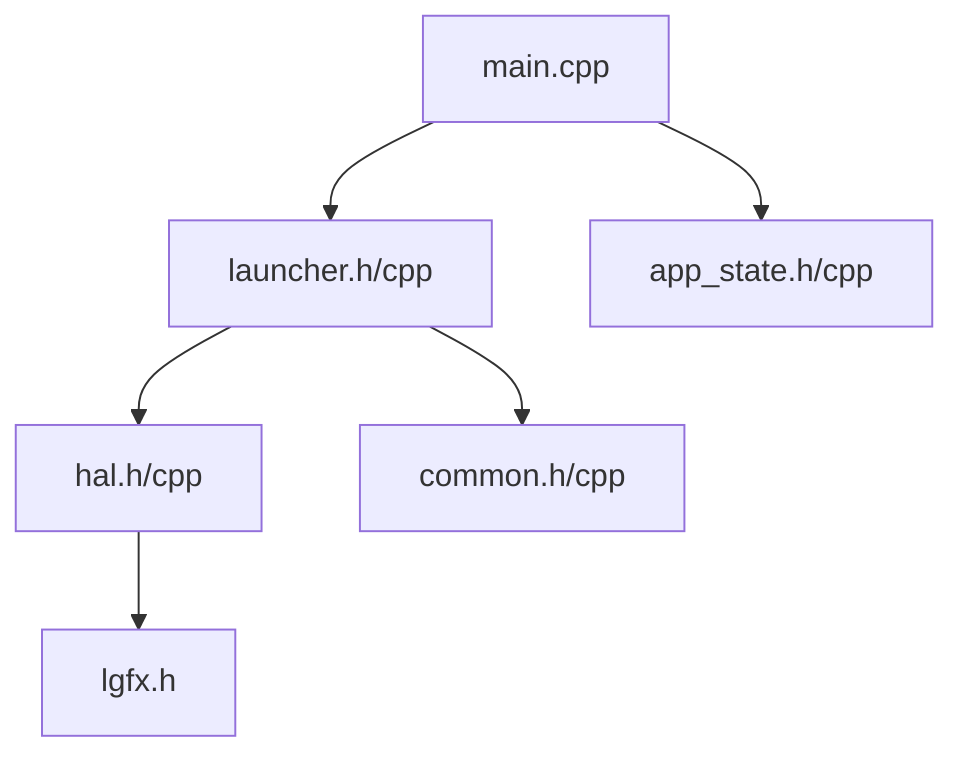
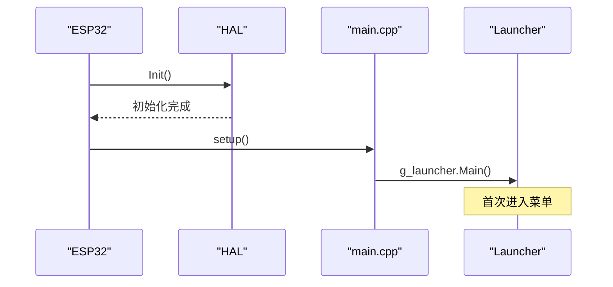
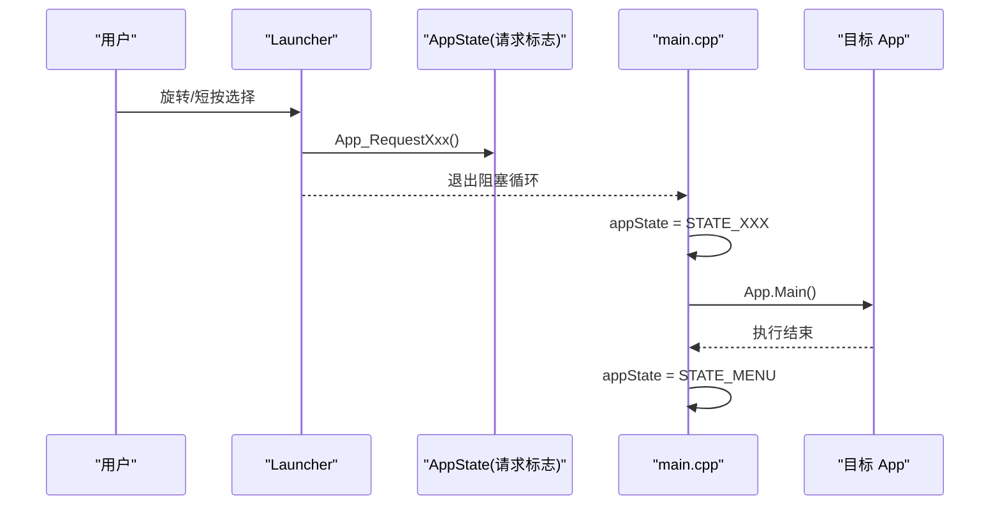

# 系统架构

<cite>
**本文引用的文件**   
- [main.cpp](file://src/main.cpp)
- [app_state.h](file://src/app_state.h)
- [app_state.cpp](file://src/app_state.cpp)
- [launcher.h](file://src/launcher.h)
- [launcher.cpp](file://src/launcher.cpp)
- [hal.h](file://src/hal/hal.h)
- [hal.cpp](file://src/hal/hal.cpp)
- [lgfx.h](file://include/lgfx.h)
- [common.h](file://src/common.h)
- [common.cpp](file://src/common.cpp)
</cite>

## 目录
1. [简介](#简介)
2. [项目结构](#项目结构)
3. [核心组件](#核心组件)
4. [架构总览](#架构总览)
5. [详细组件分析](#详细组件分析)
6. [依赖关系分析](#依赖关系分析)
7. [性能与资源特性](#性能与资源特性)
8. [故障排查指南](#故障排查指南)
9. [结论](#结论)
10. [附录：启动流程与事件模型](#附录启动流程与事件模型)

## 简介
本文件系统性地梳理 ESP32 NullPod 固件的架构设计，围绕“应用层 → HAL 层 → 驱动层”的分层模型展开。重点说明：
- 状态机模式在 AppState 中的应用与主程序 main.cpp 中的状态管理逻辑
- Launcher 作为菜单界面与应用启动器的职责
- 各组件之间的交互关系与数据流
- 单例模式在全局实例管理中的应用
- 系统启动流程、应用切换机制与事件处理模型

## 项目结构
代码采用分层组织方式：
- 应用层：Launcher（菜单与启动器）、各功能 App（如 Matrix、Dashboard、Compass 等）
- HAL 层：统一硬件抽象接口，封装 LCD、I2C、IMU、MAG、DPS、RTC、SD、Power、Buzzer、RGB LED、Encoder、Audio、Bluetooth 等
- 驱动层：LovyanGFX/LGFX、传感器库、存储与通信外设驱动

图表来源
- [launcher.h:44-65](file://src/launcher.h#L44-L65)
- [hal.h:101-212](file://src/hal/hal.h#L101-L212)
- [lgfx.h:34-115](file://include/lgfx.h#L34-L115)

章节来源
- [launcher.h:1-153](file://src/launcher.h#L1-L153)
- [hal.h:1-215](file://src/hal/hal.h#L1-L215)
- [lgfx.h:1-118](file://include/lgfx.h#L1-L118)

## 核心组件
- 应用状态与请求标志：通过 volatile 全局标志实现跨模块的事件通知，避免直接耦合
- Launcher：菜单 UI、输入处理、图标滚动动画、长按关机提示、状态栏刷新
- HAL：统一的硬件抽象接口，提供初始化、查询与更新能力
- LGFX：屏幕与触控驱动的封装类，定义引脚、面板、总线、触摸参数

章节来源
- [app_state.h:1-42](file://src/app_state.h#L1-L42)
- [app_state.cpp:1-37](file://src/app_state.cpp#L1-L37)
- [launcher.h:85-150](file://src/launcher.h#L85-L150)
- [launcher.cpp:1-444](file://src/launcher.cpp#L1-L444)
- [hal.h:101-212](file://src/hal/hal.h#L101-L212)
- [lgfx.h:34-115](file://include/lgfx.h#L34-L115)

## 架构总览
系统以 main.cpp 为入口，完成 HAL 初始化后进入 Launcher 的主循环；Launcher 负责渲染菜单、处理编码器/按键输入，并通过 app_state 的请求标志触发应用切换；main.cpp 根据当前 AppState 调度具体 App 的执行。

图表来源
- [main.cpp:18-24](file://src/main.cpp#L18-L24)
- [main.cpp:27-126](file://src/main.cpp#L27-L126)
- [launcher.cpp:57-79](file://src/launcher.cpp#L57-L79)
- [launcher.cpp:81-197](file://src/launcher.cpp#L81-L197)
- [launcher.cpp:427-443](file://src/launcher.cpp#L427-L443)
- [app_state.cpp:21-36](file://src/app_state.cpp#L21-L36)

## 详细组件分析

### 应用状态与事件模型（AppState + 请求标志）
- 使用一组 volatile bool 全局变量表示“请求切换至某应用”，由上层（Launcher 或 App）置位，main.cpp 轮询并切换状态
- 提供 App_RequestXxx() 函数集中设置标志，屏蔽底层细节，便于扩展新应用

图表来源
- [app_state.h:4-21](file://src/app_state.h#L4-L21)
- [app_state.cpp:3-36](file://src/app_state.cpp#L3-L36)
- [main.cpp:27-126](file://src/main.cpp#L27-L126)

章节来源
- [app_state.h:1-42](file://src/app_state.h#L1-L42)
- [app_state.cpp:1-37](file://src/app_state.cpp#L1-L37)
- [main.cpp:27-126](file://src/main.cpp#L27-L126)

### Launcher：菜单界面与应用启动器
- 生命周期：Init → Main（阻塞式循环）→ Exit
- 输入处理：编码器旋转/短按映射到菜单滚动与确认；支持长按 Power 键关机（含进度条与蜂鸣反馈）
- 绘制：背景、状态栏（时间/WiFi/电量）、图标区域（带平滑滚动插值）、标签区、提示栏
- 应用切换：每个菜单项绑定 action 回调，回调中调用 App_RequestXxx() 置位请求标志，随后 Launcher::Main 检测到标志后退出阻塞循环，交由 main.cpp 调度

图表来源
- [launcher.h:85-150](file://src/launcher.h#L85-L150)
- [launcher.cpp:57-79](file://src/launcher.cpp#L57-L79)
- [launcher.cpp:81-197](file://src/launcher.cpp#L81-L197)
- [launcher.cpp:230-238](file://src/launcher.cpp#L230-L238)
- [launcher.cpp:331-368](file://src/launcher.cpp#L331-L368)
- [launcher.cpp:370-425](file://src/launcher.cpp#L370-L425)
- [launcher.cpp:427-443](file://src/launcher.cpp#L427-L443)

章节来源
- [launcher.h:1-153](file://src/launcher.h#L1-L153)
- [launcher.cpp:1-444](file://src/launcher.cpp#L1-L444)

### HAL 层：硬件抽象与统一接口
- 提供 Init/Update 生命周期钩子，集中初始化电源、LCD、I2C、输入、编码器、RTC、IMU、SD、磁力计、气压计、蜂鸣器、RGB LED、蓝牙等
- 对外暴露 GetDisplay/GetCanvas、getEncoder、isReturn、getVoltage、GetLocalTime 等接口供上层使用
- 将底层驱动细节（如 LovyanGFX、传感器库）隐藏于 HAL 内部

图表来源
- [hal.cpp:4-25](file://src/hal/hal.cpp#L4-L25)
- [hal.h:101-212](file://src/hal/hal.h#L101-L212)

章节来源
- [hal.h:1-215](file://src/hal/hal.h#L1-L215)
- [hal.cpp:1-72](file://src/hal/hal.cpp#L1-L72)

### 显示与触控驱动（LGFX）
- 定义 SPI 总线、ST7789 面板、PWM 背光、CST816S 触控的配置
- 提供屏幕分辨率、偏移、旋转等参数，并将触控挂载到面板

图表来源
- [lgfx.h:34-115](file://include/lgfx.h#L34-L115)

章节来源
- [lgfx.h:1-118](file://include/lgfx.h#L1-L118)

### 公共工具与颜色
- rgb565/dim565 颜色转换与变暗
- drawScaledIcon 缩放绘制图标（用于 Launcher 图标区域）
- 内存/分区百分比统计工具

章节来源
- [common.h:1-36](file://src/common.h#L1-L36)
- [common.cpp:1-151](file://src/common.cpp#L1-L151)

## 依赖关系分析
- main.cpp 依赖 launcher.h 与 app_state.h，并通过全局 g_launcher 与请求标志协调应用切换
- Launcher 依赖 HAL（获取 Display/Canvas、编码器、按键、电量、时间等）与 common（颜色与图标绘制）
- HAL 依赖 lgfx.h 与各类传感器/存储驱动

图表来源
- [main.cpp:1-13](file://src/main.cpp#L1-L13)
- [launcher.h:1-8](file://src/launcher.h#L1-L8)
- [hal.h:1-9](file://src/hal/hal.h#L1-L9)
- [lgfx.h:1-7](file://include/lgfx.h#L1-L7)

章节来源
- [main.cpp:1-209](file://src/main.cpp#L1-L209)
- [launcher.h:1-153](file://src/launcher.h#L1-L153)
- [hal.h:1-215](file://src/hal/hal.h#L1-L215)
- [lgfx.h:1-118](file://include/lgfx.h#L1-L118)

## 性能与资源特性
- 显示刷新优化：仅在滚动变化时重绘整个画布；状态栏每秒刷新一次以减少频繁 IO
- 平滑滚动：使用目标与实际偏移差值的线性插值，提升视觉流畅度
- 低功耗：长按 Power 键关机前关闭背光并蜂鸣提示，减少待机功耗
- 资源监控：HAL 提供内存与 PSRAM 使用情况日志，便于调试与优化

章节来源
- [launcher.cpp:157-197](file://src/launcher.cpp#L157-L197)
- [launcher.cpp:190-195](file://src/launcher.cpp#L190-L195)
- [launcher.cpp:120-146](file://src/launcher.cpp#L120-L146)
- [hal.cpp:56-71](file://src/hal/hal.cpp#L56-L71)

## 故障排查指南
- 无法进入菜单：检查 HAL::Init 顺序与外设初始化是否成功；查看串口输出与蜂鸣提示
- 菜单无响应：确认编码器/按键输入是否正常；检查 getEncoder 返回值与按键映射
- 屏幕不亮：检查背光控制与 Backlight_Off 调用路径；确认 LCD_Init 配置正确
- 应用切换失败：确认 App_RequestXxx() 被调用且 main.cpp 能读取到请求标志；检查 AppState 枚举与 switch 分支覆盖
- 关机无反应：检查 isReturn() 与长按计时逻辑；确认蜂鸣与背光关闭流程

章节来源
- [hal.cpp:4-25](file://src/hal/hal.cpp#L4-L25)
- [launcher.cpp:81-197](file://src/launcher.cpp#L81-L197)
- [launcher.cpp:120-146](file://src/launcher.cpp#L120-L146)
- [main.cpp:27-126](file://src/main.cpp#L27-L126)

## 结论
NullPod 固件采用清晰的分层架构：应用层通过 Launcher 提供一致的菜单体验与启动入口；HAL 层屏蔽硬件差异并提供稳定接口；驱动层专注设备细节。状态机与请求标志解耦了 UI 与应用调度，提升了可维护性与可扩展性。单例化的 g_launcher 简化了全局访问，配合 main.cpp 的状态轮询实现了稳定的应用切换流程。

## 附录：启动流程与事件模型

### 系统启动流程

图表来源
- [main.cpp:18-24](file://src/main.cpp#L18-L24)
- [hal.cpp:4-25](file://src/hal/hal.cpp#L4-L25)

### 应用切换机制

图表来源
- [launcher.cpp:427-443](file://src/launcher.cpp#L427-L443)
- [main.cpp:27-126](file://src/main.cpp#L27-L126)

### 事件处理模型
- 输入事件：编码器旋转/短按、长按 Power 键
- 显示事件：滚动插值、状态栏定时刷新
- 系统事件：应用切换、关机流程

章节来源
- [launcher.cpp:81-197](file://src/launcher.cpp#L81-L197)
- [launcher.cpp:120-146](file://src/launcher.cpp#L120-L146)
- [launcher.cpp:190-195](file://src/launcher.cpp#L190-L195)