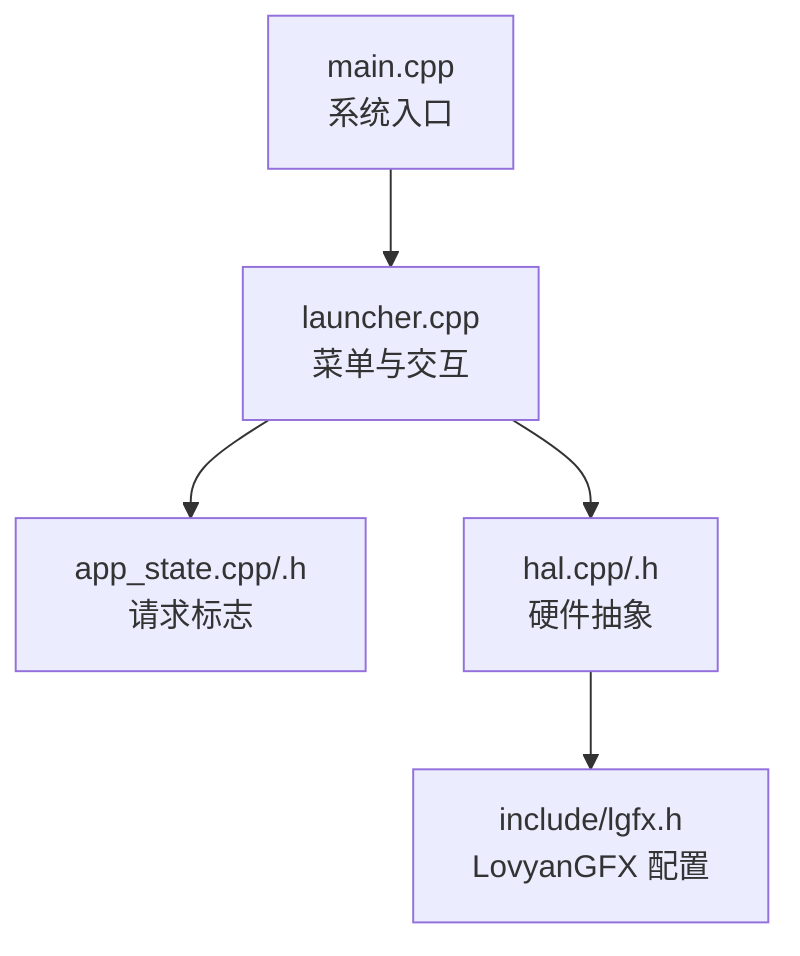
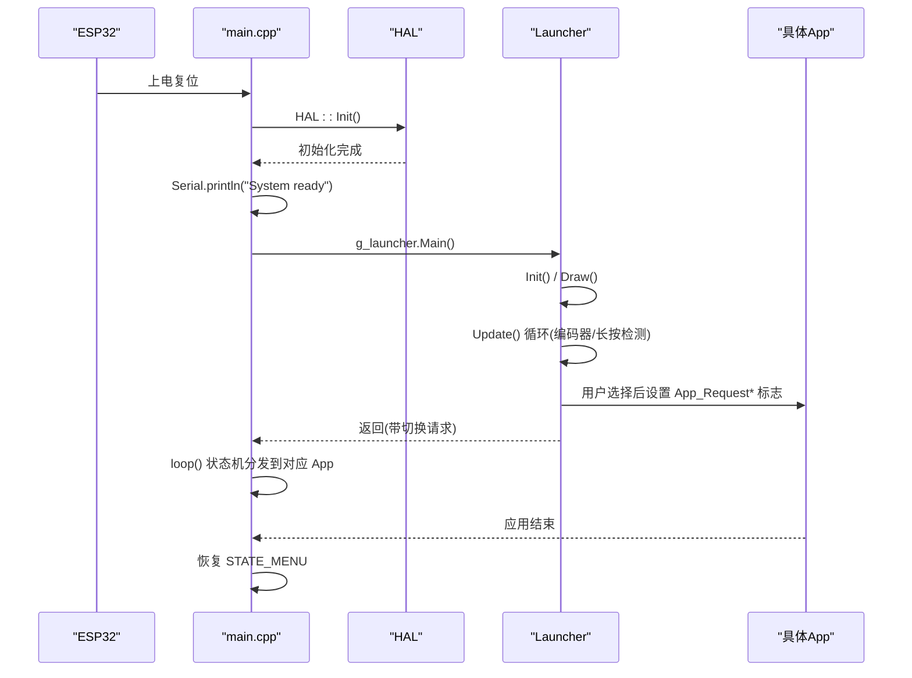
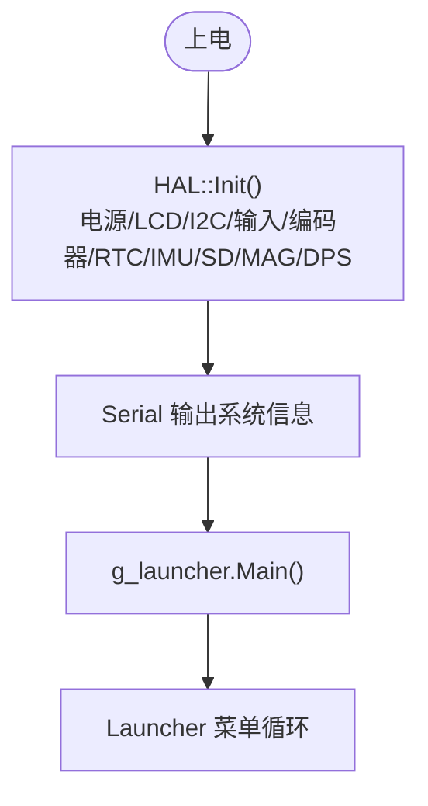
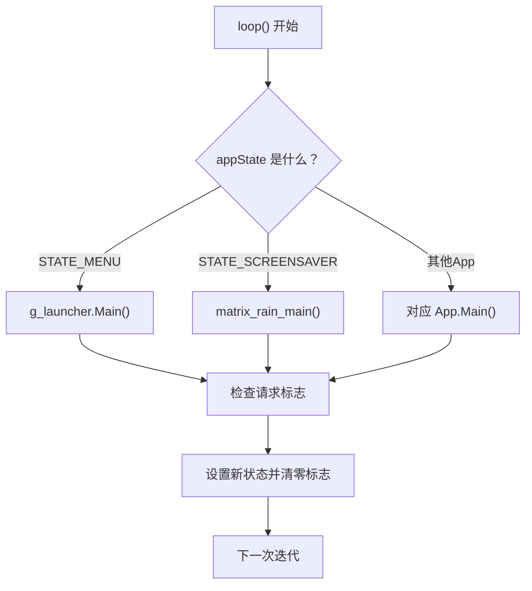
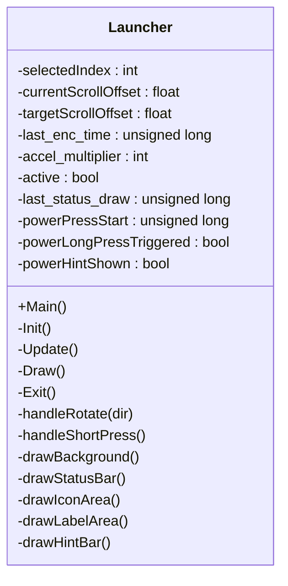
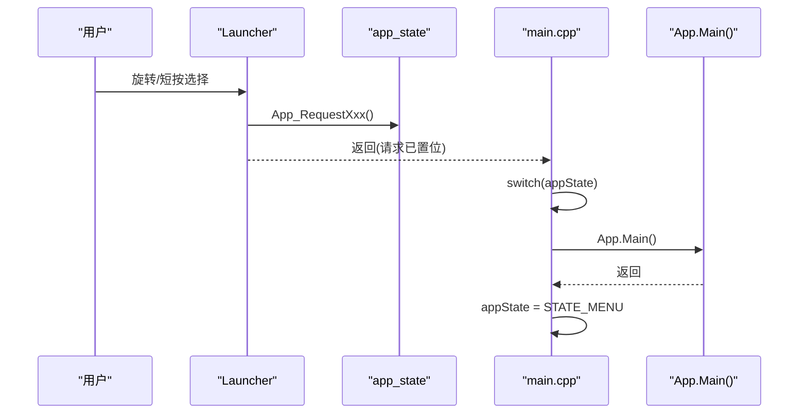
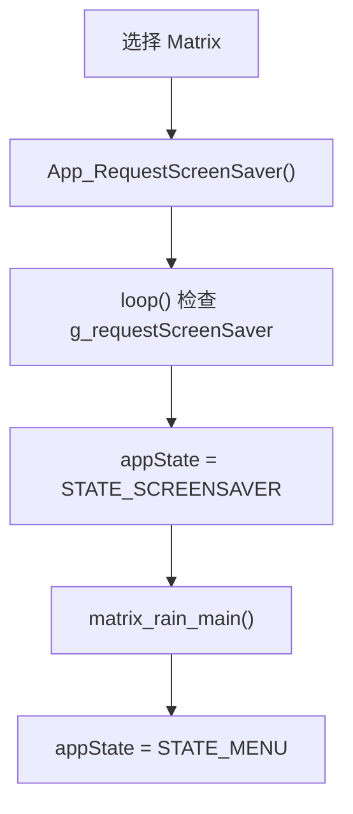
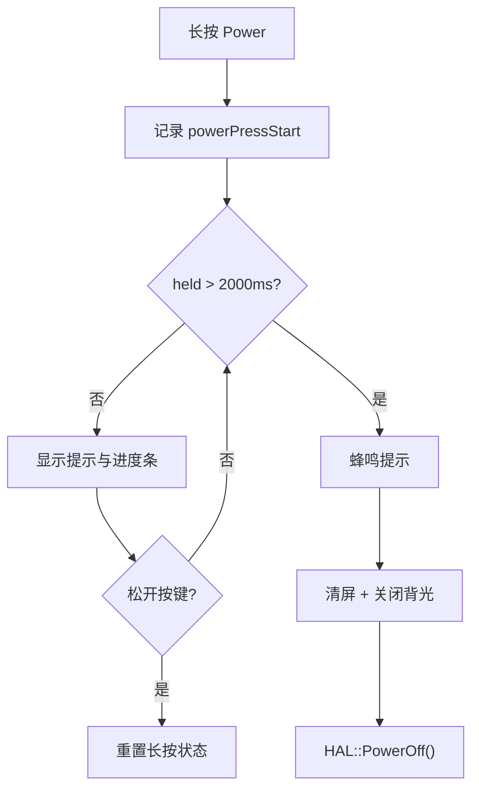
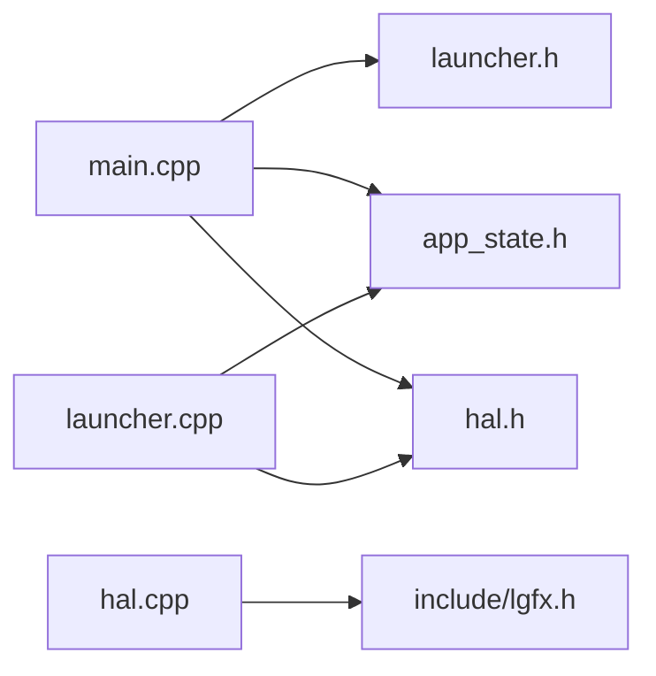

# 系统生命周期管理

<cite>
**本文引用的文件**   
- [main.cpp](file://src/main.cpp)
- [launcher.cpp](file://src/launcher.cpp)
- [launcher.h](file://src/launcher.h)
- [app_state.cpp](file://src/app_state.cpp)
- [app_state.h](file://src/app_state.h)
- [hal.cpp](file://src/hal/hal.cpp)
- [hal.h](file://src/hal/hal.h)
- [lgfx.h](file://include/lgfx.h)
</cite>

## 目录
1. [简介](#简介)
2. [项目结构](#项目结构)
3. [核心组件](#核心组件)
4. [架构总览](#架构总览)
5. [详细组件分析](#详细组件分析)
6. [依赖关系分析](#依赖关系分析)
7. [性能与内存优化](#性能与内存优化)
8. [故障排除指南](#故障排除指南)
9. [结论](#结论)

## 简介
本文面向 ESP32 NullPod 固件的系统生命周期管理，聚焦以下目标：
- 系统启动流程：setup() 中的 HAL 初始化、串口输出、Launcher 启动。
- 主循环 loop() 的状态机执行逻辑与应用切换机制。
- 应用的启动、运行和退出机制（以 Launcher 为入口）。
- 屏幕保护程序的触发条件与处理逻辑。
- 系统启动时序图与生命周期流程图。
- 资源管理与内存优化策略。
- 调试与故障排除指导。

本说明尽量以“代码级”为依据进行解释，并在需要时提供图示帮助理解。

## 项目结构
本项目采用分层组织方式：
- 应用层：各功能 App（如 Matrix、Dashboard、Compass 等）通过 Launcher 菜单进入。
- 状态协调层：app_state.* 维护跨模块的“请求标志”，用于从任意位置请求切换到某个 App。
- 界面与导航层：launcher.* 实现菜单 UI、交互与长按关机逻辑。
- 硬件抽象层：hal.* 封装 LCD、I2C、RTC、IMU、SD、电源、蜂鸣器等硬件能力。
- 显示驱动配置：include/lgfx.h 定义 LovyanGFX 面板、触摸、引脚等参数。

**图表来源**
- [main.cpp:18-24](file://src/main.cpp#L18-L24)
- [launcher.cpp:57-79](file://src/launcher.cpp#L57-L79)
- [app_state.cpp:1-37](file://src/app_state.cpp#L1-L37)
- [hal.cpp:4-25](file://src/hal/hal.cpp#L4-L25)
- [lgfx.h:1-118](file://include/lgfx.h#L1-L118)

**章节来源**
- [main.cpp:18-24](file://src/main.cpp#L18-L24)
- [launcher.cpp:57-79](file://src/launcher.cpp#L57-L79)
- [hal.cpp:4-25](file://src/hal/hal.cpp#L4-L25)
- [lgfx.h:1-118](file://include/lgfx.h#L1-L118)

## 核心组件
- main.cpp：系统入口，负责 HAL 初始化、串口打印、首次进入 Launcher，以及主循环状态机调度。
- launcher.cpp/.h：Launcher 类实现菜单 UI、编码器输入、长按关机、状态栏绘制与应用切换请求。
- app_state.cpp/.h：全局 volatile 请求标志集合，供任意模块设置并通知主循环或 Launcher。
- hal.cpp/.h：HAL 统一接口，包含 Init()、Update()、LCD/RTC/Power/Encoder 等能力。
- lgfx.h：LovyanGFX 显示与触摸配置，定义屏幕尺寸、SPI 总线、触摸控制器等。

**章节来源**
- [main.cpp:18-209](file://src/main.cpp#L18-L209)
- [launcher.cpp:1-444](file://src/launcher.cpp#L1-L444)
- [launcher.h:1-153](file://src/launcher.h#L1-L153)
- [app_state.cpp:1-37](file://src/app_state.cpp#L1-L37)
- [app_state.h:1-42](file://src/app_state.h#L1-L42)
- [hal.cpp:1-72](file://src/hal/hal.cpp#L1-L72)
- [hal.h:1-215](file://src/hal/hal.h#L1-L215)
- [lgfx.h:1-118](file://include/lgfx.h#L1-L118)

## 架构总览
系统启动与运行由“单线程 + 阻塞式 Launcher + 主循环状态机”构成：
- setup() 调用 HAL::Init() 完成底层设备初始化，随后 Serial 输出系统就绪信息，并调用 g_launcher.Main() 进入 Launcher。
- Launcher::Main() 是阻塞式生命周期：内部循环不断 Update()，直到有 App 切换请求才返回。
- loop() 根据当前 appState 分发到对应 App；App 结束后将状态复位为 STATE_MENU。
- 所有 App 切换均通过 app_state 的 volatile 标志位进行解耦通信。

**图表来源**
- [main.cpp:18-24](file://src/main.cpp#L18-L24)
- [launcher.cpp:57-79](file://src/launcher.cpp#L57-L79)
- [app_state.cpp:21-36](file://src/app_state.cpp#L21-L36)

## 详细组件分析

### 系统启动流程（setup）
- HAL 初始化：顺序初始化电源、LCD、I2C、输入、编码器、RTC、IMU、SD、磁力计、气压传感器等，最后蜂鸣提示音。
- 串口输出：打印构建时间、堆与 PSRAM 空闲大小等信息，便于调试。
- Launcher 启动：首次进入菜单，等待用户交互。

**图表来源**
- [hal.cpp:4-25](file://src/hal/hal.cpp#L4-L25)
- [main.cpp:18-24](file://src/main.cpp#L18-L24)

**章节来源**
- [hal.cpp:4-25](file://src/hal/hal.cpp#L4-L25)
- [main.cpp:18-24](file://src/main.cpp#L18-L24)

### 主循环状态机（loop）
- 基于 appState 的分发器：每个状态对应一个 App 或特殊行为（如屏幕保护）。
- 每个 App 分支在结束时将 appState 重置为 STATE_MENU，保证回到菜单。
- 在状态分发之后，检查 app_state 的请求标志，若置位则切换至对应状态并清零标志。

**图表来源**
- [main.cpp:27-209](file://src/main.cpp#L27-L209)
- [app_state.cpp:1-37](file://src/app_state.cpp#L1-L37)

**章节来源**
- [main.cpp:27-209](file://src/main.cpp#L27-L209)
- [app_state.cpp:1-37](file://src/app_state.cpp#L1-L37)

### Launcher 生命周期与交互
- Init()：初始化菜单项、获取显示与画布、绘制一次界面。
- Main()：阻塞式循环，持续 Update()，直到检测到任何 App 切换请求即返回。
- Update()：读取编码器事件、处理短按、长按 Power 关机逻辑、平滑滚动、状态栏每秒刷新。
- 长按 Power：超过 2 秒触发关机流程（蜂鸣提示、清屏、关闭背光、调用 PowerOff），并提供进度条反馈。

**图表来源**
- [launcher.h:85-148](file://src/launcher.h#L85-L148)
- [launcher.cpp:9-51](file://src/launcher.cpp#L9-L51)
- [launcher.cpp:57-79](file://src/launcher.cpp#L57-L79)
- [launcher.cpp:82-197](file://src/launcher.cpp#L82-L197)

**章节来源**
- [launcher.cpp:9-51](file://src/launcher.cpp#L9-L51)
- [launcher.cpp:57-79](file://src/launcher.cpp#L57-L79)
- [launcher.cpp:82-197](file://src/launcher.cpp#L82-L197)
- [launcher.h:85-148](file://src/launcher.h#L85-L148)

### 应用的启动、运行与退出机制
- 启动：用户在 Launcher 中选择某项，触发对应的 action 回调，调用 App_Request* 函数设置请求标志。
- 运行：Launcher::Main() 检测到请求后返回，loop() 根据 appState 调用对应 App 的 Main()。
- 退出：App 的 Main() 返回后，状态机将该状态复位为 STATE_MENU，回到菜单。

**图表来源**
- [launcher.cpp:428-443](file://src/launcher.cpp#L428-L443)
- [app_state.cpp:21-36](file://src/app_state.cpp#L21-L36)
- [main.cpp:27-209](file://src/main.cpp#L27-L209)

**章节来源**
- [launcher.cpp:428-443](file://src/launcher.cpp#L428-L443)
- [app_state.cpp:21-36](file://src/app_state.cpp#L21-L36)
- [main.cpp:27-209](file://src/main.cpp#L27-L209)

### 屏幕保护程序（Matrix Rain）
- 触发条件：用户在 Launcher 菜单中选择 “Matrix”，actionScreenSaverEntry() 调用 App_RequestScreenSaver() 设置 g_requestScreenSaver。
- 处理逻辑：loop() 中检测到该标志后，将 appState 设为 STATE_SCREENSAVER，并调用 matrix_rain_main()；完成后恢复 STATE_MENU。

**图表来源**
- [launcher.cpp:428-429](file://src/launcher.cpp#L428-L429)
- [app_state.cpp:21-21](file://src/app_state.cpp#L21-L21)
- [main.cpp:35-39](file://src/main.cpp#L35-L39)

**章节来源**
- [launcher.cpp:428-429](file://src/launcher.cpp#L428-L429)
- [app_state.cpp:21-21](file://src/app_state.cpp#L21-L21)
- [main.cpp:35-39](file://src/main.cpp#L35-L39)

### 长按关机流程
- 检测：Update() 中通过 HAL::isReturn() 判断按键状态。
- 计时：记录按下起始时间，超过 2 秒触发关机。
- 反馈：蜂鸣两次、清屏、关闭背光，然后调用 HAL::PowerOff()。
- 进度条：按住超过 500ms 显示“Power off”提示与进度条，颜色随时间变化。

**图表来源**
- [launcher.cpp:109-155](file://src/launcher.cpp#L109-L155)
- [launcher.cpp:171-187](file://src/launcher.cpp#L171-L187)

**章节来源**
- [launcher.cpp:109-155](file://src/launcher.cpp#L109-L155)
- [launcher.cpp:171-187](file://src/launcher.cpp#L171-L187)

## 依赖关系分析
- main.cpp 依赖 launcher.h、app_state.h、hal.h 与各 App 头文件。
- launcher.cpp 依赖 hal.h、common.h、app_state.h 与图标资源。
- app_state.* 仅暴露请求标志与 setter 函数，被 Launcher 与各 App 使用。
- hal.cpp 依赖 lgfx.h 提供的显示与触摸能力。

**图表来源**
- [main.cpp:1-13](file://src/main.cpp#L1-L13)
- [launcher.cpp:1-3](file://src/launcher.cpp#L1-L3)
- [hal.cpp:1-2](file://src/hal/hal.cpp#L1-L2)
- [lgfx.h:1-118](file://include/lgfx.h#L1-L118)

**章节来源**
- [main.cpp:1-13](file://src/main.cpp#L1-L13)
- [launcher.cpp:1-3](file://src/launcher.cpp#L1-L3)
- [hal.cpp:1-2](file://src/hal/hal.cpp#L1-L2)
- [lgfx.h:1-118](file://include/lgfx.h#L1-L118)

## 性能与内存优化
- 显示缓冲与绘制：
  - 使用 LGFX_Sprite 作为离屏画布，减少直接刷屏开销。
  - 仅在滚动或状态栏更新时重绘，避免每帧全量刷新。
- 延迟与响应：
  - Launcher::Main() 内循环使用 delay(5) 降低 CPU 占用，同时保持交互响应。
  - 状态栏每秒刷新一次，平衡实时性与功耗。
- 内存诊断：
  - HAL::logMemory() 可输出堆与 PSRAM 使用情况，辅助定位内存泄漏或碎片化问题。
- 建议：
  - 避免在 App.Main() 中进行长时间阻塞操作；必要时拆分任务或使用轻量定时器。
  - 谨慎使用大对象与动态分配，优先使用静态缓冲区或预分配内存。
  - 对频繁调用的绘图路径进行批量化与增量更新。

**章节来源**
- [launcher.cpp:57-79](file://src/launcher.cpp#L57-L79)
- [launcher.cpp:189-195](file://src/launcher.cpp#L189-L195)
- [hal.cpp:56-71](file://src/hal/hal.cpp#L56-L71)

## 故障排除指南
- 无法进入菜单：
  - 检查 HAL::Init() 是否成功（LCD、I2C、RTC 等初始化失败可能导致后续异常）。
  - 查看串口输出是否有错误信息。
- 屏幕无显示：
  - 确认 include/lgfx.h 的 SPI 引脚与触摸引脚配置正确。
  - 检查 HAL::GetDisplay()/GetCanvas() 是否返回有效指针。
- 编码器无响应：
  - 确认 Encoder_Init() 已调用，且 getEncoder() 能返回键值。
- 长按关机无效：
  - 检查 HAL::isReturn() 返回值与按键映射。
  - 确认 PowerOff() 实现可用。
- 内存不足或崩溃：
  - 使用 HAL::logMemory() 输出堆与 PSRAM 使用情况。
  - 排查 App.Main() 中的大对象分配与未释放资源。

**章节来源**
- [hal.cpp:4-25](file://src/hal/hal.cpp#L4-L25)
- [hal.cpp:56-71](file://src/hal/hal.cpp#L56-L71)
- [launcher.cpp:109-155](file://src/launcher.cpp#L109-L155)
- [lgfx.h:1-118](file://include/lgfx.h#L1-L118)

## 结论
ESP32 NullPod 的生命周期管理以“HAL 初始化 + Launcher 阻塞式菜单 + 主循环状态机”为核心：
- setup() 完成底层初始化并进入 Launcher。
- Launcher 负责交互、绘制与长按关机，并通过 app_state 的请求标志与主循环解耦。
- loop() 根据 appState 分发到具体 App，App 结束后自动回到菜单。
- 屏幕保护程序通过菜单选择触发，运行完毕后自动返回菜单。
- 通过 LGFX 离屏缓冲、按需刷新与 HAL::logMemory() 等手段，兼顾性能与可观测性。