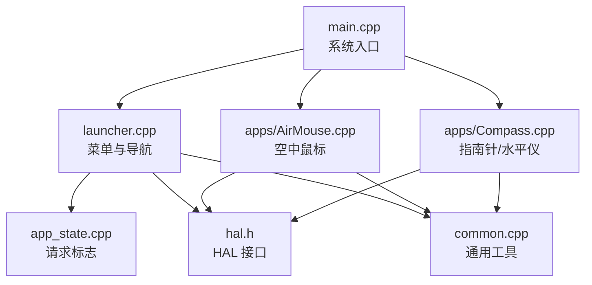
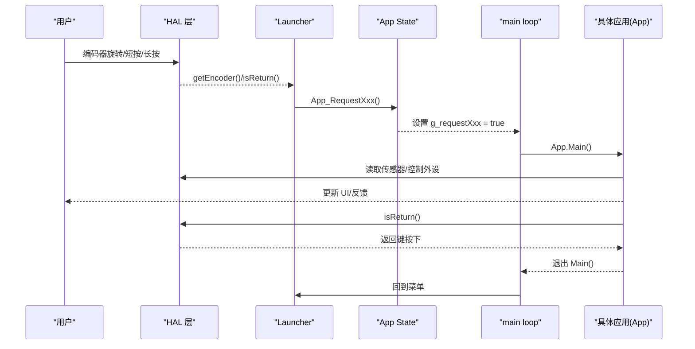
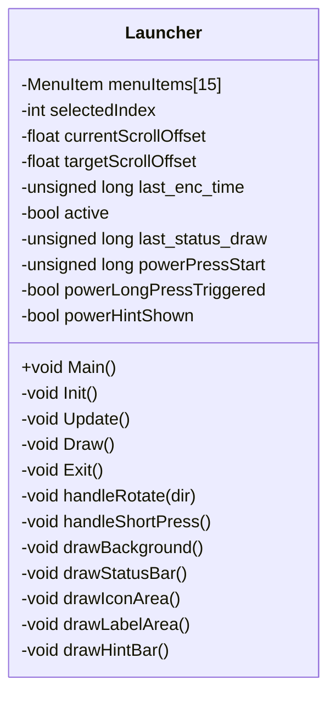
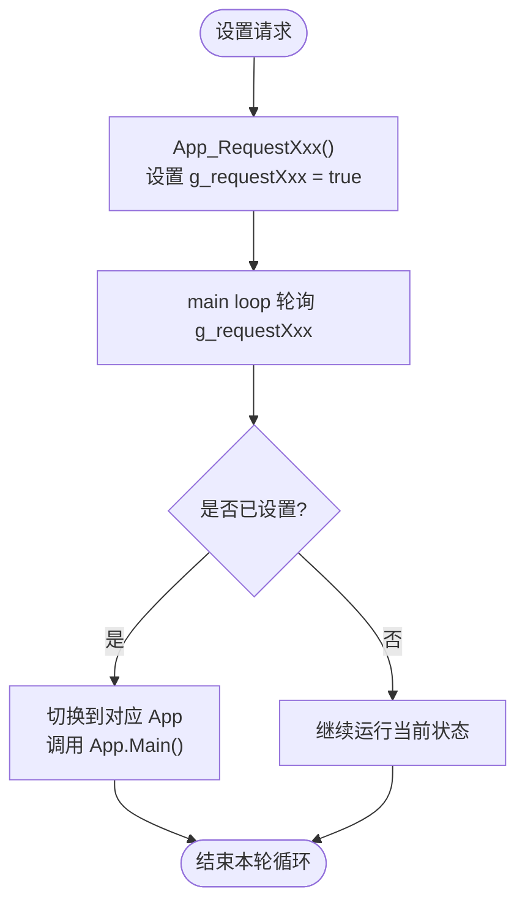
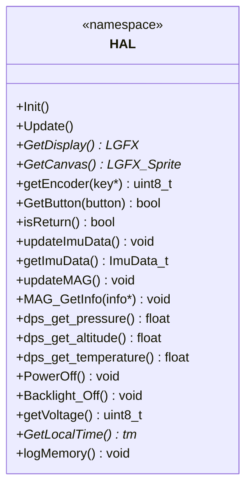
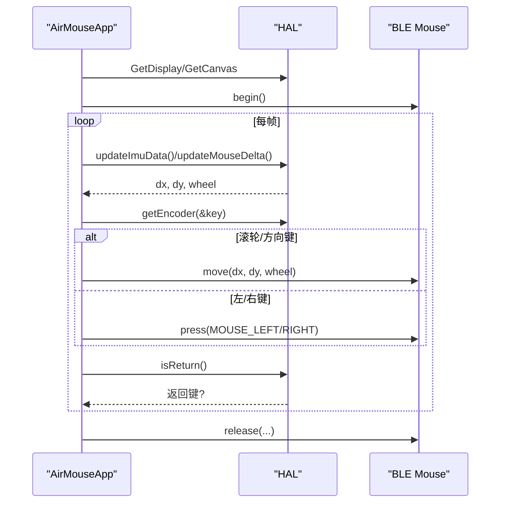
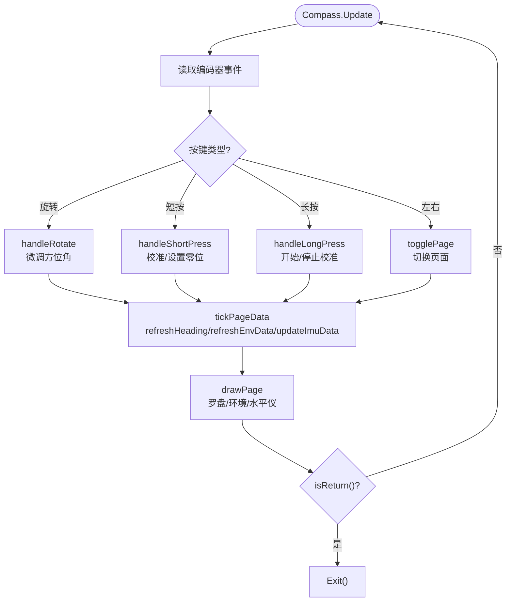
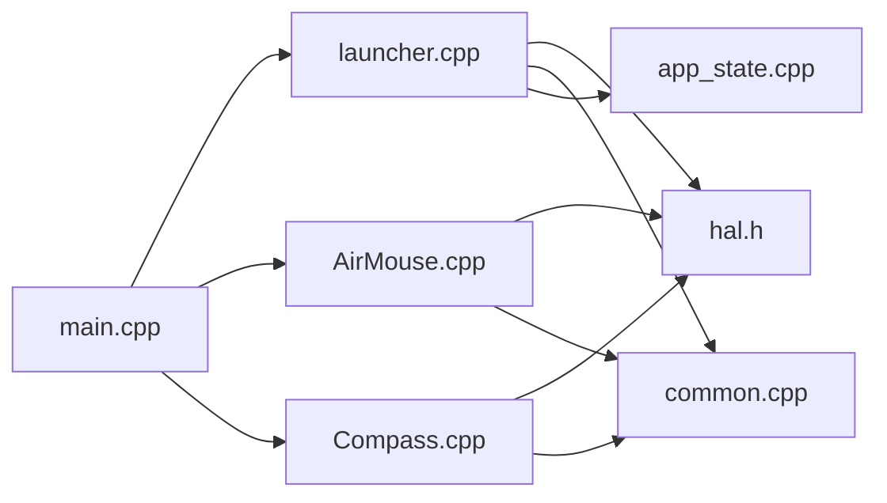

# 组件交互模型

<cite>
**本文引用的文件**   
- [main.cpp](file://src/main.cpp)
- [launcher.h](file://src/launcher.h)
- [launcher.cpp](file://src/launcher.cpp)
- [app_state.h](file://src/app_state.h)
- [app_state.cpp](file://src/app_state.cpp)
- [common.h](file://src/common.h)
- [common.cpp](file://src/common.cpp)
- [hal.h](file://src/hal/hal.h)
- [hal.cpp](file://src/hal/hal.cpp)
- [hal_input.cpp](file://src/hal/hal_input.cpp)
- [AirMouse.h](file://src/apps/AirMouse.h)
- [AirMouse.cpp](file://src/apps/AirMouse.cpp)
- [Compass.h](file://src/apps/Compass.h)
- [Compass.cpp](file://src/apps/Compass.cpp)
</cite>

## 目录
1. [引言](#引言)
2. [项目结构](#项目结构)
3. [核心组件](#核心组件)
4. [架构总览](#架构总览)
5. [详细组件分析](#详细组件分析)
6. [依赖关系分析](#依赖关系分析)
7. [性能与资源特性](#性能与资源特性)
8. [故障排查指南](#故障排查指南)
9. [结论](#结论)
10. [附录：扩展与集成指南](#附录扩展与集成指南)

## 引言
本文面向 ESP32 NullPod 固件，系统性梳理 Launcher、应用模块（以 AirMouse、Compass 为例）、HAL 层之间的交互模型。重点说明：
- 全局实例（g_launcher、g_compass、g_airMouseApp 等）的创建与管理方式
- 事件驱动的通信机制（编码器按键、长按关机、状态切换标志）
- 单例模式在组件管理中的应用
- 组件间的解耦设计与接口约定
- 组件扩展与集成的指导原则

## 项目结构
项目采用“顶层入口 + 启动器 + 应用模块 + HAL 抽象”的分层组织：
- src/main.cpp：系统入口，初始化 HAL，进入 Launcher 主循环，并依据请求标志切换到具体 App
- src/launcher.*：菜单与导航中心，负责输入处理、UI 绘制、通过请求标志触发 App 切换
- src/app_state.*：跨模块的请求标志与请求函数，作为轻量级事件总线
- src/common.*：通用 UI 工具与颜色常量
- src/hal/*：硬件抽象层，统一封装显示、触摸、按键、IMU、磁力计、气压、RTC、电源、蜂鸣器等
- src/apps/*：各功能应用，遵循统一的 Main/Init/Update/Exit 生命周期

**图表来源**
- [main.cpp:19-24](file://src/main.cpp#L19-L24)
- [launcher.cpp:58-79](file://src/launcher.cpp#L58-L79)
- [app_state.cpp:21-36](file://src/app_state.cpp#L21-L36)
- [hal.h:101-212](file://src/hal/hal.h#L101-L212)
- [AirMouse.cpp:153-165](file://src/apps/AirMouse.cpp#L153-L165)
- [Compass.cpp:740-752](file://src/apps/Compass.cpp#L740-L752)

**章节来源**
- [main.cpp:19-24](file://src/main.cpp#L19-L24)
- [launcher.h:85-150](file://src/launcher.h#L85-L150)
- [hal.h:101-212](file://src/hal/hal.h#L101-L212)

## 核心组件
- Launcher：菜单界面与导航中心，维护菜单项、滚动动画、状态栏、长按关机逻辑；通过回调调用 App_Request* 函数设置请求标志
- App State：定义一组 volatile 请求标志与对应的 App_Request* 函数，供任意模块设置，由 main loop 消费
- HAL：提供统一的硬件能力接口，包括显示、输入、传感器、电源、音频、蓝牙等
- 应用模块：如 AirMouse、Compass，遵循 Main/Init/Update/Exit 生命周期，直接通过 HAL 访问硬件

关键全局实例：
- g_launcher：Launcher 的单例实例，位于 launcher.cpp
- g_airMouseApp：AirMouseApp 的单例实例，位于 AirMouse.cpp
- g_compass：Compass 的单例实例，位于 Compass.cpp

这些实例在各自源文件中以全局变量形式声明和定义，并在 main.cpp 中通过 .Main() 被调度执行。

**章节来源**
- [launcher.cpp:5-6](file://src/launcher.cpp#L5-L6)
- [AirMouse.cpp:5-6](file://src/apps/AirMouse.cpp#L5-L6)
- [Compass.cpp:4](file://src/apps/Compass.cpp#L4)
- [main.cpp:21-24](file://src/main.cpp#L21-L24)

## 架构总览
整体控制流为“事件驱动 + 状态机”：
- 用户输入（编码器旋转/短按/长按）由 HAL 上报给上层
- Launcher 或当前 App 根据输入更新 UI 或业务状态
- 需要切换应用时，设置对应请求标志（volatile bool）
- main loop 轮询请求标志，切换到目标 App 并调用其 Main()
- App 内部通过 HAL 读取传感器、控制外设、发送 HID 等

**图表来源**
- [launcher.cpp:82-197](file://src/launcher.cpp#L82-L197)
- [launcher.cpp:428-443](file://src/launcher.cpp#L428-L443)
- [app_state.cpp:21-36](file://src/app_state.cpp#L21-L36)
- [main.cpp:27-126](file://src/main.cpp#L27-L126)
- [AirMouse.cpp:153-165](file://src/apps/AirMouse.cpp#L153-L165)
- [Compass.cpp:740-752](file://src/apps/Compass.cpp#L740-L752)

## 详细组件分析

### Launcher 组件
职责：
- 初始化显示与画布，构建菜单项数组
- 处理编码器旋转与短按，平滑滚动与重绘
- 长按 Power 键实现关机流程（蜂鸣提示、清屏、调用 HAL::PowerOff）
- 每秒刷新状态栏时间、电量、连接图标
- 通过 action 回调调用 App_Request* 设置切换标志

数据与状态：
- menuItems：菜单项表（标签、颜色、图标、action 回调）
- selectedIndex、currentScrollOffset、targetScrollOffset：滚动与选中项
- powerPressStart、powerLongPressTriggered、powerHintShown：长按关机状态机

交互要点：
- handleRotate：根据方向调整 selectedIndex，计算滚动偏移
- handleShortPress：调用当前菜单项的 action 回调
- Update：读取编码器事件、处理长按、平滑滚动、状态栏刷新

**图表来源**
- [launcher.h:85-150](file://src/launcher.h#L85-L150)
- [launcher.cpp:58-79](file://src/launcher.cpp#L58-L79)
- [launcher.cpp:82-197](file://src/launcher.cpp#L82-L197)
- [launcher.cpp:200-228](file://src/launcher.cpp#L200-L228)
- [launcher.cpp:331-368](file://src/launcher.cpp#L331-L368)

**章节来源**
- [launcher.cpp:5-51](file://src/launcher.cpp#L5-L51)
- [launcher.cpp:58-79](file://src/launcher.cpp#L58-L79)
- [launcher.cpp:82-197](file://src/launcher.cpp#L82-L197)
- [launcher.cpp:200-228](file://src/launcher.cpp#L200-L228)
- [launcher.cpp:331-368](file://src/launcher.cpp#L331-L368)

### App State（事件总线）
职责：
- 定义一组 volatile 请求标志（g_requestXxx），用于跨模块安全传递切换请求
- 提供 App_RequestXxx 函数，将请求置位

设计要点：
- 使用 volatile 保证中断/多线程环境下的可见性
- 每个 App 对应一个请求标志与一个请求函数，便于扩展

**图表来源**
- [app_state.cpp:21-36](file://src/app_state.cpp#L21-L36)
- [main.cpp:128-207](file://src/main.cpp#L128-L207)

**章节来源**
- [app_state.h:4-40](file://src/app_state.h#L4-L40)
- [app_state.cpp:1-37](file://src/app_state.cpp#L1-L37)
- [main.cpp:128-207](file://src/main.cpp#L128-L207)

### HAL 层
职责：
- 统一初始化与更新各类硬件子系统（LCD、I2C、Touch、Button、IMU、MAG、DPS、RTC、SD、Power、Buzzer、RGB LED、Encoder、Audio、Bluetooth）
- 提供高层 API 供 Launcher 与应用模块调用

关键接口：
- 显示：GetDisplay/GetCanvas
- 输入：getEncoder、GetButton、isReturn/isEnter
- IMU/MAG/DPS：updateImuData/getImuData、updateMAG/MAG_GetInfo、dps_get_*
- 电源：PowerOff/Backlight_Off/getVoltage
- 系统：GetLocalTime/logMemory

**图表来源**
- [hal.h:101-212](file://src/hal/hal.h#L101-L212)
- [hal.cpp:4-33](file://src/hal/hal.cpp#L4-L33)
- [hal_input.cpp:7-59](file://src/hal/hal_input.cpp#L7-L59)

**章节来源**
- [hal.h:101-212](file://src/hal/hal.h#L101-L212)
- [hal.cpp:4-33](file://src/hal/hal.cpp#L4-L33)
- [hal_input.cpp:7-59](file://src/hal/hal_input.cpp#L7-L59)

### AirMouse 应用
职责：
- 初始化 BLE Mouse，绘制 UI，读取 IMU 数据生成鼠标移动
- 处理编码器事件：滚轮、左/右键、方向键映射到 HID
- 通过 HAL::isReturn() 检测返回键退出应用

生命周期：
- Main：Init -> imuCalibrate -> while(Update; isReturn?) -> Exit

交互要点：
- HAL::updateImuData/updateMouseDelta 获取 dx/dy/wheel
- HAL::getEncoder 处理按键
- BleMouse.move/press/release 发送 HID

**图表来源**
- [AirMouse.cpp:14-23](file://src/apps/AirMouse.cpp#L14-L23)
- [AirMouse.cpp:58-147](file://src/apps/AirMouse.cpp#L58-L147)
- [AirMouse.cpp:153-165](file://src/apps/AirMouse.cpp#L153-L165)

**章节来源**
- [AirMouse.h:8-44](file://src/apps/AirMouse.h#L8-L44)
- [AirMouse.cpp:5-6](file://src/apps/AirMouse.cpp#L5-L6)
- [AirMouse.cpp:14-23](file://src/apps/AirMouse.cpp#L14-L23)
- [AirMouse.cpp:58-147](file://src/apps/AirMouse.cpp#L58-L147)
- [AirMouse.cpp:153-165](file://src/apps/AirMouse.cpp#L153-L165)

### Compass 应用
职责：
- 多页面应用：罗盘（表盘旋转+方位角）、环境信息（气压/海拔/气温）、气泡水平仪
- 通过 HAL 读取 MAG/IMU/DPS 数据，进行角度计算、平滑、渲染
- 支持校准磁力计、陀螺仪，持久化水平仪零位（Preferences）

生命周期：
- Main：Init -> while(check_serial_command; Update; isReturn?) -> Exit

交互要点：
- refreshHeading：从 MAG 数据计算方位角，指数平滑，驱动表盘旋转
- drawEnvPage：定时刷新 DPS 数据，绘制卡片式 UI
- drawLevelBubble：基于 IMU 姿态计算气泡位置，支持零位偏移与死区
- 页面切换：togglePage/setPage，标记 g_pageChanged 强制整页重绘

**图表来源**
- [Compass.cpp:580-620](file://src/apps/Compass.cpp#L580-L620)
- [Compass.cpp:641-681](file://src/apps/Compass.cpp#L641-L681)
- [Compass.cpp:740-752](file://src/apps/Compass.cpp#L740-L752)

**章节来源**
- [Compass.h:43-128](file://src/apps/Compass.h#L43-L128)
- [Compass.cpp:16-37](file://src/apps/Compass.cpp#L16-L37)
- [Compass.cpp:97-138](file://src/apps/Compass.cpp#L97-L138)
- [Compass.cpp:222-263](file://src/apps/Compass.cpp#L222-L263)
- [Compass.cpp:271-339](file://src/apps/Compass.cpp#L271-L339)
- [Compass.cpp:341-457](file://src/apps/Compass.cpp#L341-L457)
- [Compass.cpp:477-539](file://src/apps/Compass.cpp#L477-L539)
- [Compass.cpp:580-620](file://src/apps/Compass.cpp#L580-L620)
- [Compass.cpp:641-681](file://src/apps/Compass.cpp#L641-L681)
- [Compass.cpp:740-752](file://src/apps/Compass.cpp#L740-L752)

## 依赖关系分析
- Launcher 依赖：
  - HAL：显示、输入、电源、时间、蜂鸣
  - common：颜色、图标缩放绘制
  - app_state：请求标志与请求函数
- App 模块依赖：
  - HAL：传感器、输入、电源、音频、蓝牙
  - common：颜色、图标绘制
- main.cpp 依赖：
  - HAL：系统初始化
  - Launcher：首次进入菜单
  - 各 App：通过全局实例调用 Main()

**图表来源**
- [main.cpp:1-13](file://src/main.cpp#L1-L13)
- [launcher.cpp:1-3](file://src/launcher.cpp#L1-L3)
- [AirMouse.cpp:1-3](file://src/apps/AirMouse.cpp#L1-L3)
- [Compass.cpp:1-2](file://src/apps/Compass.cpp#L1-L2)

**章节来源**
- [main.cpp:1-13](file://src/main.cpp#L1-L13)
- [launcher.cpp:1-3](file://src/launcher.cpp#L1-L3)
- [AirMouse.cpp:1-3](file://src/apps/AirMouse.cpp#L1-L3)
- [Compass.cpp:1-2](file://src/apps/Compass.cpp#L1-L2)

## 性能与资源特性
- 显示与渲染：
  - Launcher 使用平滑滚动插值减少频繁重绘
  - 状态栏每秒刷新一次，避免高频 UI 更新
  - Compass 使用 PSRAM Sprite 存储 PNG 表盘，降低 SRAM 压力
- 传感器采样：
  - Compass 对 MAG 数据采样节流（COMPASS_MAG_REFRESH_MS）
  - 环境数据刷新节流（ENV_REFRESH_MS）
- 输入处理：
  - Encoder 事件去抖与加速（accel_multiplier）
  - 长按关机阈值（2s）与进度条反馈（500ms~2000ms）
- 内存与存储：
  - Preferences 持久化水平仪零位
  - logMemory 输出堆/PSRAM/Flash 使用情况

优化建议：
- 对高频 UI 区域使用局部刷新而非整屏重绘
- 合理设置传感器采样频率，避免阻塞主循环
- 使用 PSRAM 缓存大图与缓冲精灵，注意释放时机

**章节来源**
- [launcher.cpp:157-197](file://src/launcher.cpp#L157-L197)
- [launcher.cpp:200-228](file://src/launcher.cpp#L200-L228)
- [Compass.cpp:222-263](file://src/apps/Compass.cpp#L222-L263)
- [Compass.cpp:328-339](file://src/apps/Compass.cpp#L328-L339)
- [Compass.cpp:516-539](file://src/apps/Compass.cpp#L516-L539)
- [hal.cpp:56-71](file://src/hal/hal.cpp#L56-L71)

## 故障排查指南
常见问题与定位：
- 无法进入某 App：
  - 检查对应 App_Request* 是否被调用（Launcher 的 action 回调）
  - 确认 main loop 是否正确消费 g_requestXxx 并调用 App.Main()
- 长按关机无响应：
  - 检查 HAL::isReturn() 与 Launcher 的长按状态机逻辑
  - 确认 HAL::PowerOff() 是否被调用
- 传感器数据异常：
  - 检查 HAL::updateImuData()/updateMAG() 是否在主循环中被调用
  - 查看 Compass 的节流参数与校准流程
- BLE 鼠标不工作：
  - 检查 BleMouse.begin() 是否成功
  - 确认按键映射与 HID 发送逻辑

调试手段：
- 使用 Serial 打印关键状态（如 Compass 的串口命令监听）
- 使用 HAL::logMemory() 输出内存状态
- 在 Launcher 的状态栏中观察时间与电量是否正常刷新

**章节来源**
- [launcher.cpp:109-155](file://src/launcher.cpp#L109-L155)
- [launcher.cpp:331-368](file://src/launcher.cpp#L331-L368)
- [Compass.cpp:710-738](file://src/apps/Compass.cpp#L710-L738)
- [hal.cpp:56-71](file://src/hal/hal.cpp#L56-L71)

## 结论
ESP32 NullPod 的组件交互模型以 Launcher 为中心，通过 App State 的 volatile 请求标志实现松耦合的应用切换；HAL 层屏蔽硬件差异，向上提供统一接口；应用模块遵循统一生命周期，专注于业务逻辑与 UI 渲染。该设计具备良好的可扩展性与可维护性，适合在嵌入式资源受限环境下稳定运行。

## 附录：扩展与集成指南
新增应用步骤：
1. 在 src/apps 下创建新应用类，实现 Main/Init/Update/Exit
2. 在 src/app_state.h/.cpp 中添加新的请求标志与 App_Request* 函数
3. 在 launcher.cpp 的 menuItems 中添加菜单项，并绑定 action 回调
4. 在 main.cpp 的 switch(appState) 中添加对应分支，调用 App.Main()
5. 如需全局实例，参考 g_airMouseApp/g_compass 的模式，在应用源文件中定义 extern 实例

接口约定：
- 所有应用通过 HAL 访问硬件，禁止直接操作底层寄存器
- 所有 UI 绘制通过 HAL::GetCanvas() 获取的 LGFX_Sprite 进行
- 所有输入事件通过 HAL::getEncoder()/GetButton()/isReturn() 获取
- 所有状态切换通过 App_Request* 设置请求标志，由 main loop 消费

最佳实践：
- 使用节流与平滑算法降低 UI 与传感器更新频率
- 合理使用 PSRAM 存储大图与缓冲精灵，注意释放
- 使用 Preferences 持久化用户配置
- 保持 Main 循环简洁，避免阻塞延时过长

**章节来源**
- [launcher.cpp:28-43](file://src/launcher.cpp#L28-L43)
- [app_state.h:23-39](file://src/app_state.h#L23-L39)
- [app_state.cpp:21-36](file://src/app_state.cpp#L21-L36)
- [main.cpp:27-126](file://src/main.cpp#L27-L126)
- [AirMouse.cpp:5-6](file://src/apps/AirMouse.cpp#L5-L6)
- [Compass.cpp:4](file://src/apps/Compass.cpp#L4)