# 项目概述

<cite>
**本文引用的文件**   
- [platformio.ini](file://platformio.ini)
- [main.cpp](file://src/main.cpp)
- [lgfx.h](file://include/lgfx.h)
- [launcher.h](file://src/launcher.h)
- [launcher.cpp](file://src/launcher.cpp)
- [hal.h](file://src/hal/hal.h)
- [hal.cpp](file://src/hal/hal.cpp)
- [Compass.h](file://src/apps/Compass.h)
- [AirMouse.h](file://src/apps/AirMouse.h)
- [FluidApp.h](file://src/apps/FluidApp/FluidApp.h)
- [Tetris.h](file://src/apps/game/Tetris.h)
- [hal_dps.cpp](file://src/hal/hal_dps.cpp)
</cite>

## 目录
1. [简介](#简介)
2. [项目结构](#项目结构)
3. [核心组件](#核心组件)
4. [架构总览](#架构总览)
5. [详细组件分析](#详细组件分析)
6. [依赖关系分析](#依赖关系分析)
7. [性能与资源特性](#性能与资源特性)
8. [快速开始](#快速开始)
9. [故障排查指南](#故障排查指南)
10. [结论](#结论)

## 简介
ESP32 NullPod 是一个基于 ESP32-S3 的多功能嵌入式智能设备固件，提供指南针、空中鼠标、流体模拟、游戏等丰富应用。项目采用 Arduino 框架与 PlatformIO 构建系统，使用 LovyanGFX 图形库驱动 SPI 屏幕与 I2C 触控，并通过硬件抽象层（HAL）统一封装显示、输入、传感器、电源、RTC、SD 卡等能力，形成模块化应用架构。

## 项目结构
- src/main.cpp：系统入口，初始化 HAL 并启动菜单；在 loop 中根据状态分发到各应用。
- include/lgfx.h：LovyanGFX 的屏显与触控配置，定义 SPI 引脚、面板参数与 CST816S 触控。
- src/launcher.*：菜单与 UI 主循环，负责图标滚动、状态栏、长按关机提示与交互路由。
- src/hal/*：硬件抽象层，统一暴露 LCD、I2C、Touch、IMU、MAG、DPS、RTC、SD、Power、Buzzer、RGB LED、Encoder、Audio、Bluetooth 等接口。
- src/apps/*：具体应用实现，如指南针、空气鼠标、流体模拟、俄罗斯方块等。
- data/*：Web 资源（用于可能的 Web 管理界面）。
- partitions/*：LittleFS 分区表。
- platformio.ini：PlatformIO 工程配置，指定板型、框架、文件系统、内存与 PSRAM 标志等。

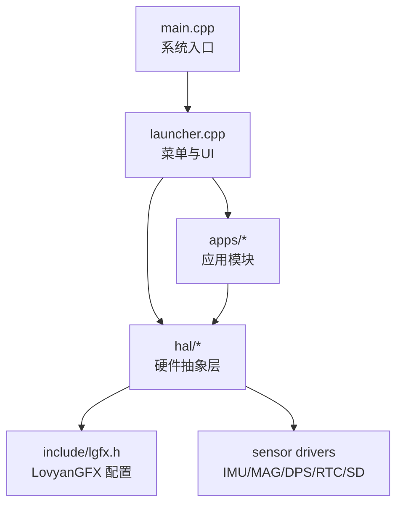

**图示来源** 
- [main.cpp:19-24](file://src/main.cpp#L19-L24)
- [launcher.cpp:58-79](file://src/launcher.cpp#L58-L79)
- [hal.h:101-212](file://src/hal/hal.h#L101-L212)
- [lgfx.h:34-114](file://include/lgfx.h#L34-L114)

**章节来源**
- [platformio.ini:11-31](file://platformio.ini#L11-L31)
- [main.cpp:19-24](file://src/main.cpp#L19-L24)

## 核心组件
- 系统入口与状态机：main.cpp 在 setup 中调用 HAL::Init 并进入 Launcher；loop 通过 AppState 切换不同应用。
- 菜单与交互：Launcher 类维护菜单项、平滑滚动、状态栏刷新与长按关机逻辑。
- 硬件抽象层：HAL 命名空间提供统一的初始化与更新接口，屏蔽底层差异。
- 图形与触控：LGFX 类封装 ST7789 面板与 CST816S 触控，提供绘图与触摸事件。
- 应用示例：Compass、AirMouse、FluidApp、Tetris 等应用均遵循 Init/Main/Update/Exit 生命周期。

**章节来源**
- [main.cpp:19-24](file://src/main.cpp#L19-L24)
- [launcher.h:85-148](file://src/launcher.h#L85-L148)
- [hal.h:101-212](file://src/hal/hal.h#L101-L212)
- [lgfx.h:34-114](file://include/lgfx.h#L34-L114)

## 架构总览
系统以 main.cpp 为入口，初始化 HAL 后进入 Launcher 的主循环；用户交互通过 Encoder/Touch 触发，Launcher 将请求转发给对应 App；App 通过 HAL 访问外设与传感器；LovyanGFX 作为图形后端被 HAL 与应用共同使用。

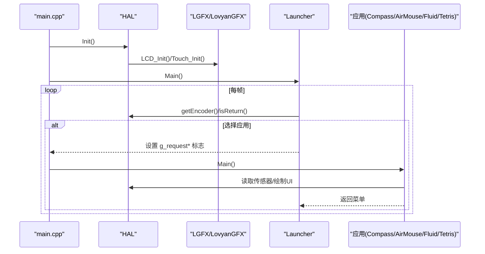

**图示来源** 
- [main.cpp:19-24](file://src/main.cpp#L19-L24)
- [launcher.cpp:82-197](file://src/launcher.cpp#L82-L197)
- [hal.cpp:4-25](file://src/hal/hal.cpp#L4-L25)

## 详细组件分析

### 系统入口与状态机（main.cpp）
- 职责：初始化 HAL，首次进入菜单；在 loop 中根据 AppState 分发到各应用；处理全局请求标志位切换状态。
- 关键点：AppState 枚举涵盖菜单、屏保、仪表盘、LED、遥控器、音乐、天气、指南针、气压计、游戏、文件、SD 卡、WiFi、设置、关于等。

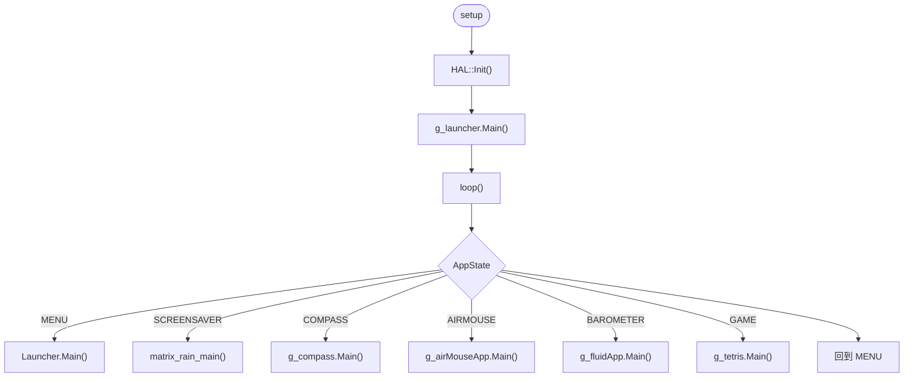

**图示来源** 
- [main.cpp:19-24](file://src/main.cpp#L19-L24)
- [main.cpp:27-126](file://src/main.cpp#L27-L126)

**章节来源**
- [main.cpp:19-24](file://src/main.cpp#L19-L24)
- [main.cpp:27-126](file://src/main.cpp#L27-L126)

### 菜单与交互（Launcher）
- 职责：渲染背景、状态栏、图标流、标签与提示栏；处理编码器旋转与短按；长按 Power 键进行关机流程；每秒刷新状态栏时间/连接图标。
- 关键设计：平滑滚动插值、加速滚轮、长按进度条与蜂鸣反馈、状态栏独立刷新。

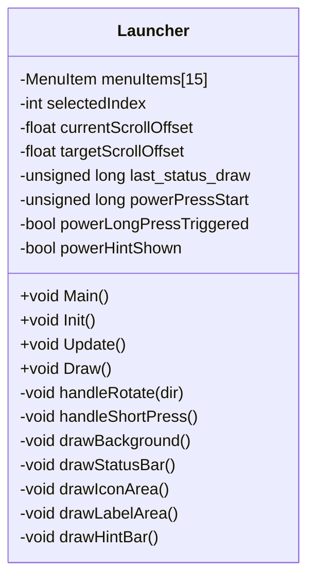

**图示来源** 
- [launcher.h:85-148](file://src/launcher.h#L85-L148)
- [launcher.cpp:58-79](file://src/launcher.cpp#L58-L79)
- [launcher.cpp:82-197](file://src/launcher.cpp#L82-L197)
- [launcher.cpp:231-238](file://src/launcher.cpp#L231-L238)
- [launcher.cpp:332-368](file://src/launcher.cpp#L332-L368)
- [launcher.cpp:427-443](file://src/launcher.cpp#L427-L443)

**章节来源**
- [launcher.h:85-148](file://src/launcher.h#L85-L148)
- [launcher.cpp:58-79](file://src/launcher.cpp#L58-L79)
- [launcher.cpp:82-197](file://src/launcher.cpp#L82-L197)
- [launcher.cpp:231-238](file://src/launcher.cpp#L231-L238)
- [launcher.cpp:332-368](file://src/launcher.cpp#L332-L368)
- [launcher.cpp:427-443](file://src/launcher.cpp#L427-L443)

### 硬件抽象层（HAL）
- 职责：统一初始化与更新所有外设；提供 Display/Canvas、I2C、Touch、Button、IMU、MAG、DPS、RTC、SD、Power、Buzzer、RGB LED、Encoder、Audio、Bluetooth 等接口。
- 特点：面向应用的稳定 API；内部可组合多个驱动库；支持日志与内存信息输出。

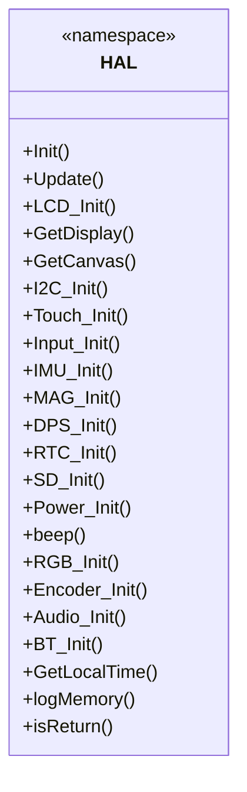

**图示来源** 
- [hal.h:101-212](file://src/hal/hal.h#L101-L212)
- [hal.cpp:4-25](file://src/hal/hal.cpp#L4-L25)

**章节来源**
- [hal.h:101-212](file://src/hal/hal.h#L101-L212)
- [hal.cpp:4-25](file://src/hal/hal.cpp#L4-L25)

### 图形与触控（LGFX/LovyanGFX）
- 职责：配置 SPI 总线、ST7789 面板、背光与 CST816S 触控；定义屏幕分辨率与偏移；绑定触控到面板。
- 关键点：SPI 频率、面板方向、触控坐标映射、I2C 地址与引脚。

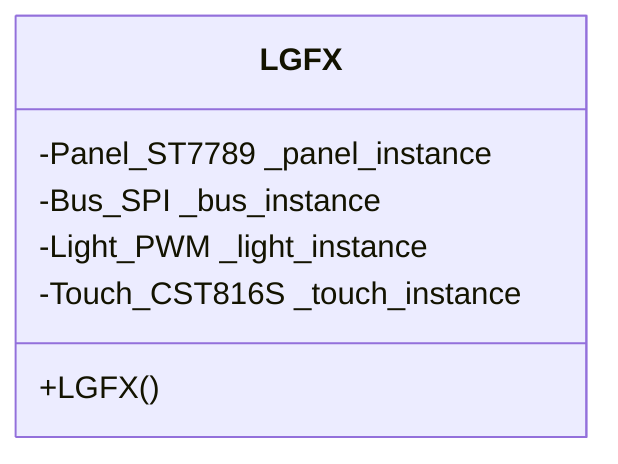

**图示来源** 
- [lgfx.h:34-114](file://include/lgfx.h#L34-L114)

**章节来源**
- [lgfx.h:34-114](file://include/lgfx.h#L34-L114)

### 应用：指南针（Compass）
- 职责：罗盘表盘旋转、方位角显示与环境信息（气压/海拔/气温）、气泡水平仪页面；支持校准与零位复位。
- 数据流：从 HAL::MAG_GetInfo 获取磁力计数据，结合 IMU 姿态计算气泡位置；环境数据通过 DPS 接口获取。

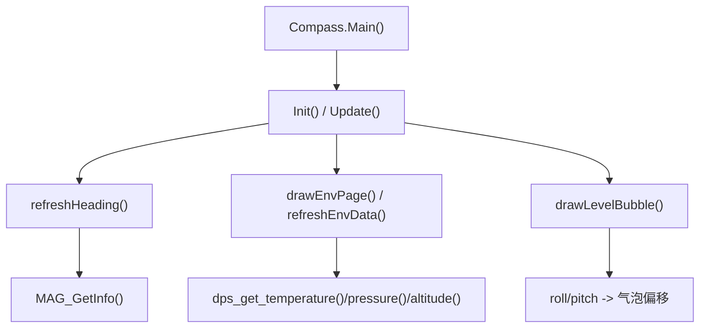

**图示来源** 
- [Compass.h:43-126](file://src/apps/Compass.h#L43-L126)
- [hal_dps.cpp:38-56](file://src/hal/hal_dps.cpp#L38-L56)

**章节来源**
- [Compass.h:43-126](file://src/apps/Compass.h#L43-L126)
- [hal_dps.cpp:38-56](file://src/hal/hal_dps.cpp#L38-L56)

### 应用：空中鼠标（AirMouse）
- 职责：利用 IMU 检测手势与加速度，转换为鼠标移动；提供校准与 UI 指示。
- 交互：通过 HAL::updateImuData 与 HAL::updateMouseDelta 获取位移增量。

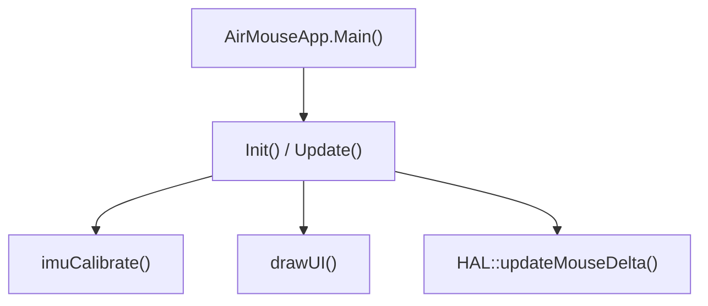

**图示来源** 
- [AirMouse.h:8-42](file://src/apps/AirMouse.h#L8-L42)
- [hal.h:130-140](file://src/hal/hal.h#L130-L140)

**章节来源**
- [AirMouse.h:8-42](file://src/apps/AirMouse.h#L8-L42)
- [hal.h:130-140](file://src/hal/hal.h#L130-L140)

### 应用：流体模拟（FluidApp）
- 职责：流体/水波模拟演示，展示图形渲染与动画能力。
- 生命周期：遵循 Init/Main/Update/Exit 模式。

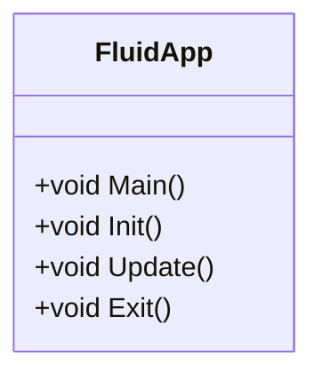

**图示来源** 
- [FluidApp.h:6-18](file://src/apps/FluidApp/FluidApp.h#L6-L18)

**章节来源**
- [FluidApp.h:6-18](file://src/apps/FluidApp/FluidApp.h#L6-L18)

### 应用：俄罗斯方块（Tetris）
- 职责：完整的游戏逻辑，包括棋盘布局、方块生成/旋转/下落、消行计分、等级提升、最高分持久化。
- 布局：左侧游戏区占画布宽度的约 2/3，右侧信息面板显示分数、最高分、消行数与等级。

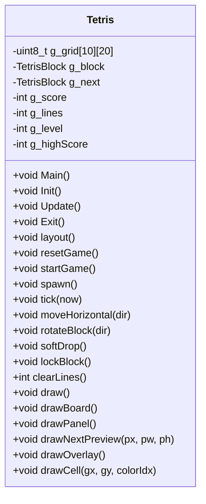

**图示来源** 
- [Tetris.h:66-155](file://src/apps/game/Tetris.h#L66-L155)

**章节来源**
- [Tetris.h:66-155](file://src/apps/game/Tetris.h#L66-L155)

## 依赖关系分析
- 构建与平台：PlatformIO 配置 esp32-s3-devkitc-1 板型，Arduino 框架，启用 PSRAM，使用 LittleFS 文件系统，嵌入 PNG 资源。
- 图形库：LovyanGFX 提供 ST7789 面板与 CST816S 触控驱动。
- 传感器：IMU（陀螺仪/加速度计）、磁力计（QMC5883P 或兼容）、气压计（BMP280）、RTC、SD 卡。
- 通信：蓝牙（NimBLE-Arduino）、Wi-Fi（WiFiManager）。
- 输入：编码器、按键、触控手势。

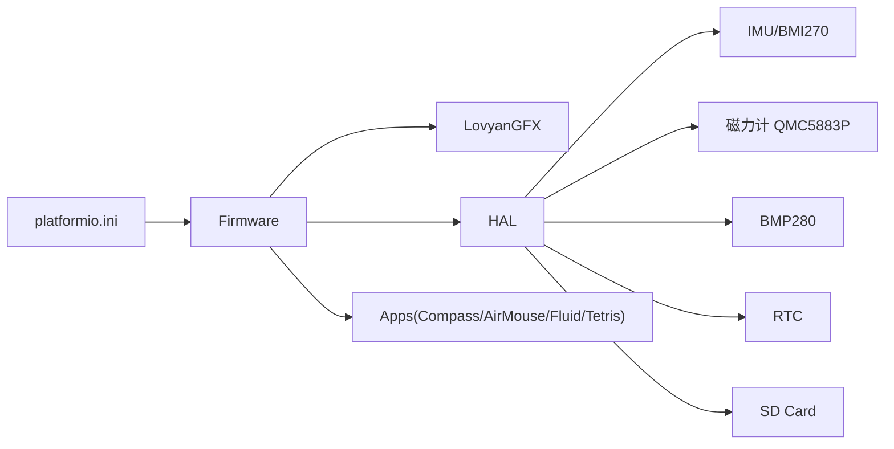

**图示来源** 
- [platformio.ini:11-31](file://platformio.ini#L11-L31)
- [hal.h:130-179](file://src/hal/hal.h#L130-L179)
- [hal_dps.cpp:1-56](file://src/hal/hal_dps.cpp#L1-L56)

**章节来源**
- [platformio.ini:11-31](file://platformio.ini#L11-L31)
- [hal.h:130-179](file://src/hal/hal.h#L130-L179)
- [hal_dps.cpp:1-56](file://src/hal/hal_dps.cpp#L1-L56)

## 性能与资源特性
- PSRAM 启用：通过编译宏启用 PSRAM，有利于大图与复杂 UI 渲染。
- 文件系统：LittleFS 用于存储图片与资源，减少 RAM 占用。
- 图形优化：LovyanGFX 支持 DMA 与批量写入，降低 CPU 负载。
- 传感器采样：BMP280 采样率与滤波系数可调，平衡精度与功耗。

[本节为通用指导，不直接分析具体文件]

## 快速开始
- 开发环境
  - 安装 PlatformIO IDE 或 CLI。
  - 克隆仓库并打开工程根目录。
- 构建与上传
  - 选择目标环境 esp32-s3-devkitc-1。
  - 执行构建与上传命令。
- 运行第一个应用
  - 上电后进入菜单，使用编码器旋转选择“指南针”或“空气鼠标”，短按确认进入。
  - 长按电源键 2 秒可关机，期间有蜂鸣与进度条提示。

**章节来源**
- [platformio.ini:11-31](file://platformio.ini#L11-L31)
- [main.cpp:19-24](file://src/main.cpp#L19-L24)
- [launcher.cpp:109-155](file://src/launcher.cpp#L109-L155)

## 故障排查指南
- 屏幕无显示
  - 检查 SPI 引脚与面板配置是否正确（参考 lgfx.h）。
  - 确认背光与供电正常。
- 触控无效
  - 检查 I2C 地址与引脚（CST816S），确保未与其他设备冲突。
- 传感器无数据
  - 检查 I2C 设备地址与接线；查看串口日志中的初始化信息。
- 无法关机
  - 确认长按 Power 键是否达到阈值；检查蜂鸣与背光关闭逻辑。

**章节来源**
- [lgfx.h:34-114](file://include/lgfx.h#L34-L114)
- [hal.cpp:56-71](file://src/hal/hal.cpp#L56-L71)
- [launcher.cpp:109-155](file://src/launcher.cpp#L109-L155)

## 结论
ESP32 NullPod 固件以清晰的 HAL 抽象与模块化应用架构为基础，结合 LovyanGFX 强大的图形能力，提供了丰富的交互体验与扩展性。开发者可在现有框架上快速添加新应用，复用 HAL 提供的传感器与外设能力，同时享受稳定的 UI 与交互机制。