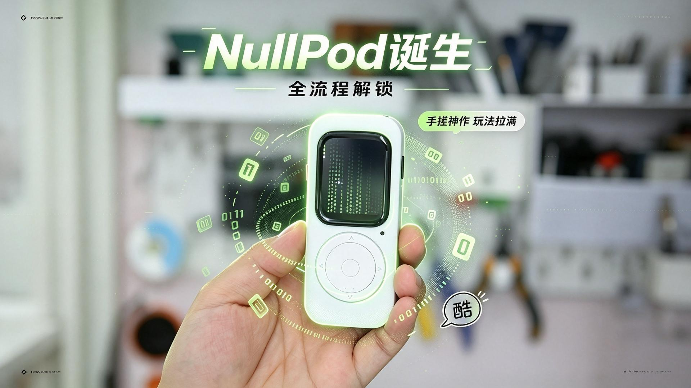

<div align="center">


</div>

<p align="center">
  <strong><a href="README.md">中文</a> | <a href="README.en.md">English</a></strong>
</p>

# NullPod

Firmware for a multi-purpose **ESP32-S3** handheld device. The codebase is organised as a **HAL (hardware abstraction layer) + carousel Launcher + independent Apps** stack, shipping apps such as compass, air mouse, IR remote, Wi-Fi provisioning, web file manager, settings, wooden fish and Tetris.

Video intro：[Bilibili · BV1bdJe6aEVS](https://www.bilibili.com/video/BV1bdJe6aEVS)

Hardware (open source, Chinese site)：[https://oshwhub.com/zupub/project_vnrjysdh](https://oshwhub.com/zupub/project_vnrjysdh)

## Table of Contents

- [Features](#features)
- [Hardware](#hardware)
- [Repository Layout](#repository-layout)
- [Architecture](#architecture)
- [Getting Started](#getting-started)
- [Web File Manager](#web-file-manager)
- [Settings & Wi-Fi](#settings--wi-fi)
- [Adding a New App](#adding-a-new-app)
- [Partition Tables](#partition-tables)
- [Third-Party Libraries](#third-party-libraries)
- [Development Conventions](#development-conventions)
- [Known Limitations](#known-limitations)
- [Credits](#credits)
- [License](#license)

---

## Features

On boot the device shows an icon carousel. Rotate the encoder (or use the D-pad) to move between entries, short-press to launch, long-press the power key to shut down.

| Menu entry | Description | Status |
| --- | --- | --- |
| Matrix | Digital rain screen saver (`DigitalRainAnimation`) | Implemented |
| Dashboard | Circular gauge dial: 1° per encoder click, 1/2/4/8 increment, RGB hue follows the angle (`CircularDial`) | Implemented |
| LED | WS2812 breathing light: adjustable waveform, frequency, saturation, brightness range and hue (`BreathDemo`) | Implemented |
| Remote | IR remote with virtual pad, code list, macros, IR learning and waveform view (`RemoteTV`) | Implemented |
| Music | Electronic wooden fish: tap by key or shake, merit / today counters with daily reset stored in NVS (`WoodFish`) | Implemented |
| Weather | Weather | Placeholder |
| Compass | Compass: dial page / environment page (pressure, altitude, temperature) / spirit level (`Compass`) | Implemented |
| Air Mouse | BLE air mouse — IMU orientation to pointer delta, buttons emulate left/right click (`AirMouse`) | Implemented |
| Barometer | Barometer | Placeholder |
| Game | Tetris with high score persisted to NVS (`Tetris`) | Implemented |
| Files | Wi-Fi AP + web file manager over LittleFS | Implemented |
| SD Card | On-device SD card browser, detects `.nes` files (`FileBrowser`) | Implemented |
| WiFi | Wi-Fi provisioning: AP portal `esp-nullpod-XXXXXX` plus network info page (`WiFiManagerApp`) | Implemented |
| Settings | Settings: Keep WiFi / buzzer / brightness / 12·24-hour clock / network time (`SettingsApp`) | Implemented |
| About | System info: RAM / PSRAM / Flash usage rings and CPU temperature (`AboutApp`) | Implemented |

Other capabilities:

- All rendering goes through a full-screen `LGFX_Sprite` canvas (double buffering): draw into the sprite, then `pushSprite` — no flicker, no tearing.
- Touch gestures: tap, long press, swipe up / down / left / right (`TouchGesture`).
- Rotary encoder counted in hardware via PCNT; keys handled by a shared `Button` class (short/long press, debounce).
- On-screen colour-coded logging (`HAL_LOG_INFO/WARN/ERROR`) for field debugging plus file/line-tagged serial logs (`HAL_LOGI/W/E`).
- Status bar refreshes every second: RTC time (follows the 12/24-hour setting), Wi-Fi icon and battery icon; holding the power key for 2 s powers the device off with a beep and a progress bar.
- Settings (brightness, buzzer, time format, Keep WiFi) and Wi-Fi credentials are persisted in the `config` NVS namespace; network time sync uses the non-blocking `HAL::Ntp_Begin()` / `Ntp_Update()` pair.

## Hardware

ESP32-S3 SoC with 16MB flash and OPI PSRAM (`board_build.arduino.memory_type = qio_opi`), 240×280 display.

| Component | Part | Bus / Address | Pins |
| --- | --- | --- | --- |
| Display | ST7789 240×280 | SPI @ 40MHz | MOSI 7 / SCLK 6 / CS 5 / DC 4 / RST 8 / BL 15 |
| Touch | CST816S | I2C0 @ 0x15 | SDA 11 / SCL 10 / RST 13 / IRQ 14 |
| IMU | BMI270 | I2C | SDA 11 / SCL 10 |
| Magnetometer | QMC5883P | I2C | SDA 11 / SCL 10 |
| Barometer | BMP280 | I2C @ 0x77 | SDA 11 / SCL 10 |
| RTC | PCF8563 | I2C | SDA 11 / SCL 10 |
| SD card | — | SPI (HSPI) | CS 41 / MOSI 38 / MISO 40 / CLK 39 |
| Rotary encoder | — | PCNT + GPIO | CHA 9 / CHB 3 / SEL 0 |
| D-pad | — | GPIO input pull-up | UP 16 / DOWN 12 / LEFT 21 / RIGHT 2 |
| Power key | — | GPIO | KEY 17 / BOOT 0 |
| Power latch | — | GPIO output | HOLD 18 |
| Battery sense | Resistor divider 56k/22k | ADC | ADC 1 |
| Buzzer | — | `tone()` PWM | 46 |
| RGB LED | WS2812 | RMT | 45 |
| IR emitter | — | IRremote | 42 |

All pin definitions live in [`src/hal/hal_config.h`](src/hal/hal_config.h); panel/touch/bus parameters are in [`include/lgfx.h`](include/lgfx.h).

## Repository Layout

```text
NullPod_Master/
├── platformio.ini            # PlatformIO project configuration
├── partitions/               # Custom partition tables (16MB / 8MB)
├── include/lgfx.h            # LovyanGFX panel/touch/bus config
├── data/                     # Front-end assets uploaded to LittleFS
│   ├── index.html
│   ├── app.js
│   └── style.css
├── lib/                      # Vendored third-party libraries (committed)
└── src/
    ├── main.cpp              # setup / loop, app state machine
    ├── launcher.cpp/.h       # Carousel main menu
    ├── app_state.cpp/.h      # App switch request flags
    ├── common.cpp/.h         # Shared helpers (colours, memory usage)
    ├── hal/                  # Hardware abstraction layer
    │   ├── hal.h             # Single public entry point (namespace HAL)
    │   ├── hal_config.h      # Pin macros, NVS keys, logging macros
    │   ├── hal.cpp           # Init sequencing
    │   ├── hal_display.cpp   # LCD, canvas, backlight PWM
    │   ├── hal_i2c.cpp       # I2C bus and register access
    │   ├── hal_input.cpp     # Keys and gestures
    │   ├── hal_encoder.cpp   # PCNT encoder + key events
    │   ├── hal_imu.cpp       # BMI270 attitude and mouse delta
    │   ├── hal_mag.cpp       # QMC5883P with hard-iron calibration
    │   ├── hal_dps.cpp       # BMP280 temperature/pressure/altitude
    │   ├── hal_rtc.cpp       # PCF8563 and network time sync
    │   ├── hal_sdcard.cpp    # SD mount and directory listing
    │   ├── hal_power.cpp     # Power latch, shutdown, battery level, backlight
    │   ├── hal_buzzer.cpp    # Buzzer
    │   ├── hal_rgb.cpp       # Shared WS2812 driver for the whole project
    │   ├── hal_wifi.cpp      # WiFiManager provisioning and network info
    │   └── Button.cpp/.h     # Button state machine
    ├── apps/                 # One class per app, each exposing Main()
    │   ├── DigitalRainAnimation / CircularDial / BreathDemo / RemoteTV
    │   ├── Compass / AirMouse / FileBrowser / FileManager
    │   ├── WiFiManagerApp / SettingsApp / AboutApp
    │   └── game/             # Tetris.cpp, WoodFish.cpp
    └── assets/               # Fonts, icons, images (some embedded into flash)
```

## Architecture

### Boot sequence

```text
setup()
  └─ HAL::Init()        power latch → LCD/I2C/keys/encoder → RTC → IMU → SD → MAG → DPS → startup beep
     └─ g_launcher.Main()   blocking main menu
loop()
  └─ switch (appState)      run the selected app, reset to STATE_MENU when it returns
```

### App scheduling

- [`src/app_state.h`](src/app_state.h) declares a set of `volatile bool g_requestXxx` flags, set by each menu item's `action` callback via `App_RequestXxx()`.
- `Launcher::Main()` is a blocking loop: when any request flag is set it returns; `loop()` then reads and clears the flag and switches `appState`.
- Every app follows the **`Init() → Main()` (internal loop) → `Exit()`** lifecycle. Returning from `Main()` means the app exited; peripherals are acquired/released as needed (e.g. `FileManager` shuts down the AP, stops the web server and unmounts LittleFS on exit).

### HAL layering

Apps only touch hardware through the `HAL::` namespace (`HAL::GetCanvas()`, `HAL::beep()`, `HAL::MAG_GetInfo()`, …) and never include driver headers directly. Driver headers are confined to `hal/*.cpp`, so swapping a part only requires editing the HAL implementation.

### Logging

| Macro | Destination | Purpose |
| --- | --- | --- |
| `HAL_LOGI / HAL_LOGW / HAL_LOGE` | Serial, with `file:line` | HAL-level debugging |
| `HAL_LOG_INFO / WARN / ERROR` | On-screen canvas (colour tags) | Field debugging without a serial console |

### Wi-Fi and network time

- `hal_wifi.cpp` wraps WiFiManager. Every operation is non-blocking and driven by the owning app calling `HAL::Wifi_Update()` in its main loop; the hotspot is always `esp-nullpod-` plus the last 3 MAC bytes.
- Provisioning results (SSID / password) go to NVS; `HAL::Wifi_HasSaved()` reports whether a network is stored and `HAL::Wifi_Forget()` clears it.
- Time sync is started by `HAL::Ntp_Begin()` and polled with `HAL::Ntp_Update()`, returning `NTP_IDLE / NTP_RUNNING / NTP_OK / NTP_FAIL`; a successful sync is written to the PCF8563. `HAL::Ntp_Reset()` abandons the current request.
- The `Keep WiFi` switch decides whether the radio stays up when the WiFi app exits (`HAL::isWifiKeepAlive()`), trading power for connectivity.

## Getting Started

### Requirements

- [PlatformIO](https://platformio.org/) (VS Code extension or CLI)
- An ESP32-S3 board/device with 16MB flash and PSRAM
- The Python environment is managed by PlatformIO — nothing to install manually

### Build and flash

```bash
# Build
pio run

# Build and flash firmware (auto-detected port)
pio run -t upload

# Flash to a specific port
pio run -t upload --upload-port COM5

# Upload data/ to LittleFS (required by the web file manager)
pio run -t uploadfs

# Serial monitor (115200)
pio device monitor
```

> After switching to a new partition table for the first time, run `pio run -t erase` once so stale partition data cannot break the LittleFS mount.
>
> The current firmware already uses about 94% of the 4MB app slot (less than 250KB free), so keep headroom in mind before adding features.

### Key settings

Highlights from [`platformio.ini`](platformio.ini):

| Setting | Value | Note |
| --- | --- | --- |
| `platform` | `espressif32 @ ~6.5.0` | Arduino framework |
| `board` | `esp32-s3-devkitc-1` | ESP32-S3 |
| `board_build.arduino.memory_type` | `qio_opi` | QIO flash + OPI PSRAM |
| `board_build.partitions` | `partitions/custom_16MB_littlefs.csv` | 16MB layout |
| `board_build.filesystem` | `littlefs` | Filesystem type |
| `board_upload.flash_size` | `16MB` | Flash size |
| `build_flags` | `ARDUINO_USB_CDC_ON_BOOT=1`, … | USB CDC serial, PSRAM, debug level |
| `board_build.embed_files` | `compass_dial.png`, `woodfish.png` | Images embedded into firmware |

## Web File Manager

Launch the **Files** app and the device brings up a hotspot:

| Item | Value |
| --- | --- |
| SSID | `ESP32-S3-SD-Manager` |
| Password | `12345678` |
| URL | `http://192.168.4.1` |

Join the hotspot and use a browser to browse, upload, download, delete, create folders and check storage usage. The front-end assets live in LittleFS (the `data/` folder) and are served by the `WebServer` in [`src/apps/FileManager.cpp`](src/apps/FileManager.cpp):

| Route | Method | Purpose |
| --- | --- | --- |
| `/list` | GET | List a directory |
| `/upload` | POST | Upload a file |
| `/download` | GET | Download a file |
| `/delete` | DELETE | Delete a file |
| `/mkdir` | POST | Create a directory |
| `/storage` | GET | Storage information |

If the static files are missing the firmware degrades to API-only mode — check that `pio run -t uploadfs` has been run.

## Settings & Wi-Fi

### Wi-Fi provisioning

Launching the **WiFi** app first shows a prompt page (it enters provisioning when the countdown ends, or immediately on OK):

| Item | Value |
| --- | --- |
| Hotspot | `esp-nullpod-XXXXXX` (last 3 MAC bytes) |
| Portal URL | `http://192.168.4.1` |

Once configured, the page switches to network info and shows SSID / IP / gateway / channel / signal strength / uptime. Credentials are stored in NVS and reconnect automatically next time; long-press OK to forget the network and provision again.

> This hotspot is for internet access (provisioning + time sync) and is independent from the `ESP32-S3-SD-Manager` hotspot opened by the **Files** app, which only serves the file manager.

### Settings

The **Settings** app is a list-style page: rotate the knob or use up/down to move, OK to confirm, power key to go back one level (closes a dialog when one is open).

| Item | Type | Notes |
| --- | --- | --- |
| Keep WiFi | Toggle | Keeps the radio up after the WiFi app exits; off by default |
| Buzzer | Toggle | Global buzzer switch, effective immediately |
| Brightness | Slider | Backlight 10%–100%, live preview, written to NVS on OK |
| Time Format | 12 / 24 hour | Affects the status bar and settings time display |
| Network Time | Action | NTP sync (`pool.ntp.org`), written to the RTC on success |

Keys written to NVS (namespace `config`):

| Key | Meaning |
| --- | --- |
| `lcd_bk` | Backlight brightness |
| `buzzer_en` | Buzzer switch |
| `time_fmt` | 12 / 24-hour clock |
| `wifi_keep` | Keep WiFi |
| `wifi_ssid` / `wifi_password` | Wi-Fi credentials |

> Game apps use their own namespaces: the Tetris high score lives in `tetris` and the wooden fish counters in `woodfish`.

## Adding a New App

Adding `MyApp` takes four steps:

1. **Write the app class on top of HAL.** Create `src/apps/MyApp.h/.cpp` with a blocking `Main()` and expose a global instance:

   ```cpp
   // src/apps/MyApp.h
   class MyApp
   {
   public:
       void Main();
   protected:
       void Init();
       void Update();
       void Draw();
       void Exit();
   };
   extern MyApp g_myApp;
   ```

2. **Add a state and a request flag.** Append `STATE_MYAPP` to `enum AppState` in [`src/launcher.h`](src/launcher.h), declare `extern volatile bool g_requestMyApp;` and `void App_RequestMyApp(void);` in [`src/app_state.h`](src/app_state.h), and implement them in `app_state.cpp`.

3. **Hook into the main loop.** Add `case STATE_MYAPP:` to the `switch` in [`src/main.cpp`](src/main.cpp): call `g_myApp.Main();` then reset `appState = STATE_MENU`, and add the corresponding branch to the request-flag chain at the end of the function.

4. **Register in the menu.** Fill in a `menuItems[]` entry in `Launcher::Init()` of [`src/launcher.cpp`](src/launcher.cpp) (label, accent colour, icon, `action` callback) and update `MENU_COUNT` in `launcher.h` to the real number of entries. Put new icons in `src/assets/icon/` following the existing style and declare them in `icons.h`.

## Partition Tables

Two custom layouts ship with the project; both keep dual OTA slots plus a dedicated LittleFS partition:

| File | Flash | app0/app1 | LittleFS |
| --- | --- | --- | --- |
| `partitions/custom_16MB_littlefs.csv` | 16MB | 4MB each | 7.875MB |
| `partitions/custom_8MB_littlefs.csv` | 8MB | 2.75MB each | 2.375MB |

The LittleFS SubType stays `spiffs` for toolchain compatibility; the filesystem is identified by the `littlefs` name when mounting. Switching to an 8MB board requires updating both `board_build.partitions` and `board_upload.flash_size`.

## Third-Party Libraries

Everything under `lib/` is vendored into the repository so builds are reproducible and offline:

| Library | Version | Purpose |
| --- | --- | --- |
| LovyanGFX | 1.1.12 | Display and touch driver |
| SparkFun BMI270 Arduino Library | 1.0.3 | IMU |
| QMC5883PCompass | 1.0.0 | Magnetometer |
| Adafruit BMP280 Library | 3.0.0 | Barometer |
| Adafruit BusIO | 1.17.4 | I2C dependency |
| Adafruit Unified Sensor | 1.1.15 | Sensor abstraction dependency |
| SensorLib | 0.3.1 | PCF8563 RTC |
| IRremote | 4.7.1 | IR transmit/receive |
| Adafruit NeoPixel | 1.15.2 | WS2812 |
| ESP32 BLE Mouse / NimBLE-Arduino | 0.4.0 / 2.2.3 | BLE air mouse |
| WiFiManager | 2.0.17 | Wi-Fi provisioning |

## Development Conventions

- **Encoding:** sources are UTF-8; keep the surrounding 4-space indentation and naming style.
- **Hardware access:** always go through `HAL::`; apps must not call drivers directly.
- **Rendering:** draw into `HAL::GetCanvas()` and `pushSprite(0, 0)` afterwards to avoid tearing.
- **New pins:** add a macro in `hal_config.h` only — never hard-code pin numbers in feature code.
- **Persistence:** use `Preferences` (namespace `config`); define every key in `hal_config.h`.
- **Error handling:** return `bool` for success/failure and log the reason with `HAL_LOGE`; no exceptions.

## Known Limitations

- **Weather** and **Barometer** are still placeholders that only log; `Audio_*` and `BT_*` are declared in `hal.h` but not yet implemented.
- The **Music** slot now launches the electronic wooden fish (`WoodFish`); its menu label and icon have not been renamed yet.
- Flash usage is close to the 4MB app slot limit (about 3.96MB, 94%); trim fonts / icon assets or adjust the partition table before adding features.
- The `Keep WiFi` switch only affects what happens when the WiFi app exits — an established STA connection is not dropped immediately.
- The periodic update calls in `HAL::Update()` (`hal.cpp`) are commented out, so each app drives its own sensor refresh.
- `RGB_Init()` is commented out in `HAL::Init()`; the WS2812 is initialised on demand by the LED / Dashboard apps (`hal_rgb.cpp` guarantees it only runs once).
- The web file manager runs in AP mode with a hard-coded hotspot password in `FileManager.cpp` — change it before any public release.

## Credits

- Part of the hardware circuit design and the boot screen are adapted from [海底捞【Rachel】迷你游戏机](https://oshwhub.com/eda_rgprdhwej/mason)
- Thanks to the LovyanGFX, IRremote, NimBLE-Arduino, Adafruit, SparkFun and WiFiManager open-source projects.

## License

Released under the [MIT License](LICENSE). Copyright (c) 2026 zupub.

Third-party libraries under `lib/` keep their own licenses; see the license files in each library directory.
