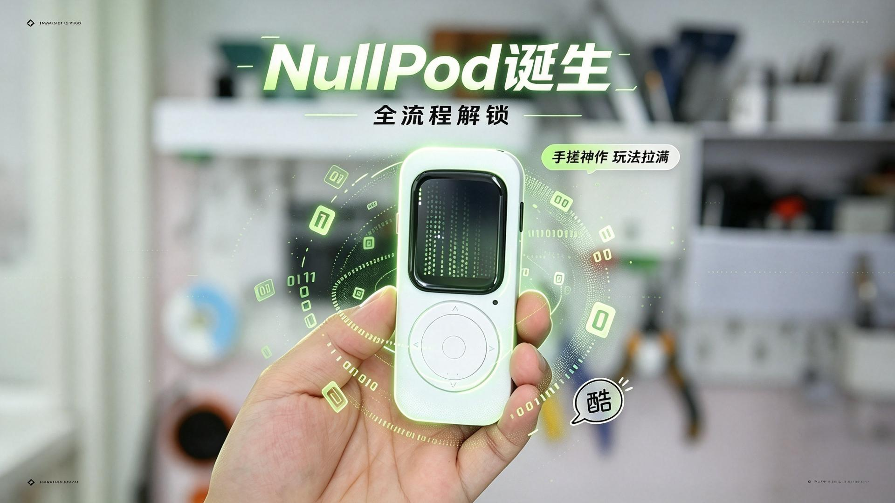

<div align="center">


</div>

<p align="center">
  <strong><a href="README.md">中文</a> | <a href="README_EN.md">English</a></strong>
</p>

# NullPod

基于 **ESP32-S3** 的多功能掌上设备固件。以 HAL（硬件抽象层）+ 轮播式 Launcher + 独立 App 的分层结构组织代码，内置指南针、气压计、空中鼠标、红外遥控、Web 文件管理器、俄罗斯方块等应用。

视频介绍：[Bilibili · BV1bdJe6aEVS](https://www.bilibili.com/video/BV1bdJe6aEVS)

硬件开源：[https://oshwhub.com/zupub/project_vnrjysdh](https://oshwhub.com/zupub/project_vnrjysdh)

## 目录

- [功能特性](#功能特性)
- [硬件配置](#硬件配置)
- [仓库结构](#仓库结构)
- [架构说明](#架构说明)
- [快速开始](#快速开始)
- [Web 文件管理器](#web-文件管理器)
- [新增一个应用](#新增一个应用)
- [分区表](#分区表)
- [第三方库](#第三方库)
- [开发约定](#开发约定)
- [已知限制](#已知限制)
- [致谢](#致谢)
- [许可证](#许可证)

---

## 功能特性

启动后进入图标轮播菜单，通过旋转编码器或方向键切换条目、短按确认进入，长按电源键关机。

| 菜单项 | 说明 | 状态 |
| --- | --- | --- |
| Matrix | 数字雨屏保动画（`DigitalRainAnimation`） | 已实现 |
| Dashboard | 表盘 / 仪表盘 | 占位 |
| LED | WS2812 呼吸灯演示（`BreathDemo`） | 已实现 |
| Remote | 红外遥控器，含虚拟按键、码库、宏、IR 学习与波形显示（`RemoteTV`） | 已实现 |
| Music | 音乐播放（HAL 已预留 `Audio_*` 接口） | 占位 |
| Weather | 天气 | 占位 |
| Compass | 指南针：罗盘页 / 环境页（气压·海拔·温度）/ 水平仪页（`Compass`） | 已实现 |
| Air Mouse | BLE 空中鼠标，IMU 姿态转指针位移，按键模拟左右键（`AirMouse`） | 已实现 |
| Barometer | 气压计 | 占位 |
| Game | 俄罗斯方块，最高分持久化到 NVS（`Tetris`） | 已实现 |
| Files | WiFi 热点 + Web 文件管理器（LittleFS） | 已实现 |
| SD Card | 屏幕端 SD 卡文件浏览，识别 `.nes` 文件（`FileBrowser`） | 已实现 |
| WiFi | WiFi 配置 | 占位 |
| Settings | 设置（当前仅触发网络对时） | 占位 |
| About | 系统信息：RAM / PSRAM / Flash 占用环形图与 CPU 温度（`AboutApp`） | 已实现 |

其他能力：

- 屏幕端统一使用 `LGFX_Sprite` 全屏画布（双缓冲），所有绘制先写 sprite 再 `pushSprite` 上屏，避免闪烁。
- 触摸手势：轻点、长按、上/下/左/右滑动（`TouchGesture`）。
- 旋转编码器走 PCNT 硬件计数，按键走统一 `Button` 类（短按/长按/去抖）。
- 出错时屏幕端有彩色日志（`HAL_LOG_INFO/WARN/ERROR`），串口端有带文件行号的 `HAL_LOGI/E/W`。

## 硬件配置

SoC 为 ESP32-S3，16MB Flash + OPI PSRAM（`board_build.arduino.memory_type = qio_opi`），屏幕 240×280。

| 器件 | 型号 | 总线 / 地址 | 引脚 |
| --- | --- | --- | --- |
| 显示屏 | ST7789 240×280 | SPI，40MHz | MOSI 7 / SCLK 6 / CS 5 / DC 4 / RST 8 / BL 15 |
| 触摸 | CST816S | I2C0 @ 0x15 | SDA 11 / SCL 10 / RST 13 / IRQ 14 |
| IMU | BMI270 | I2C | SDA 11 / SCL 10 |
| 磁力计 | QMC5883P | I2C | SDA 11 / SCL 10 |
| 气压计 | BMP280 | I2C @ 0x77 | SDA 11 / SCL 10 |
| RTC | PCF8563 | I2C | SDA 11 / SCL 10 |
| SD 卡 | — | SPI（HSPI） | CS 41 / MOSI 38 / MISO 40 / CLK 39 |
| 旋转编码器 | — | PCNT + GPIO | CHA 9 / CHB 3 / SEL 0 |
| 方向键 | — | GPIO 上拉输入 | UP 16 / DOWN 12 / LEFT 21 / RIGHT 2 |
| 电源键 | — | GPIO | KEY 17 / BOOT 0 |
| 电源自锁 | — | GPIO 输出 | HOLD 18 |
| 电池检测 | 电阻分压 56k/22k | ADC | ADC 1 |
| 蜂鸣器 | — | `tone()` PWM | 46 |
| RGB 灯 | WS2812 | RMT | 45 |
| 红外发射 | — | IRremote | 42 |

所有引脚定义集中在 [`src/hal/hal_config.h`](src/hal/hal_config.h)，显示屏/触摸总线参数在 [`include/lgfx.h`](include/lgfx.h)。

## 仓库结构

```text
NullPod_Master/
├── platformio.ini            # PlatformIO 工程配置
├── partitions/               # 自定义分区表（16MB / 8MB）
├── include/lgfx.h            # LovyanGFX 面板/触摸/总线配置
├── data/                     # 上传到 LittleFS 的 Web 前端
│   ├── index.html
│   ├── app.js
│   └── style.css
├── lib/                      # vendored 第三方库（随工程提交）
└── src/
    ├── main.cpp              # setup / loop，应用状态机
    ├── launcher.cpp/.h       # 轮播式主菜单
    ├── app_state.cpp/.h      # 应用切换请求标志
    ├── common.cpp/.h         # 通用工具（颜色、内存占用等）
    ├── hal/                  # 硬件抽象层
    │   ├── hal.h             # 对外唯一入口（命名空间 HAL）
    │   ├── hal_config.h      # 引脚宏、NVS key、日志宏
    │   ├── hal.cpp           # 初始化编排
    │   ├── hal_display.cpp   # LCD、画布、背光 PWM
    │   ├── hal_i2c.cpp       # I2C 总线与寄存器读写
    │   ├── hal_input.cpp     # 按键与手势
    │   ├── hal_encoder.cpp   # PCNT 编码器 + 按键事件
    │   ├── hal_imu.cpp       # BMI270 姿态与鼠标增量
    │   ├── hal_mag.cpp       # QMC5883P 与硬铁校准
    │   ├── hal_dps.cpp       # BMP280 温度/气压/海拔
    │   ├── hal_rtc.cpp       # PCF8563 与网络对时
    │   ├── hal_sdcard.cpp    # SD 卡挂载与目录
    │   ├── hal_power.cpp     # 电源自锁、关机、电量
    │   ├── hal_buzzer.cpp    # 蜂鸣器
    │   └── Button.cpp/.h     # 按键状态机
    ├── apps/                 # 每个 App 一个类，暴露 Main()
    └── assets/               # 字体、图标、图片（部分经 embed_files 编入固件）
```

## 架构说明

### 启动流程

```text
setup()
  └─ HAL::Init()        电源自锁 → LCD/I2C/按键/编码器 → RTC → IMU → SD → MAG → DPS → 提示音
     └─ g_launcher.Main()   阻塞式运行主菜单
loop()
  └─ switch (appState)      运行被选中的 App，返回后重置为 STATE_MENU
```

### 应用调度

- `app_state.h` 中声明一组 `volatile bool g_requestXxx` 请求标志，由菜单项的 `action` 回调置位（`App_RequestXxx()`）。
- `Launcher::Main()` 是阻塞循环：检测到任一请求标志被置位就退出，`loop()` 再读取标志、清标志并把 `appState` 切到对应状态。
- 每个 App 遵循 **`Init() → Main()（内部循环）→ Exit()`** 的生命周期，`Main()` 返回即表示退出应用；进入与退出时按需初始化/释放外设（例如 FileManager 退出时会关闭 AP、停止 Web 服务、卸载 LittleFS）。

### HAL 分层

应用层只通过 `HAL::` 命名空间的函数访问硬件（`HAL::GetCanvas()`、`HAL::beep()`、`HAL::MAG_GetInfo()` 等），不直接 include 任何驱动库；`hal.h` 之外的驱动头文件均只在 `hal/*.cpp` 内部引入。这样更换器件只需改 HAL 实现。

### 日志约定

| 宏 | 输出去向 | 用途 |
| --- | --- | --- |
| `HAL_LOGI / HAL_LOGW / HAL_LOGE` | 串口，带 `文件:行号` | HAL 层调试 |
| `HAL_LOG_INFO / WARN / ERROR` | 屏幕画布（彩色标签） | 现场排障，无需串口 |

## 快速开始

### 环境要求

- [PlatformIO](https://platformio.org/)（VS Code 插件或 CLI）
- 一块 ESP32-S3、16MB Flash + PSRAM 的开发板/整机
- Python 环境由 PlatformIO 自动管理，无需手工安装

### 构建与烧录

```bash
# 编译
pio run

# 编译并烧录固件（自动检测串口）
pio run -t upload

# 指定串口
pio run -t upload --upload-port COM5

# 上传 data/ 到 LittleFS（Web 文件管理器必需）
pio run -t uploadfs

# 串口监视（115200）
pio device monitor
```

> 首次烧录新分区表后建议执行一次 `pio run -t erase`，避免旧分区残留数据导致 LittleFS 挂载失败。

### 依赖配置要点

[`platformio.ini`](platformio.ini) 关键项：

| 配置 | 值 | 说明 |
| --- | --- | --- |
| `platform` | `espressif32 @ ~6.5.0` | Arduino 框架 |
| `board` | `esp32-s3-devkitc-1` | ESP32-S3 |
| `board_build.arduino.memory_type` | `qio_opi` | Flash QIO + OPI PSRAM |
| `board_build.partitions` | `partitions/custom_16MB_littlefs.csv` | 16MB 布局 |
| `board_build.filesystem` | `littlefs` | 文件系统类型 |
| `board_upload.flash_size` | `16MB` | Flash 容量 |
| `build_flags` | `ARDUINO_USB_CDC_ON_BOOT=1` 等 | USB CDC 串口、PSRAM、调试等级 |
| `board_build.embed_files` | `compass_dial.png`、`woodfish.png` | 图片直接编入固件 |

## Web 文件管理器

进入 **Files** 应用后设备开启热点：

| 项目 | 值 |
| --- | --- |
| SSID | `ESP32-S3-SD-Manager` |
| 密码 | `12345678` |
| 地址 | `http://192.168.4.1` |

连接热点后即可在浏览器中浏览 / 上传 / 下载 / 删除 / 新建目录 / 查看容量。前端静态资源存放于 LittleFS（`data/` 目录），由 [`src/apps/FileManager.cpp`](src/apps/FileManager.cpp) 中的 `WebServer` 提供：

| 路由 | 方法 | 功能 |
| --- | --- | --- |
| `/list` | GET | 列出目录内容 |
| `/upload` | POST | 上传文件 |
| `/download` | GET | 下载文件 |
| `/delete` | DELETE | 删除文件 |
| `/mkdir` | POST | 新建目录 |
| `/storage` | GET | 容量信息 |

静态文件缺失时固件会回退为纯 API 模式，此时请检查是否已执行 `pio run -t uploadfs`。

## 新增一个应用

以新增 `MyApp` 为例，共四步：

1. **继承 HAL 编写应用类**：在 `src/apps/` 新建 `MyApp.h/.cpp`，实现阻塞式 `Main()`，并通过全局实例暴露：

   ```cpp
   // src/apps/MyApp.h
   class MyApp
   {
   public:
       void Main();
   protected:
       void Init();
       void Update();
       void Draw();
       void Exit();
   };
   extern MyApp g_myApp;
   ```

2. **新增状态与请求标志**：在 [`src/launcher.h`](src/launcher.h) 的 `enum AppState` 中追加 `STATE_MYAPP`，在 [`src/app_state.h`](src/app_state.h) 中声明 `extern volatile bool g_requestMyApp;` 与 `void App_RequestMyApp(void);`，并在 `app_state.cpp` 中实现。

3. **挂到主循环**：在 [`src/main.cpp`](src/main.cpp) 的 `switch` 中新增 `case STATE_MYAPP:`，调用 `g_myApp.Main();` 后把 `appState` 重置为 `STATE_MENU`，同时在该函数末尾的标志检查链中追加对应分支。

4. **加入菜单**：在 [`src/launcher.cpp`](src/launcher.cpp) 的 `Init()` 里填写 `menuItems[]` 条目（名称、主题色、图标、`action` 回调），并把 `launcher.h` 中的 `MENU_COUNT` 改为实际条目数；图标按现有风格放在 `src/assets/icon/`，并在 `icons.h` 中声明。

## 分区表

工程提供两套自定义布局，均保留双 OTA 槽位与独立 LittleFS 分区：

| 文件 | Flash | app0/app1 | LittleFS |
| --- | --- | --- | --- |
| `partitions/custom_16MB_littlefs.csv` | 16MB | 各 4MB | 7.875MB |
| `partitions/custom_8MB_littlefs.csv` | 8MB | 各 2.75MB | 2.375MB |

LittleFS 的 SubType 沿用 `spiffs` 以兼容工具链，挂载时按名称 `littlefs` 识别。切换到 8MB 板时需要同时修改 `board_build.partitions` 与 `board_upload.flash_size`。

## 第三方库

`lib/` 目录下的库以 vendored 方式随工程提交（离线可构建，版本可控）：

| 库 | 版本 | 用途 |
| --- | --- | --- |
| LovyanGFX | 1.1.12 | 显示屏与触摸驱动 |
| SparkFun BMI270 Arduino Library | 1.0.3 | IMU |
| QMC5883PCompass | 1.0.0 | 磁力计 |
| Adafruit BMP280 Library | 3.0.0 | 气压计 |
| Adafruit BusIO | 1.17.4 | I2C 依赖 |
| Adafruit Unified Sensor | 1.1.15 | 传感器抽象依赖 |
| SensorLib | 0.3.1 | PCF8563 RTC |
| IRremote | 4.7.1 | 红外收发 |
| Adafruit NeoPixel | 1.15.2 | WS2812 |
| ESP32 BLE Mouse / NimBLE-Arduino | 0.4.0 / 2.2.3 | BLE 空中鼠标 |
| WiFiManager | 2.0.17 | WiFi 配网（预留） |

## 开发约定

- **编码**：源文件为 UTF-8；新增代码请保持与周边一致的缩进（4 空格）与命名风格。
- **硬件访问**：一律通过 `HAL::`，不要在 App 中直接调用驱动库。
- **绘制**：使用 `HAL::GetCanvas()` 绘制后 `pushSprite(0, 0)`，避免直接写屏产生撕裂。
- **新增引脚**：只在 `hal_config.h` 中增加宏，不要在业务代码里硬编码引脚号。
- **持久化**：使用 `Preferences`（命名空间 `config`），key 统一在 `hal_config.h` 中定义。
- **错误处理**：函数返回 `bool` 表示成败，配合 `HAL_LOGE` 记录原因，不使用异常。

## 已知限制

- 部分菜单项（Dashboard / Music / Weather / Barometer / WiFi / Settings）目前只是占位，进入后仅打印日志或执行极简逻辑；`hal.h` 中的 `Audio_*`、`BT_*` 接口已声明但尚未实现。
- `hal.cpp` 中 `HAL::Update()` 的周期更新调用目前被注释，各 App 需自行驱动传感器刷新。
- `HAL::Init()` 中 `RGB_Init()` 被注释，WS2812 由 LED 应用自行初始化。
- Web 文件管理器工作于 AP 模式，热点密码硬编码在 `FileManager.cpp` 中，正式发布前请自行修改。

## 致谢

- 部分硬件电路及启动画面参考 [海底捞【Rachel】迷你游戏机](https://oshwhub.com/eda_rgprdhwej/mason)
- 感谢 LovyanGFX、IRremote、NimBLE-Arduino、Adafruit、SparkFun、WiFiManager 等开源项目。

## 许可证

本项目以 [MIT License](LICENSE) 发布，Copyright (c) 2026 zupub。

`lib/` 下的第三方库遵循各自原有许可证，详情见各库目录中的许可文件。
